# Detecting the Alpha Rhythm on Two Low-Cost EEG Headsets

A method review for EEG practitioners and neuroscience students. We describe how an interactive art installation detects the posterior alpha rhythm in real time on two consumer headsets at once, show why our first two detectors mostly reported noise, and present a replacement tested on 20 people's real EEG. We ask you to check whether the method is physiologically sound for the hardware we use, and where it will fail.

---

## 1. At a glance

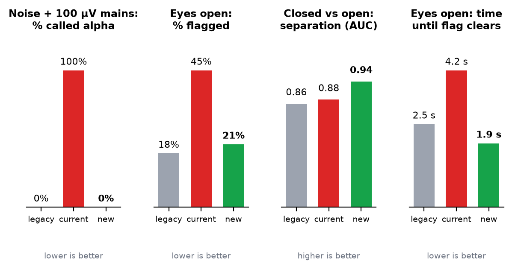

> *Source: simulation of the NPG Lite signal path on an open eyes-open/eyes-closed dataset (20 adults); measured 2026-10-24. Method in [§6.1](#61-how-we-tested).*

**The problem.** Our detector's job is a single yes/no flag, `is_alpha`, per electrode, per person, about eight times a second. The detector in use today said "alpha" **100% of the time on pure noise** once a little mains hum was present, and **45% of the time with the eyes open**.

**The fix in one sentence.** Instead of asking "is the signal rhythmic near 10 Hz?", we ask **"does the 8–13 Hz part of the spectrum stand clearly above the 1/f background estimated from its neighbouring frequencies?"** The answer is expressed in decibels (dB), so it needs no calibration to microvolts.

**What it achieves on real EEG** (occipital electrodes, people the method was not tuned on):

| | Legacy rule | Current detector | **Proposed** |
|---|---|---|---|
| Eyes closed: % of time flagged as alpha | 61% | 88% | **75%** |
| Eyes open: % of time flagged as alpha | 18% | 45% ⚠️ | **21%** |
| Pure noise with 100 µV mains: % flagged | 0% | 100% 🔴 | **0%** ✅ |
| Separation of eyes closed vs open (AUC) | 0.86 | 0.88 | **0.94** ✅ |
| Seconds for the flag to clear after eyes open | 2.5 s | 4.2 s | **1.9 s** ✅ |

The AUC (area under the receiver-operating curve) is the probability that a random eyes-closed moment scores higher than a random eyes-open moment. 0.5 is chance and 1.0 is perfect.

**What we ask of you** is listed in [§8](#8-questions-for-the-reviewer). In short: whether this definition of "alpha present" is sound, whether the parameters are physiologically sensible, and what we have missed.

---

## 2. The setup

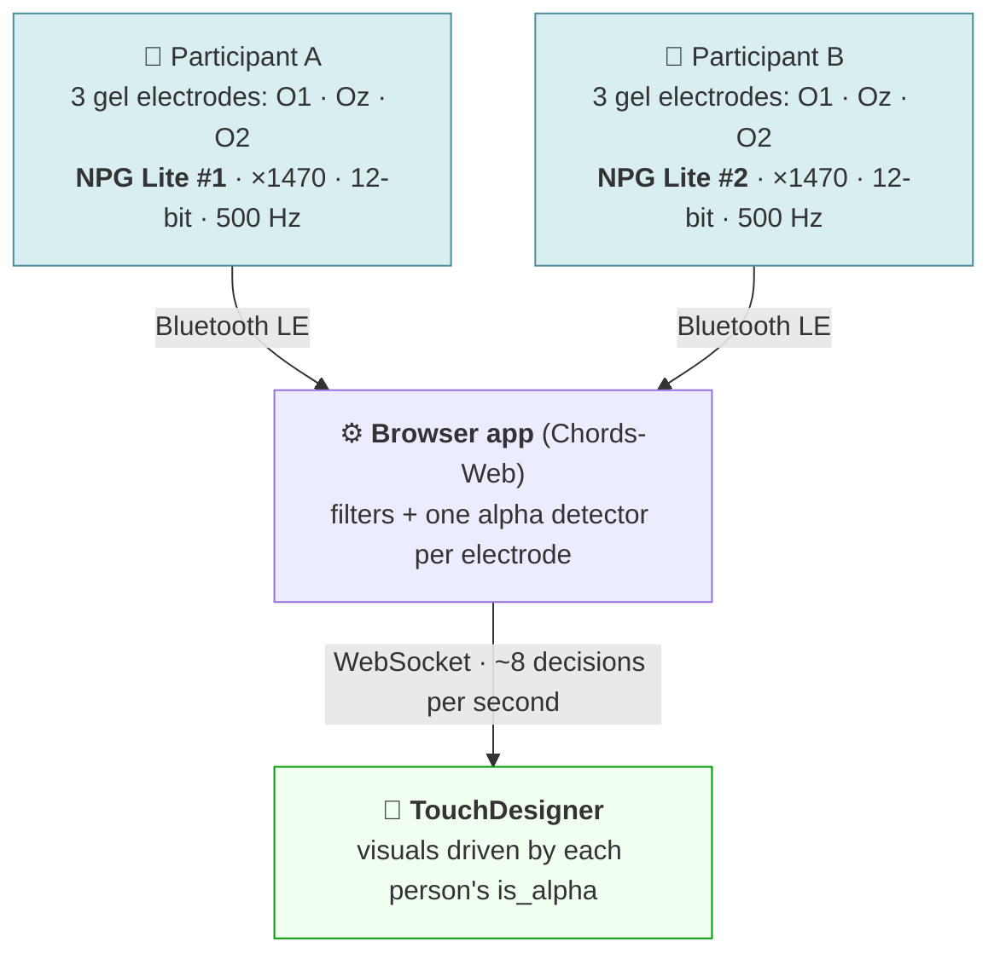

Two people wear one headset each during guided activities. The browser app turns each electrode's signal into an `is_alpha` flag. TouchDesigner, a visual programming tool for live media, then uses the flags to drive the artwork. For example, it can show when one person, the other, or both are in an alpha state.

### 2.1 The hardware

The **NPG Lite** (Neuro PlayGround Lite, Upside Down Labs) is a three-channel bio-amplifier board built around an ESP32-C6 microcontroller.

| Property | Value | Source |
|---|---|---|
| Channels | 3 per device (6 with an add-on board) | manufacturer docs |
| Sampling rate | 500 Hz per channel | firmware `SAMP_RATE 500.0` |
| Resolution | 12-bit (0–4095 counts), ADC range ~3.3 V | firmware, ESP32-C6 |
| Amplifier gain | ×1470 by default (×882 selectable) | manufacturer, by email 2026-04-11 |
| One count equals | 3.3 V / 4095 / 1470 ≈ **0.55 µV** | derived |
| Electrodes | wet (gel) snap electrodes supplied | manufacturer docs |
| Calibration | none built in; the manufacturer warns early (v0.1) chips have ADC non-linearity and offset | manufacturer, by email |

**What this means for detection.** Alpha of 10–50 µV is roughly 18–90 counts, far above the ADC step size. But absolute microvolt values are only approximate. The method must therefore be **scale-free**, meaning it uses ratios of the signal to itself rather than fixed microvolt thresholds.

---

## 3. What we are trying to detect

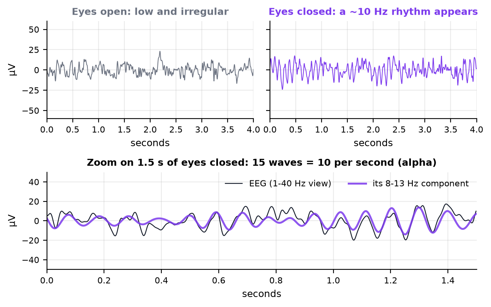

> *Source: Oz electrode, subject 3 of the open dataset, passed through our model of the NPG Lite ([§6.1](#61-how-we-tested)); displayed 1–40 Hz.*

**The target is the posterior alpha rhythm.** The IFCN (International Federation of Clinical Neurophysiology) glossary defines the alpha band as 8–13 Hz. The posterior dominant rhythm is largest over the occipital and parietal scalp, appears when the eyes close, and **attenuates when the eyes open**. The top row shows that contrast. The bottom row counts 15 waves in 1.5 s, which is 10 Hz.

**Properties the detector can rely on:**

- **Frequency.** The peak lies in 8–13 Hz. Across our 20 test subjects it sat at 9–12 Hz.
- **Time course.** It waxes and wanes in "spindles" lasting from under a second to several seconds.
- **Reactivity.** Eye opening suppresses it. This is how we check that we are seeing alpha and not something else.

**What it is not:**

- **Mu rhythm.** This is a similar-frequency rhythm over the sensorimotor strip (central electrodes). It reacts to movement, not to eye opening.
- **Slow eye-blink deflections**, which sit below about 4 Hz and are largest frontally.
- **Muscle (EMG) activity**, which is broadband and mostly above 20 Hz.

---

## 4. Why the first two detectors failed

The app has had two detectors. The **legacy rule** (Feb–May 2026) compared alpha power with theta and delta power. The **current detector** (since 2026-05-25) tests the alpha-filtered signal for regular ~10 Hz repetition. Each fails for a different, measurable reason.

### 4.1 The legacy rule fights the 1/f slope

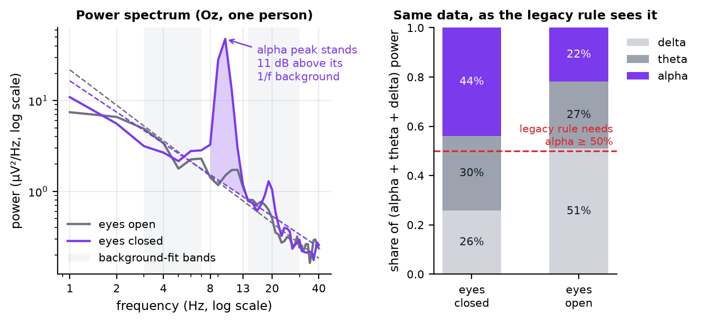

**Background.** EEG power falls steadily with frequency: the "1/f" or **aperiodic** background. A real alpha rhythm is a **bump** sitting on top of that slope (left panel, shaded).

**What went wrong.** The legacy rule asked whether alpha held **at least 50%** of the combined alpha + theta + delta power. Delta and theta sit higher on the slope, so even this person's strong eyes-closed alpha, 11 dB above the background, reaches only **44%** (right panel). The rule caught strong alpha in most people. It missed weaker but real alpha, and it was the easiest detector to blind with blinks ([§6.6](#66-artifacts)).

### 4.2 The app's "8–12 Hz" filter passes 6–16 Hz

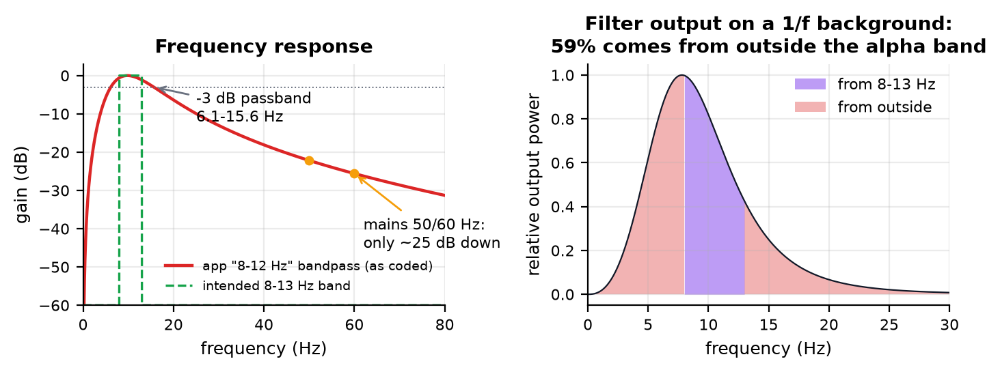

**What went wrong.** The alpha filter is a pair of gentle (second-order) filters. Its passband at half-power is **6.1–15.6 Hz** (left). On a typical 1/f background, **59% of its output comes from outside 8–13 Hz** (right). Mains interference at 50/60 Hz is only about 22–26 dB down, which is a reduction to roughly 1/15 in amplitude.

### 4.3 The current detector reports mains hum as alpha

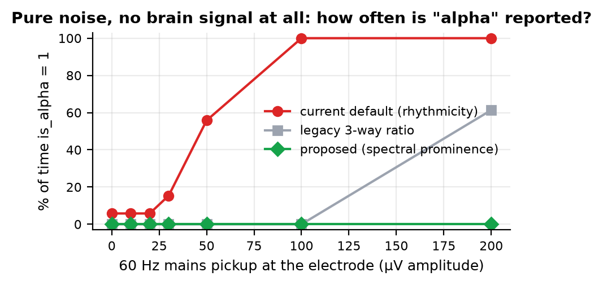

**What went wrong.** The current detector asks whether the alpha-filtered signal repeats itself after about 77–125 ms, one alpha cycle. Mains hum repeats every 16.7 ms (60 Hz) or 20 ms (50 Hz), so it also repeats after exactly **83, 100 and 117 ms**. The failure starts at about 30 µV of mains pickup, which is common with imperfect electrode contact. At 50 µV the detector reported alpha 56–100% of the time across our noise runs, and from 100 µV it **reports alpha 100% of the time on a signal containing no brain activity at all**.

A filter makes any broadband noise look rhythmic at the filter's own centre frequency. The research literature warns about exactly this: a rhythmicity test applied after a narrow filter partly measures the filter rather than the brain.

### 4.4 The flag lingers

**What went wrong.** Both old detectors turned a moment-to-moment verdict into `is_alpha` with one rule: "is there a 0.48 s run of alpha anywhere in the last 4 seconds on screen?" After alpha stops, the flag therefore stays on for up to about 3.5 s. That is the 4.2 s median clearing time in [§1](#1-at-a-glance).

---

## 5. The proposed method

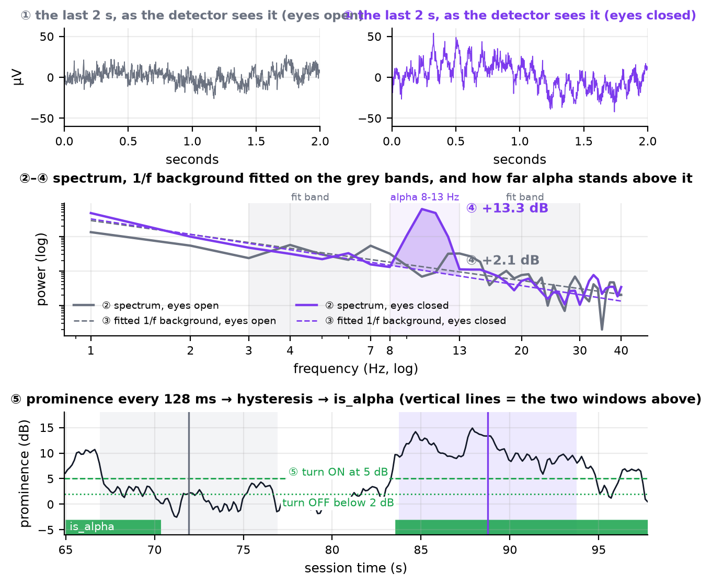

> *Source: Oz, subject 3, one eyes-open and one eyes-closed window (vertical lines in the bottom panel).*

In plain terms, about eight times a second, for each electrode (the circled numbers match the figure):

1. **① Look at the last 2 seconds.** That is long enough to resolve 1 Hz steps and short enough to follow eye closure within a second or two.
2. **② Estimate the power spectrum** with Welch's method: averaging three overlapping 1 s windows, which steadies the estimate.
3. **③ Estimate the 1/f background** by fitting a straight line to log-power against log-frequency, using only frequencies just below alpha (3–7 Hz) and just above it (14–30 Hz). Delta (below 3 Hz) is excluded because blinks and movement live there.
4. **④ Measure prominence:** how many dB the 8–13 Hz power stands above that fitted line. About 0 dB means no bump. Eyes-closed alpha in our data typically reached 5–15 dB.
5. **⑤ Decide with hysteresis.** A Schmitt trigger uses separate on and off levels so the flag does not flicker. It turns on when prominence reaches 5 dB on two consecutive updates and off when it stays below 2 dB for three.
6. **Gate artifacts** (not shown). If the window contains a jump much larger than this electrode's own recent amplitude (more than 6 robust standard deviations), or the amplifier saturates, the previous decision is held. If the artifact lasts more than 3 s (for example, a detached electrode), the flag is forced off.

### 5.1 Why this is a recognised approach

| Idea in our method | Established method it follows |
|---|---|
| Judge a rhythm by its power **relative to a fitted 1/f background** | BOSC (Better OSCillation detection; Whitten et al. 2011, Hughes et al. 2012) and its successors eBOSC and fBOSC: a power threshold above the modelled background spectrum |
| Separate the **aperiodic slope from periodic peaks** | spectral parameterisation, "FOOOF" / specparam (Donoghue et al., *Nat Neurosci* 2020) |
| Require the rhythm to **last**, not just spike | BOSC's duration threshold (a few cycles) → our 2-update confirmation plus a 2 s window |
| Use **reactivity** to verify it is alpha | the clinical definition of the posterior dominant rhythm |

Ours is a simplified, real-time version. It uses a straight-line background fit rather than a full model with a "knee", and a fixed 8–13 Hz band rather than each person's own peak.

### 5.2 Parameters in physiological terms

| Parameter | Value | Meaning |
|---|---|---|
| Alpha band | 8–13 Hz | IFCN alpha band; observed peaks 9–12 Hz |
| Background bands | 3–7 Hz and 14–30 Hz | the slope either side of alpha; delta and most EMG excluded |
| Window / update | 2.0 s every 128 ms | 1 Hz frequency resolution; ~8 decisions per second |
| Enter / exit level | 5 dB / 2 dB | ≈ 3.2× / 1.6× the background power in the band |
| Confirmation | 2 updates on, 3 updates off | ≈ 0.26 s / 0.38 s, on top of the 2 s window |
| Artifact gate | > 6 robust SD, or saturation | relative to the electrode's own last ~30 s |
| Maximum hold | 3 s | longer artifacts force the flag off |

---

## 6. Evidence on real EEG

### 6.1 How we tested

We had no clinician-labelled recordings from our own headsets, so we used open data and modelled our hardware on top of it:

- **Data:** the GIPSA-lab "EEG Alpha Waves" dataset (Cattan, Rodrigues & Congedo, 2017; Zenodo, CC-BY 4.0). It has **20 adults** recorded with 16 wet electrodes on a research amplifier at 512 Hz, in ten 10 s blocks alternating eyes closed and eyes open.
- **Device model:** we resampled the data to 500 Hz, converted it to NPG Lite counts (×1470 gain, 12-bit, plus 3 counts rms of ADC noise), and ran it through **the app's own filter coefficients**, ported exactly from the source code.
- **Honest split:** we tuned the parameters on 11 subjects (even IDs) and report results on the other 9, unseen during tuning. We also measured on pure synthetic 1/f noise, which is the only true "no alpha" condition.
- **Caveat on the markers:** each block's marker was placed after the participant had already been told to open or close their eyes. Block boundaries therefore lag the true change slightly. We measured response time separately, on recordings cut and joined at known times ([§6.5](#65-response-time)).

### 6.2 Two people, two devices, side by side

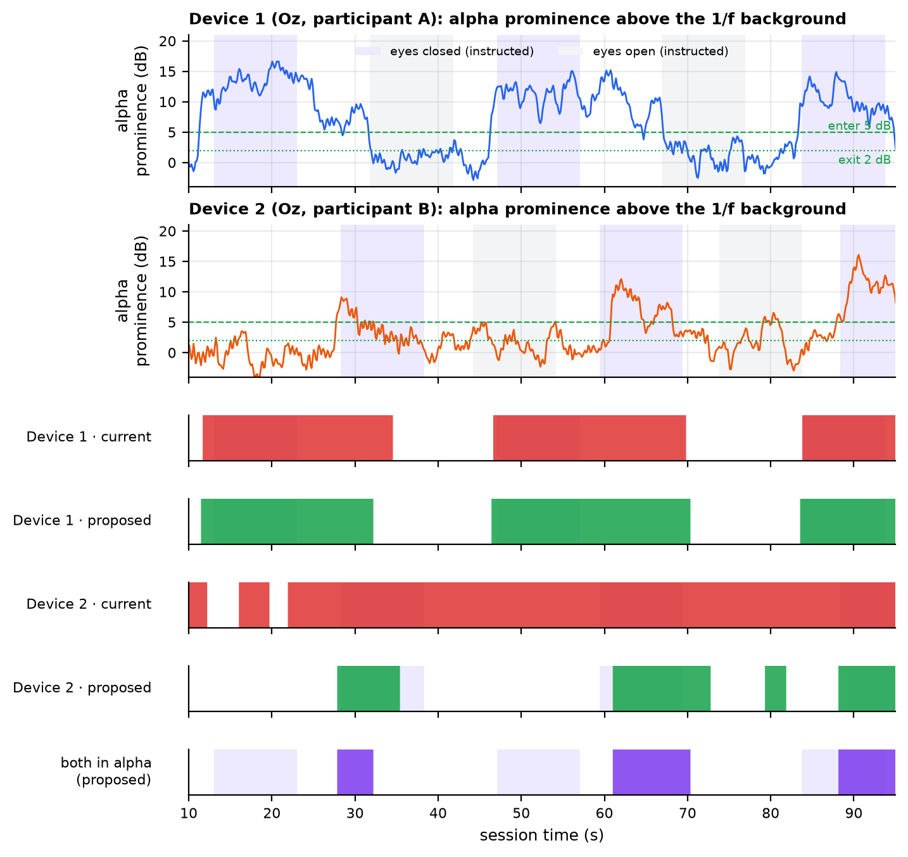

> *Source: Oz electrodes of subjects 3 (Device 1) and 19 (Device 2), both held-out subjects; purple shading = instructed eyes closed, grey = instructed eyes open, white = gaps between blocks.*

**How to read it.** The top two panels show each person's alpha prominence. Person A has strong alpha (10–15 dB); person B is modest (5–10 dB). The bars below show `is_alpha` over time: red for the current detector, green for the proposed one. The bottom bar is the moments both people were flagged as being in alpha.

**What it shows.** For person B, the **current detector is on almost the whole session**, eyes open or closed. That is the "lots of noise" we saw in the installation. The proposed detector turns on with eye closure and off with eye opening for both people. Person A stays in alpha through the white gaps after each eyes-closed block, until told to open their eyes. The detector follows the brain, not the block markers.

### 6.3 Across twenty people

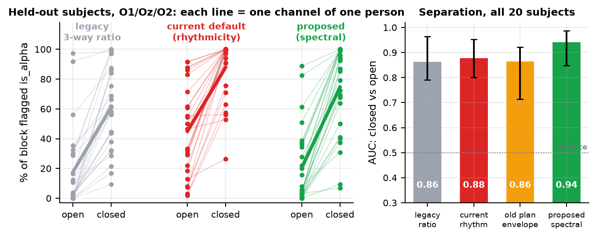

**How to read the left panel.** Each faint line is one occipital electrode of one held-out person, joining its eyes-open flag rate to its eyes-closed flag rate. The thick line is the average. A good detector has low left ends and high right ends.

| Held-out subjects, O1/Oz/O2 | Eyes closed flagged | Eyes open flagged | Worst channel, eyes closed |
|---|---|---|---|
| Legacy rule | 61% | 18% | 9% |
| Current detector | 88% | 45% ⚠️ | 26% |
| **Proposed** | **75%** | **21%** | 7% |
| Current, with 50 µV mains added | 89% | 53% 🔴 | 35% |
| **Proposed, with 50 µV mains added** | **74%** | **21%** | 7% |

**Eyes open is not "no alpha".** Some people keep visible alpha with their eyes open, especially when relaxed in a quiet room. One subject's median eyes-open prominence at Oz was 6.5 dB, above the enter level. The eyes-open flag rate is therefore an upper bound on false alarms. The true false-alarm rate, on pure noise, is **0.4%** for the proposed method.

**Weak-alpha people remain the hard case.** Taking each person's best occipital electrode, the proposed method flags more than half of eyes-closed time in **17 of 20 people**. Three people (subjects 4, 9 and 13) have eyes-closed alpha only 2–3 dB above background, and a fixed threshold misses most of it ([§6.4](#64-choosing-the-threshold)).

### 6.4 Choosing the threshold

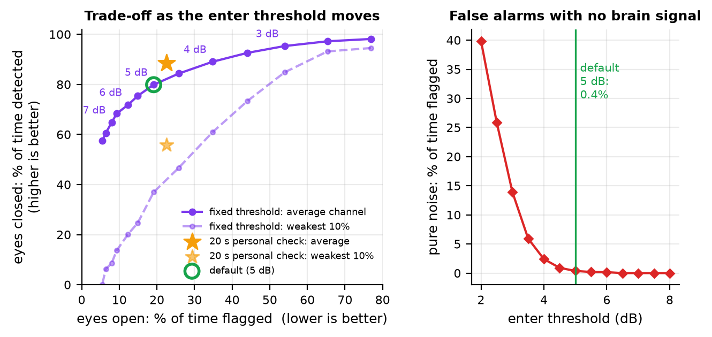

**How to read it.** Each dot on the left is one threshold setting. Moving the threshold down catches more eyes-closed alpha, but also flags more eyes-open time and, below about 4 dB, starts reporting alpha in pure noise (right).

| Enter threshold | Eyes closed flagged | Eyes open flagged | Pure noise flagged |
|---|---|---|---|
| 4 dB | 89% | 35% | 2.4% |
| **5 dB (default)** | **80%** | **19%** | **0.4%** |
| 6 dB | 72% | 12% | 0.2% |

*All 20 subjects, O1/Oz/O2.*

**An optional 20-second personal check (stars).** Each participant does one eyes-closed and one eyes-open block before the session. Their threshold is set halfway between the two, but never below 4 dB. At the same eyes-open flag rate (about 22%), this raises eyes-closed detection from about 82% to 89% on average, and from about 42% to 56% for the weakest 10% of electrodes. It is off by default because it adds a step for participants.

### 6.5 Response time

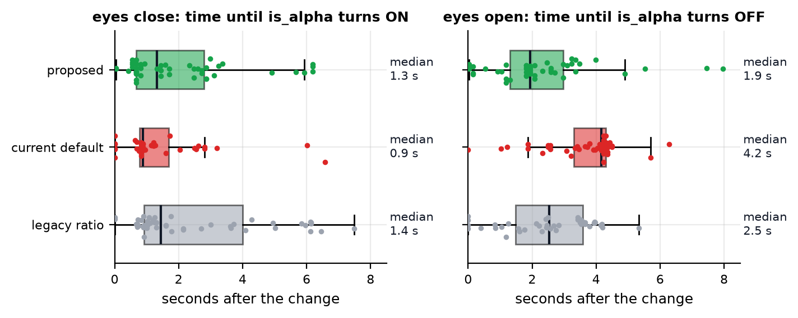

> *Source: for each of the 20 people, 8 s eyes open + 8 s eyes closed + 8 s eyes open, cut from their own recording and joined at known times.*

**What it shows.** The proposed detector switches **on** a median **1.3 s** after eye closure and **off** a median **1.9 s** after eye opening. The current detector switches on faster (0.9 s) but takes **4.2 s** to clear. The 2 s analysis window sets a floor of about 1 s on both. Faster response would need a shorter window and would cost reliability.

### 6.6 Artifacts

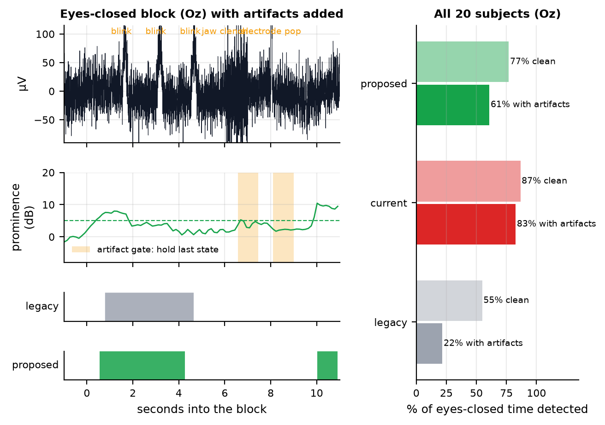

> *Stress test: a 90 µV blink every 2.5 s, a 1 s jaw clench and an electrode pop added to every block, for all 20 subjects at Oz. These amplitudes are deliberately larger than blinks normally reach at the back of the head.*

| Oz, all 20 subjects | Eyes closed, clean | Eyes closed, with artifacts | Eyes open, with artifacts |
|---|---|---|---|
| Legacy rule | 55% | **22%** 🔴 blinks bury the alpha | 3% |
| Current detector | 87% | 83% | **31%** ⚠️ |
| **Proposed** | 77% | **61%** | 9% |

**What it shows.** Artifacts never create false alpha with the proposed method; eyes-open flagging fell rather than rose. They do cost some detection: a blink's slow energy lifts the 3–7 Hz part of the background fit and lowers prominence. With blinks every 2.5 s, about half the windows were held by the gate. This is the main reason electrode placement matters ([§6.7](#67-electrode-placement)).

### 6.7 Electrode placement

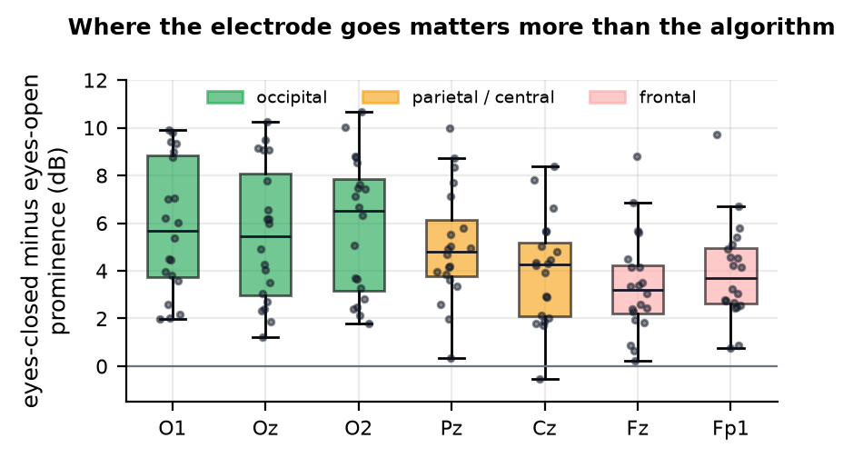

**What it shows.** The rise in prominence on eye closure is largest at **O2, O1 and Oz** (median 5.5–6.5 dB) and smallest frontally (Fz 3.2 dB). Placement over the occiput is the single biggest factor in detection quality. Central placement also risks picking up mu rhythm, which reacts to movement rather than eye opening.

### 6.8 Robustness to the device model

| Device-model change (held-out subjects, occipital) | Eyes closed | Eyes open |
|---|---|---|
| Baseline: ×1470, 3 counts ADC noise, no mains | 75% | 21% |
| 4× more ADC noise (12 counts ≈ 6.6 µV rms) | 73% | 17% |
| 200 µV mains hum | 74% | 20% |
| ×882 gain setting | 74% | 20% |
| ×882 + 12 counts noise + 200 µV mains | 70% | 14% |

The method is insensitive to gain and mains, as intended: it only uses ratios below 30 Hz.

---

## 7. Limits: what this does not show

- **Different amplifier.** The test data come from a research amplifier with wet electrodes. We modelled the NPG Lite's gain, resolution, noise and mains pickup, but not its ADC non-linearity, its electrode-contact quality or its reference/bias circuit. Validation on our own headsets is planned ([§9](#9-validation-on-our-own-hardware)).
- **Adults aged 19–44 only.** Alpha peak frequency is lower in children (around 6–8 Hz in early childhood) and often slows with age. A fixed 8–13 Hz band will under-detect in those groups.
- **Drowsiness.** As people become drowsy, posterior alpha fades and slower activity grows. The method will correctly drop the flag, but it cannot tell "alert, eyes open" from "drowsy".
- **Low-voltage alpha.** A minority of healthy adults have little visible posterior alpha. In 3 of our 20 subjects, eyes-closed alpha was only 2–3 dB above background.
- **Not diagnostic.** This is a feedback signal for an artwork. It is not a clinical measurement, and the microvolt scale is approximate.
- **Two flags on at once is not synchrony.** If both people are told to close their eyes together, both flags will rise together. That co-occurrence comes from the shared instruction, not from any interaction between the two brains. The hyperscanning literature (Burgess 2013; Zimmermann et al. 2024) shows that inter-brain "synchrony" measures readily report such shared-task effects. We describe the artwork's "both in alpha" moments as co-occurrence, not as brain-to-brain coupling.

---

## 8. Questions for the reviewer

1. **Definition.** Is "8–13 Hz power at least 5 dB above a log-log line fitted to 3–7 Hz and 14–30 Hz" a reasonable working definition of posterior alpha being present? Would you define the band or the background differently?
2. **Band.** Should we centre the band on each person's own alpha peak, which we already measure, instead of a fixed 8–13 Hz?
3. **Threshold.** Is 5 dB a sensible default, and is the optional 20-second eyes-closed / eyes-open check worth the extra step for participants?
4. **Placement.** With 3 electrodes per person, is O1 / Oz / O2 the right choice? Where should reference and ground go on this hardware: earlobe, mastoid, or elsewhere?
5. **Artifacts.** Are blinks, jaw clenching and electrode pops the right artifacts to test? Which others matter in a seated, interactive setting (talking, head turns, sweat)?
6. **Eyes-open alpha.** Should alpha present with the eyes open count as a correct detection or a false alarm, for the purposes of an artwork about relaxation?
7. **Language.** Is "alpha state" an acceptable public description, and what should we avoid claiming?
8. **Other signals.** Besides alpha, we plan to send the artwork two slower values from the same spectrum: power at 32–45 Hz above the 1/f line, which we treat as **muscle tension** rather than brain activity, and the **1/f exponent** smoothed over about 10 s, used as background texture rather than as a state. Are these fair readings at O1/Oz/O2 with 2 s windows? Is there anything else this hardware can report honestly that we should add?

---

## 9. Validation on our own hardware

Before the method goes live, we will record each team member and a few volunteers on the NPG Lite itself:

| Step | What | Why |
|---|---|---|
| 1 | Gel electrodes at O1, Oz, O2; reference and ground as you advise | best placement ([§6.7](#67-electrode-placement)) |
| 2 | 5 × (30 s eyes open, 30 s eyes closed), seated, quiet room | known ground truth with reactivity |
| 3 | 1 min of each activity used in the artwork | the real use case |
| 4 | Record raw counts with the app's recorder; replay offline through the same analysis | identical code path, repeatable tuning |
| 5 | A clinician marks alpha on the recordings (a 1–40 Hz display is provided) | labels independent of the detector |
| 6 | Report the same tables as [§6.3](#63-across-twenty-people) to [§6.6](#66-artifacts) | like-for-like with this document |

**Pass criteria (proposed):**
- Eyes-closed detection at least 70% on occipital electrodes.
- Eyes-open flagging no more than 25%.
- False alarms below 2% with electrodes disconnected or shorted.
- Flag clears within 3 s of eye opening in 90% of blocks.

---

## References

- Kane N. et al. (2017). A revised glossary of terms most commonly used by clinical electroencephalographers. *Clinical Neurophysiology Practice* 2:170–185. doi:10.1016/j.cnp.2017.07.002
- Donoghue T. et al. (2020). Parameterizing neural power spectra into periodic and aperiodic components. *Nature Neuroscience* 23:1655–1665. doi:10.1038/s41593-020-00744-x
- Whitten T.A., Hughes A.M., Dickson C.T., Caplan J.B. (2011). A better oscillation detection method robustly extracts EEG rhythms across brain state changes: the human alpha rhythm as a test case. *NeuroImage* 54:860–874.
- Hughes A.M., Whitten T.A., Caplan J.B., Dickson C.T. (2012). BOSC: a better oscillation detection method, extracts both sustained and transient rhythms from rat hippocampal recordings. *Hippocampus* 22:1417–1428.
- Kosciessa J.Q. et al. (2020). Single-trial characterization of neural rhythms: potential and challenges (eBOSC). *NeuroImage* 206:116331.
- Fransen A.M.M., van Ede F., Maris E. (2015). Identifying neuronal oscillations using rhythmicity. *NeuroImage* 118:256–267.
- Burgess A.P. (2013). On the interpretation of synchronization in EEG hyperscanning studies: a cautionary note. *Front Hum Neurosci* 7:881.
- Zimmermann M. et al. (2024). Arbitrary methodological decisions skew inter-brain synchronization estimates in hyperscanning-EEG studies. *Imaging Neuroscience*. doi:10.1162/imag_a_00350
- Cattan G., Rodrigues P.L.C., Congedo M. (2018). EEG Alpha Waves dataset. Zenodo. doi:10.5281/zenodo.2348892
- Upside Down Labs. NPG Lite documentation and Chords-Arduino-Firmware (`NPG-LITE-BLE.ino`); gain figure by email, 2026-04-11.

---

## Glossary

| Term | Meaning |
|---|---|
| 1/f (aperiodic) background | the smooth fall of EEG power with frequency, on which rhythms sit as bumps |
| ADC count | one step of the device's 12-bit analog-to-digital converter; ≈ 0.55 µV at ×1470 gain |
| Alpha prominence | 8–13 Hz power divided by the fitted 1/f background in the same band, in dB |
| Artifact gate | rule that holds the last decision while a window contains a large non-brain disturbance |
| AUC | area under the ROC curve: chance of ranking a random eyes-closed moment above a random eyes-open one |
| dB (decibel) | 10 × log10 of a power ratio; 3 dB ≈ 2×, 5 dB ≈ 3.2×, 10 dB = 10× |
| Hysteresis (Schmitt trigger) | separate on and off levels, so a signal near one level does not make the flag flicker |
| `is_alpha` | the per-electrode yes/no flag sent to TouchDesigner |
| Mu rhythm | 8–13 Hz rhythm over the sensorimotor cortex, blocked by movement rather than eye opening |
| NPG Lite | Neuro PlayGround Lite, the 3-channel EEG/EMG/ECG board used here |
| Welch's method | spectrum estimate that averages several overlapping, tapered windows to reduce noise |

| Status | Item |
|---|---|
| ✅ | Method designed and tested on open data (20 subjects), 2026-10-24 |
| ✅ | Reference implementation in the app's language, verified identical to the analysis code |
| ⚠️ | Awaiting clinical review (this document) |
| 🔴 | Not yet validated on NPG Lite recordings ([§9](#9-validation-on-our-own-hardware)) |
