# Alpha Detection v2: Engineering Plan

How to replace the dual-stream page's alpha detector with one that reports alpha rather than noise. The plan covers what the current code does and why it misfires, with line references; the proposed detector, already written in TypeScript and verified against a Python reference; and the phased changes to `page.tsx`, `filters.tsx` and `WebSocketStreamer.ts`. It also cuts the operator UI down to the controls the new detector uses, and defines a richer per-person and pair data contract for TouchDesigner ([§6](#6-simplifying-the-ui-and-the-touchdesigner-contract)). It replaces the May 2026 `ALPHA_DETECTION_PLAN.md`, whose diagnosis it tests and partly corrects.

> *Branch: `docs/alpha-detection-v2` (off `main` @ `810ed2a`). Companion document for reviewers: `ALPHA_DETECTION_CLINICAL_REVIEW.md`. All numbers measured 2026-10-24 with the scripts in `docs/alpha-v2/analysis/` ([§7](#7-testing-and-reproducing-the-numbers)).*

---

## 1. Summary

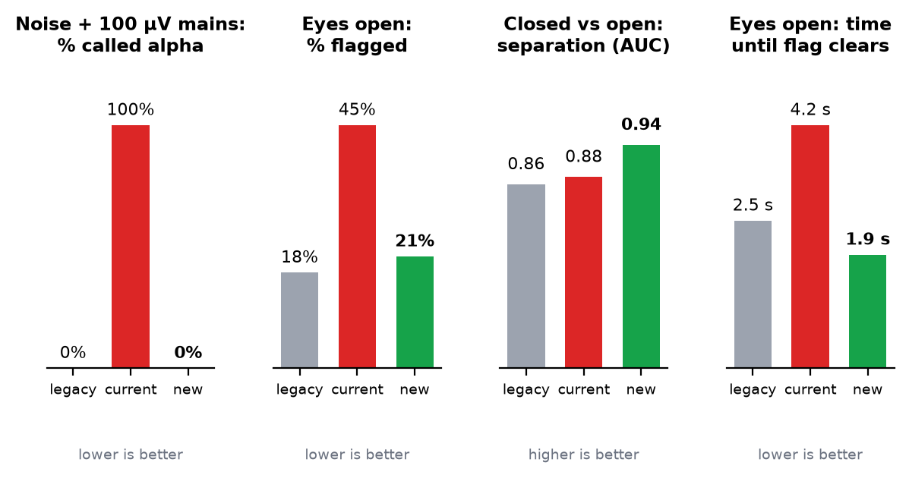

**The installation reports "lots of noise" because the default detector is fooled by mains hum.** The detector is `alphaRhythmicity`, an autocorrelation test on the alpha-filtered signal. From about 30 µV of 50/60 Hz pickup it starts reporting alpha in pure noise. At 100 µV it flags **100% of a signal that contains no EEG at all**. On clean data it flags **45% of eyes-open time**.

**The replacement measures how far 8–13 Hz power stands above the 1/f background.** That background is fitted every 128 ms over the neighbouring 3–7 Hz and 14–30 Hz bands of a 2 s Welch spectrum. On 9 held-out people it flags 75% of eyes-closed and 21% of eyes-open time, and 0.4% of pure noise; mains hum does not affect it.

| What changes | Where | Size |
|---|---|---|
| ➕ New `SpectralAlphaDetector` class (written, verified) | `src/components/SpectralAlphaDetector.ts` | ~240 lines |
| ✏️ Feed it from `ingestSample`, one per device per channel | `src/app/dual-stream/page.tsx:976-1003` | ~15 lines |
| ✏️ `runStageC` reduced to drawing the highlight | `page.tsx:1832-1925` | −60 lines |
| ✏️ TouchDesigner contract v2: a `state` message with per-person and pair fields, every 128 ms ([§6.4](#64-contract-v2)) | `WebSocketStreamer.ts`, new `DyadState.ts`, `touchdesigner_websocket.py` | ~220 lines |
| ✏️ UI: 75 detection and filter controls become 8 ([§6.2](#62-the-operator-ui)) | `page.tsx` Bands and Filter popovers | ~100 lines, −280 |
| ➖ Remove rhythmicity harness, label rings, 3-way ratio, Stage C run scan | `page.tsx:209-305, 348-370, 1774-1830` | −250 lines |

---

## 2. How the pipeline works today

> *Source: `src/app/dual-stream/page.tsx` and `src/components/filters.tsx` on `main` @ `810ed2a`.*

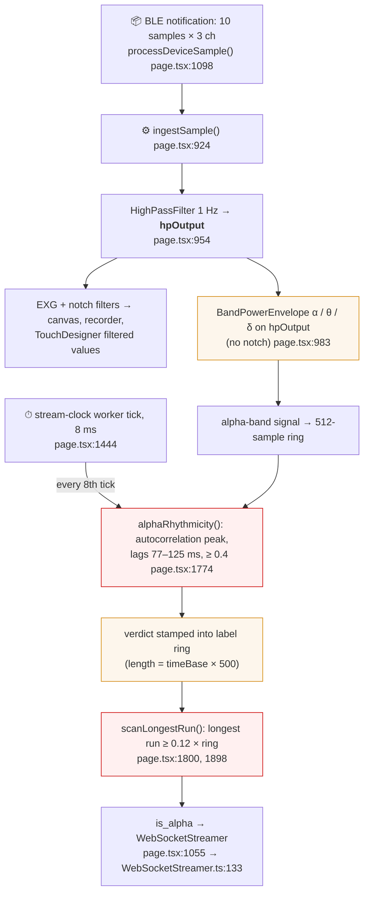

**Reading the diagram.** Samples arrive in BLE batches and are processed one at a time by `ingestSample`. Detection forks off `hpOutput`, the 1 Hz-highpassed raw counts, before any notch filter. A web-worker clock evaluates the verdict every 8 ms. The rhythmicity metric is recomputed on every 8th tick. The verdict is written into a ring buffer as long as the visible chart, and `is_alpha` is true whenever that ring contains a long enough run. Red nodes are where the noise comes from; amber nodes add delay or loss.

---

## 3. Defects found

Each defect was reproduced with the app's own filter coefficients, ported exactly (`analysis/chords_dsp.py`).

| # | Defect | Code | Effect | Evidence |
|---|---|---|---|---|
| D1 | Rhythmicity lag window 77–125 ms contains whole multiples of the mains period (83, 100, 117 ms) | `page.tsx:1774-1798, 1866-1869` | mains hum from ~30 µV; ≥ 100 µV → `is_alpha` = 100% on pure noise | [§3.1](#31-d1-and-d2-mains-hum-reads-as-alpha) |
| D2 | Detection reads `hpOutput`, before the notch | `page.tsx:954, 983` | the notch toggle never protects detection | [§3.1](#31-d1-and-d2-mains-hum-reads-as-alpha) |
| D3 | "8–12 Hz" bandpass is a 2nd-order HP + 2nd-order LP | `filters.tsx:255-260, 297-302` | real passband 6.1–15.6 Hz; 59% of output from outside 8–13 Hz | [§3.2](#32-d3-the-alpha-filter-passes-6-16-hz) |
| D4 | `is_alpha` = "a 0.48 s run exists anywhere in the visible window" | `page.tsx:1800-1830, 1898-1901` | flag lingers ~3.5 s; median 4.2 s to clear after eyes open | [§3.3](#33-d4-the-flag-lingers) |
| D5 | Verdict computed on wall-clock ticks, stamped onto samples | `page.tsx:1473-1501, 1854-1880` | in replay, rows drained in one tick share one verdict, so results depend on replay speed | code reading |
| D6 | Legacy rule: alpha ≥ 50% of α+θ+δ power | `page.tsx:1882-1887` | fails on weaker alpha; blinks drop it from 55% to 22% detected | [§3.4](#34-d6-the-legacy-ratio) |
| D7 | Detection state lives in rings sized by `timeBase` | `page.tsx:348-370` | changing chart zoom resets detection and changes its meaning | code reading |
| D8 | `noiseFloor = 1e-6` in counts² | `page.tsx:213-219` | inert; and units are now known (≈ 0.55 µV/count) | code reading |

### 3.1 D1 and D2: mains hum reads as alpha

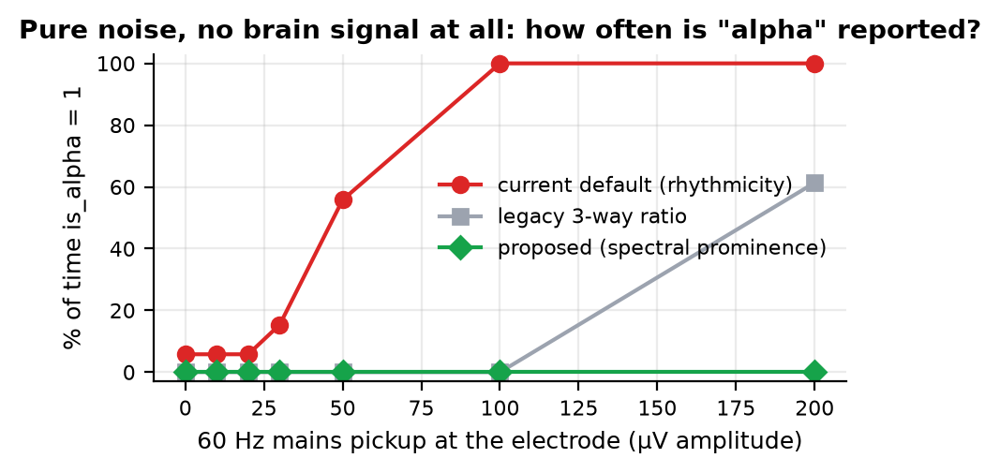

`alphaRhythmicity` searches lags from `round(sr × 0.077)` to `round(sr × 0.125)`. At 500 Hz that is 38–62 samples. A 60 Hz sinusoid has a period of 8.33 samples, so lags 42, 50 and 58 are near-exact multiples; at 50 Hz the period is 10 samples, giving 40, 50 and 60. The alpha bandpass only attenuates 60 Hz by 25.6 dB (D3). Once mains residue dominates the alpha-filtered signal, its autocorrelation peak goes to about 1. Gel electrodes with uneven contact commonly pick up tens of µV of mains: interference rises with electrode impedance mismatch.

Even with no mains, bandpassing makes broadband noise ring at the filter's centre frequency. Pure 1/f noise alone gives a 4% false-alarm rate, and real eyes-open EEG gives 45%.

### 3.2 D3: the alpha filter passes 6–16 Hz

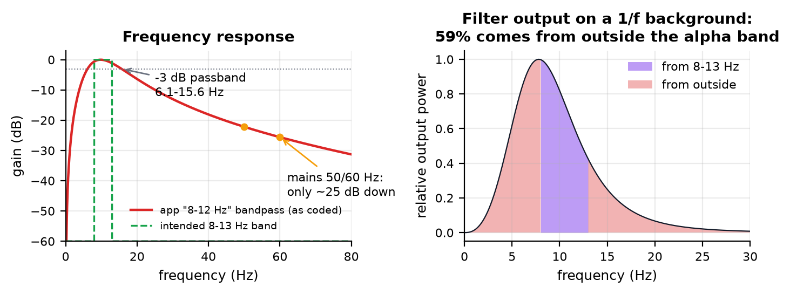

The cascade peaks at 0.69 (−3.2 dB) and is −3 dB from that peak at 6.1 and 15.6 Hz. On a 1/f^1.5 background, 59% of output power comes from outside 8–13 Hz. This matters for the overlay lines too: the cyan "alpha" trace on the chart is mostly not alpha.

### 3.3 D4: the flag lingers

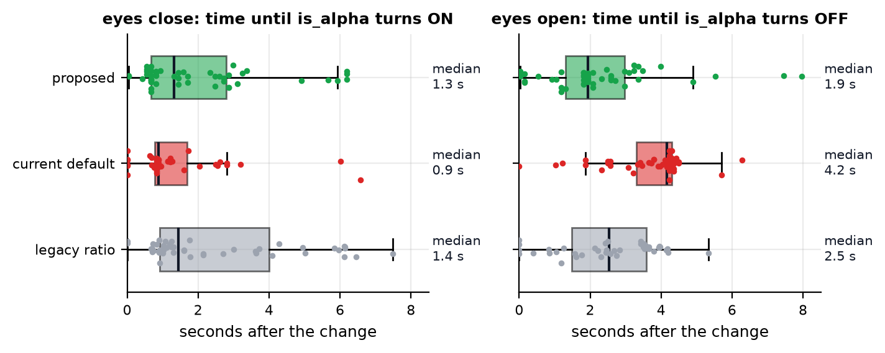

> *Measured on splices: 8 s eyes open + 8 s eyes closed + 8 s eyes open, cut from each of 20 people's recordings and joined at known times.*

`scanLongestRun` scans the whole visible ring. A qualifying run stays in the ring until the sweep overwrites it, up to `timeBase` = 4 s later. The proposed detector clears in a median 1.9 s; its floor is set by its 2 s window.

### 3.4 D6: the legacy ratio

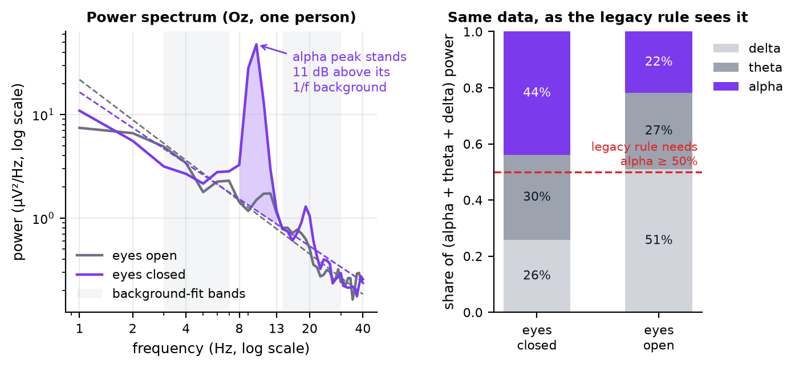

Even an 11 dB alpha peak holds only 44% of α+θ+δ power, because delta and theta sit higher on the 1/f slope. The legacy rule did better on clean data than the May plan predicted: 61% eyes-closed and 18% eyes-open on held-out people. It loses weak alpha, though, and it collapses when blinks inflate delta ([§5.4](#54-evidence)).

**The May 2026 plan's own proposal** was a biquad envelope ratio, P(8–13 Hz) / P(6–7 Hz + 13–15 Hz). Tested here, it scored AUC 0.86 against 0.94 for the spectral version: second-order flank filters leak the same way D3 does.

---

## 4. The new detector

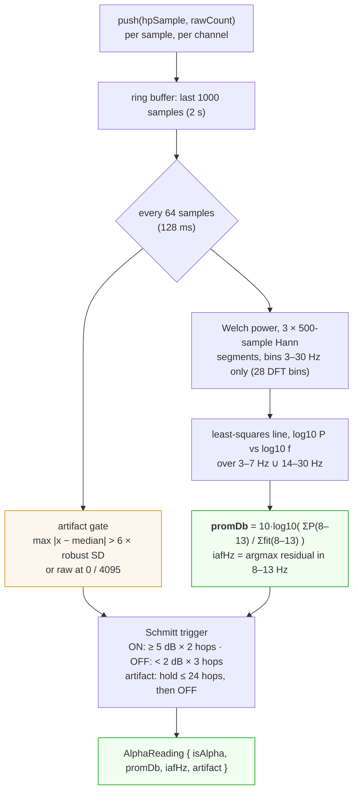

**The design in one line:** decide "alpha present" by spectral prominence over a fitted aperiodic background. This is the approach of BOSC (Whitten et al. 2011) and spectral parameterisation (Donoghue et al. 2020), reduced to something cheap enough to run eight times a second per channel in the browser.

### 4.1 Parameters

Tuned on 11 subjects (even IDs), subject to ≤ 1% false alarms on pure noise; reported on the other 9.

| Name | Default | Notes |
|---|---|---|
| `win` | 1000 samples (2 s) | 4 s gave lower false alarms but slower response; 3 s was no better |
| `seg` | 500 samples | 1 Hz bins; three 50 %-overlap segments per window |
| `hop` | 64 samples (128 ms) | ~7.8 readings/s |
| `onDb` / `offDb` | 5 / 2 dB | see the threshold trade-off in [§5.4](#54-evidence) |
| `nOn` / `nOff` | 2 / 3 hops | confirmation before switching |
| `kArt` | 6 robust SD | robust SD = 1.4826 × median absolute deviation, EMA over ~30 s of clean hops |
| `maxHoldHops` | 24 (≈ 3 s) | longer artifacts (detached electrode) force `isAlpha` off |

### 4.2 The class

The full file is `docs/alpha-v2/analysis/SpectralAlphaDetector.ts`. These are the parts that matter:

```ts
export interface AlphaReading {
    isAlpha: boolean;
    promDb: number;    // alpha prominence over the 1/f background (dB)
    iafHz: number;     // frequency of the largest alpha-band excess
    artifact: boolean; // this window was rejected; isAlpha is being held
}

export class SpectralAlphaDetector {
    constructor(fs: number, params: Partial<AlphaDetectorParams> = {}) { /* DFT tables for 3-30 Hz bins only */ }

    /** Feed one sample. Returns a new reading every `hop` samples once the window is full, else null. */
    push(hpSample: number, rawCount: number): AlphaReading | null { /* ring buffer + hop counter */ }

    get reading(): AlphaReading { return this.last; }
    reset(): void { /* clear ring, scale, state */ }
}
```

The decision step, after the spectrum and fit:

```ts
const promDb = 10 * Math.log10(pa / ba);        // Σ power / Σ fitted background over 8-13 Hz

// Schmitt trigger; artifact windows hold the state, but not for longer than maxHoldHops
if (artifact) {
    if (++this.held > this.p.maxHoldHops) { this.state = false; this.cnt = 0; }
} else {
    this.held = 0;
    const want = this.state ? promDb >= this.p.offDb : promDb >= this.p.onDb;
    if (want !== this.state) {
        this.cnt++;
        if (this.cnt >= (this.state ? this.p.nOff : this.p.nOn)) { this.state = want; this.cnt = 0; }
    } else {
        this.cnt = 0;
    }
}
```

**Why a DFT over 28 bins instead of an FFT:** we only need 3–30 Hz. With precomputed sin/cos tables that is 28 × 500 × 3 ≈ 42k multiply-adds per hop, with no dependency and any segment length. **Measured cost: 2.8 ms of CPU per second of signal per channel** (Node 22 on this Mac), so six channels use about 1.7% of a core.

### 4.3 Verified against the reference

`analysis/verify_ts.py` runs the TypeScript class under Node on the same signal as the Python reference and compares every hop:

| Recording | Hops | Max prominence difference | State / artifact / peak-Hz agreement |
|---|---|---|---|
| subject 3, Oz | 1375 | 1.8 × 10⁻⁶ dB | 100% / 100% / 100% |
| subject 11, O1 | 1350 | 4.9 × 10⁻⁷ dB | 100% / 100% / 100% |
| subject 6, Fp1 (blink-heavy) | 1467 | 1.2 × 10⁻⁶ dB | 100% / 100% / 100% |
| subject 3, Oz, electrode railed for 10 s | 1375 | 5.4 × 10⁻⁵ dB | 100%; forced off 3.1 s after the rail |

---

## 5. Implementation plan

Read the table top to bottom. 🔴 marks the critical path, the phases that make `is_alpha` trustworthy. Everything after P4 improves the result or proves it. Effort is an estimate in working days.

| Phase | What | Depends on | Effort | Fixes |
|---|---|---|---|---|
| 🔴 **P1** | Add `SpectralAlphaDetector.ts` and its fixture test | — | 1 d | — |
| 🔴 **P2** | Feed it from `ingestSample`, one per device per channel | P1 | 1 d | D1, D2, D3, D5, D8 |
| 🔴 **P3** | `runStageC` only draws the highlight | P2 | 1 d | D4, D7 |
| 🔴 **P4** | TouchDesigner contract v2 + TD patch ([§6.4](#64-contract-v2)) | P3 | 2 d | T1–T5 |
| **P5** | Simplified UI ([§6.2](#62-the-operator-ui)), live readout, signal-quality chip, µV axis | P3 | 2 d | — |
| **P6** | Optional 20 s personal check | P5 | 1 d | weak-alpha people |
| **P7** | Delete the old detector code | P4 | 1 d | D6 |
| **P8** | NPG Lite recordings, clinician marks, scoring (incl. the new contract fields) | P7 | 3 d | validation |

### 5.1 P1: add the detector

- Copy `docs/alpha-v2/analysis/SpectralAlphaDetector.ts` to `src/components/SpectralAlphaDetector.ts`.
- Commit a fixture: 60 s of one subject's `hpOutput` and raw counts, plus the reference readings from `chords_dsp.py`. Add a Node test that asserts a prominence difference under 1e-4 dB and 100% state agreement. The repo has no test runner yet; `node --test` on Node ≥ 22.18 runs TypeScript directly.

### 5.2 P2: feed it per sample

One detector per device per channel. It is sample-driven, so live and replay produce identical results (fixes D5).

```ts
// page.tsx, next to the other per-device refs
const d1AlphaRef = useRef<SpectralAlphaDetector[]>(
    Array.from({ length: 3 }, () => new SpectralAlphaDetector(500)));
const d2AlphaRef = useRef<SpectralAlphaDetector[]>(
    Array.from({ length: 3 }, () => new SpectralAlphaDetector(500)));
const d1AlphaReadingRef = useRef<(AlphaReading | null)[]>([null, null, null]);
const d2AlphaReadingRef = useRef<(AlphaReading | null)[]>([null, null, null]);
```

```ts
// ingestSample, replacing the detection block at page.tsx:976-1003
const detectionBands = detectionBandsRef.current[channel];
if (detectionBands && detectionBands.has('alpha')) {
    const reading = alphaDetectors.current[channel].push(hpOutput, sample);   // sample = raw count
    if (reading) {
        alphaReadings.current[channel] = reading;
        alphaHistory.current[channel].push(reading.isAlpha);               // for the highlight only
    }
}
```

- Call `reset()` on every detector in `resetSignalChain` (`page.tsx:900`) and in `toggleDetectionBand` when detection is switched off.
- When the sampling rate changes, rebuild the detectors with the new `fs`. `hop`, `win` and `seg` scale with it: 64 / 1000 / 500 at 500 Hz, and 32 / 500 / 250 at 250 Hz.

### 5.3 P3 and P4: Stage C draws, the streamer sends more

`runStageC` stops deciding. It reads the latest reading, positions the highlight over the most recent ON run in `alphaHistory` (a ring of hop states sized to the visible window), and forwards the reading to the streamer. Label rings, `scanLongestRun`, `minRunFrac` and the 8-tick rhythmicity schedule all go (fixes D4 and D7).

```ts
// WebSocketStreamer.ts: widen the per-channel state (was { is_alpha: boolean })
type AlphaState = { is_alpha: boolean; alpha_prom: number; alpha_iaf: number; alpha_artifact: boolean };

// sendFiltered(): per device and channel
message[`d1_ch${ch}_is_alpha`] = st.is_alpha ? 1 : 0;
message[`d1_ch${ch}_alpha_prom`] = Math.round(st.alpha_prom * 10) / 10;   // dB, for TD to scale visuals
message[`d1_ch${ch}_alpha_iaf`] = st.alpha_iaf;                           // Hz
message[`d1_ch${ch}_alpha_artifact`] = st.alpha_artifact ? 1 : 0;         // TD can dim / ignore
```

`is_alpha` keeps its name and meaning, so existing TouchDesigner networks keep working. `alpha_prom` gives TD a continuous value to animate instead of only an on/off switch.

> *Superseded in detail by [§6.4](#64-contract-v2), which moves these fields into a separate `state` message and adds per-person and pair values.*

### 5.4 Evidence

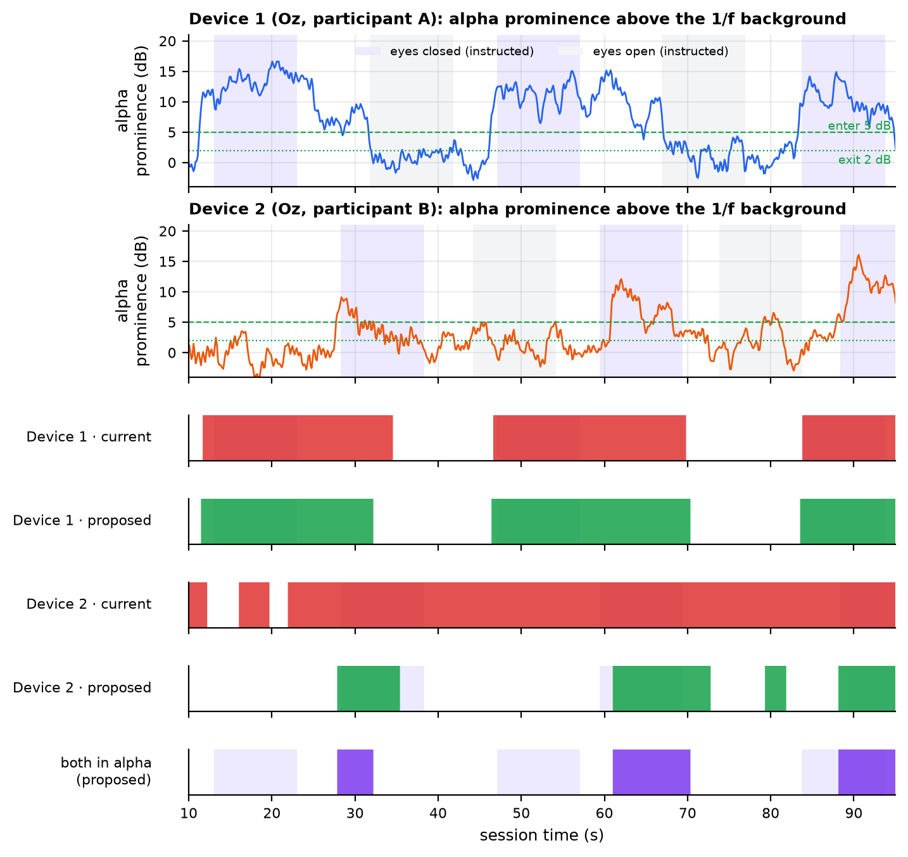

> *Held-out subjects 3 (Device 1) and 19 (Device 2), Oz. Purple = instructed eyes closed, grey = instructed eyes open.*

Device 2 under the current detector is the field symptom: on almost all session. Under the proposed detector both devices follow eye state, and "both in alpha" becomes a usable signal for TouchDesigner.

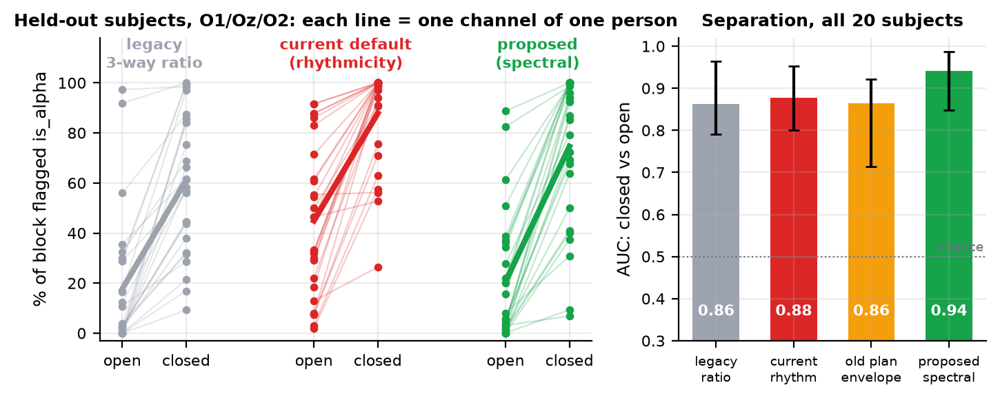

| Held-out, O1/Oz/O2 | Eyes closed | Eyes open | + 50 µV mains: eyes open | Pure noise |
|---|---|---|---|---|
| Legacy ratio | 61% | 18% | 20% | 0% (0–3% at 50 µV, 61–99% at 200 µV) |
| Current default | 88% | 45% | 53% 🔴 | 4% (56–100% at 50 µV, 100% at ≥ 100 µV) 🔴 |
| **Proposed** | **75%** | **21%** | **21%** ✅ | **0.4%** (≤ 1.5% at 50–200 µV) ✅ |

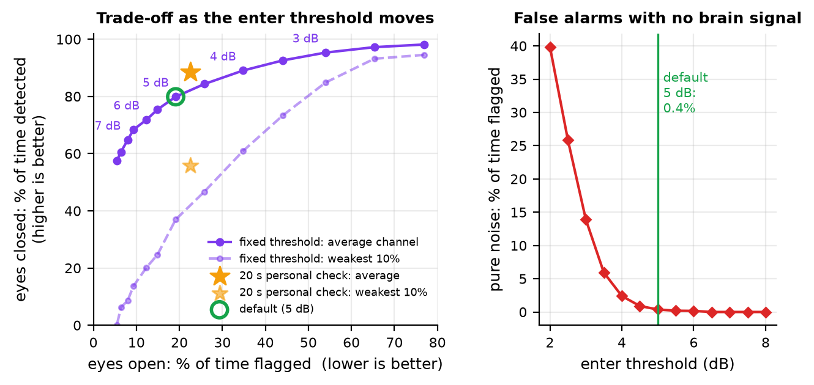

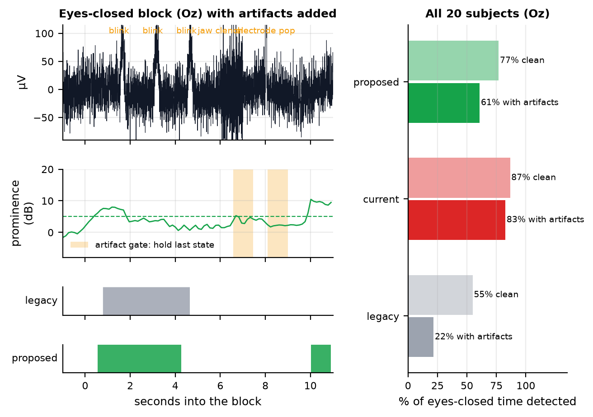

| Oz, 20 subjects | Eyes closed: clean → with artifacts | Eyes open with artifacts |
|---|---|---|
| Legacy ratio | 55% → 22% 🔴 | 3% |
| Current default | 87% → 83% | 31% ⚠️ |
| **Proposed** | 77% → **61%** | **9%** |

**Known weakness.** Blinks are slow, so they lift the 3–7 Hz fit band and lower prominence. I tested an extra 1–3 Hz gate scaled to each channel's own recent level: it recovers only 3–8 points of eyes-closed detection and holds 58–71% of windows under this stress test. It is not in the default. Occipital placement, far from the eyes, is the real fix (see the placement figure in the clinical review).

### 5.5 P5: controls, readout and signal quality

- **Replace the metric-harness controls** (`AlphaMetricConfig`) with the reduced set in [§6.2](#62-the-operator-ui):
  - one enter level (default 5 dB; exit = enter − 3 dB);
  - a live readout per channel: prominence, peak Hz, % of the last 30 s spent in artifact;
  - a "personal check" button ([§5.6](#56-p6-optional-personal-check)).
- **Signal-quality chip** per channel: mains amplitude in µV, from a Goertzel filter at 50 and 60 Hz on `hpOutput`, once a second. Amber above 20 µV, red above 50 µV. It tells the operator to re-seat an electrode before trusting the flag.
- **µV axis.** Add `UV_PER_COUNT = 3.3 / 4095 / 1470 * 1e6` (≈ 0.548) in `filters.tsx`, and label it approximate: the board has no calibration, and v0.1 silicon has ADC non-linearity (manufacturer, email 2026-04-11). If `GAIN_PIN` 14 selects ×882, use that gain instead.

### 5.6 P6: optional personal check

A 20 s guided step per participant: 10 s eyes closed, then 10 s eyes open. Take the median prominence of each half and set `onDb = max(4, (ecMedian + eoMedian) / 2)` and `offDb = onDb − 3`. At an equal eyes-open flag rate (about 22%), this lifts eyes-closed detection from about 82% to 89% on average, and from about 42% to 56% for the weakest 10% of channels (`analysis/personal.py`). Off by default.

### 5.7 P7: delete

| Remove | Location |
|---|---|
| `AlphaMetricConfig`, `DEFAULT_ALPHA_METRICS`, metric readout state | `page.tsx:253-305` |
| `DetectionParams` dominance / margin / minRunFrac / noiseFloor | `page.tsx:209-219` |
| alpha signal rings, slow baseline, combined verdict refs | `page.tsx:284-293, 357-367` |
| label rings and their rebuild effect | `page.tsx:246-249, 348-356` |
| `alphaRhythmicity`, `scanLongestRun`, legacy ratio in `runStageC` | `page.tsx:1774-1830, 1854-1901` |
| θ/δ `BandPowerEnvelope` instances used only for detection | `page.tsx:235-245, 980-984` |
| θ/δ overlay buttons and their band filters; per-channel EXG and notch rows ([§6.2](#62-the-operator-ui)) | `page.tsx:2331-2425, 2443-2539` |
| band keys `d*_ch*_alpha/theta/delta` in the TD message (T2) | `page.tsx:1039-1045`, `WebSocketStreamer.ts:117-126` |

Keep `BandpassFilter` for the overlay lines, but relabel the alpha line "~6–16 Hz" or replace it with a 4th-order design. That is a cosmetic change, outside the detection path.

### 5.8 P8: validate on the NPG Lite

The recording protocol and pass criteria are in the clinical review §9. Tooling is ready:

```sh
cd docs/alpha-v2/analysis
python score_recording.py session.csv                    # → session_alpha.csv + session_alpha.png
python score_recording.py session.csv --marks marks.csv  # compare with clinician marks (slot,channel,start_s,end_s)
python score_recording.py --selftest                     # builds a recording in the app's CSV format and scores it
```

`score_recording.py` reads the replay-ready CSV from `workers/indexedDBWorker.ts` (`Slot, tWallMs, …, Raw0–2`) and re-runs the raw counts through the app's own 1 Hz highpass and the reference detector. The self-test reproduces the analysis results (Device 1 Oz: 94% eyes closed, 16% eyes open).

---

## 6. Simplifying the UI and the TouchDesigner contract

Once the detector in [§4](#4-the-new-detector) is in, most detection controls on the dual-stream page tune code that no longer runs. The WebSocket message also still carries fields built for theta/delta detection. This section decides what the operator sees and what TouchDesigner (TD) receives. It assumes P1–P3 are done, and it replaces the field list sketched in [§5.3](#53-p3-and-p4-stage-c-draws-the-streamer-sends-more).

### 6.1 What two 3-channel headsets can report

> *Basis: [§5.4](#54-evidence) for alpha (open data through the NPG Lite model, 2026-10-24). The other rows are not yet measured: they are proposals, to be checked on NPG Lite recordings in P8.*

The table rates each candidate signal. "Reliable" means it can be reported per person, about eight times a second, from 3 occipital gel electrodes.

| Signal | What it measures | Reliable? | Use in TD |
|---|---|---|---|
| **Posterior alpha** (prominence, on/off) | the 8–13 Hz rhythm that appears with eyes closed and relaxed wakefulness | ✅ measured; NPG Lite check pending (P8) | **the primary state** |
| Alpha peak frequency (`iaf`) | where in 8–13 Hz the alpha peak sits | ⚠️ only while alpha is on; 1 Hz resolution | colour or pitch while in alpha |
| 1/f exponent | steepness of the aperiodic background; linked in the literature to arousal and age (Donoghue et al. 2020) | ⚠️ noisy in a 2 s window; smooth over ~10 s [unmeasured] | slow texture, never a state |
| High-frequency excess, 32–45 Hz | mostly **muscle**: jaw, forehead and neck tension, talking, swallowing | ✅ as muscle, not as brain activity [unmeasured on NPG Lite] | tension or movement |
| Contact and artifacts | mains µV, railing, the artifact gate | ✅ an engineering signal | dim or hide a person whose data is bad |
| Theta "meditation", beta "focus", gamma, emotion | — | 🔴 not with 3 occipital channels and 2 s windows | **do not send** |

**Alpha is the one brain state this setup can flag.** It is the largest rhythm at the back of the head, it has a clear test (eye opening suppresses it), and [§5.4](#54-evidence) shows it can be separated from noise. Drowsiness shows up only as alpha fading. The detector will drop the flag correctly, but it cannot tell "drowsy" from "alert with eyes open".

**The same spectrum yields three more numbers at no extra cost.** The detector already computes a 2 s spectrum and a 1/f fit every 128 ms. The fitted slope gives the 1/f exponent directly. Extending the DFT (discrete Fourier transform) from 28 bins (3–30 Hz) to 43 (3–45 Hz) gives a high-frequency excess, measured the same way as alpha prominence: dB above the 1/f line extrapolated to 32–45 Hz. It is therefore scale-free, and it stays below 50 Hz mains. The detector reads `hpOutput`, before the 45 Hz EEG low-pass, so that band is present in its input.

**The filtered waveform keeps its job.** `d1_ch0` … `d2_ch2` remain the moving texture for TD visuals. They are not used to decide state.

**Blinks are not worth sending.** At occipital sites they are small. The artifact gate already catches the large ones, and frontal electrodes would be needed to detect them reliably.

### 6.2 The operator UI

> *Source: `src/app/dual-stream/page.tsx` on `main` @ `810ed2a`: Filter popover 2324–2429, Bands popover 2433–2613, Settings 2616–2710, toolbar 2711–2775.*

Each row is one control group. *Count* is the number of rendered controls for 3 channels.

| Control | Where | Count | Decision | Why |
|---|---|---|---|---|
| Alpha metrics: AND/OR, Rhythm / Rel.rise / Power / Legacy, 3 threshold sliders, readout | Bands, 2468–2518 | 8 | ➖ remove | the metric harness goes in P7 |
| Dominance, Margin, Min run, Smoothing, Noise floor, per channel | Bands, 2563–2608 | 15 | ➖ remove | legacy ratio and Stage C parameters; none reach the new detector |
| Detect all + per-channel Detect | Bands, 2456–2466, 2540–2553 | 4 | ✏️ one **Use** toggle per channel | detection runs whenever a device is connected; Use excludes a bad electrode |
| Overlay θ, δ (all + per channel) | Bands, 2443–2539 | 8 | ➖ remove | display only; the filters leak (D3) and nothing downstream uses them once their TD fields go |
| Overlay α (all + per channel) | Bands | 4 | ✏️ one toggle, relabelled "α ~6–16 Hz" | display only |
| Gain per channel | Bands, 2554–2562 | 3 | ✏️ one global slider | display only |
| EXG type per channel: off / EMG / EEG / ECG / EOG | Filter, 2331–2408 | 20 | ➖ remove; fixed to EEG (1 Hz high-pass + 45 Hz low-pass) | this installation records only EEG; affects display and the TD waveform, never detection |
| Notch per channel: off / 50 / 60 | Filter, 2408–2425 | 12 | ✏️ one **Mains** setting: off / 50 / 60, suggested by the quality chip | mains frequency is a property of the room, not of a channel |
| Console log | toolbar, 2738–2752 | 1 | ✏️ behind `?debug=1` | developer tool |
| Channels, Zoom, Time base, Live data, Record, Replay, TD connect | Settings, toolbar | — | ✅ keep | display and session controls; after P3, Time base no longer resets detection (D7) |
| Enter level, 4–6 dB (exit = enter − 3 dB) | new | 1 | ➕ add | replaces the dB pair of the old [§5.5](#55-p5-controls-readout-and-signal-quality) plan; the same rule P6 uses |
| Personal check | new | 1 | ➕ add | P6 |
| Per-channel chip: prominence dB · peak Hz · quality colour | new | — | ➕ add (readout, not a control) | tells the operator whether to trust the flag |

**Result: 75 controls become 8**, plus a debug URL flag: the Overlay α toggle, global gain, enter level, personal check, three Use toggles and Mains. The Bands popover becomes an **Alpha** popover: three rows, one per channel, each a chip and a Use toggle, under one enter-level slider.

### 6.3 What the message carries today

> *Source: `page.tsx:1029-1058`, `WebSocketStreamer.ts:107-137`, `touchdesigner_websocket.py`.*

| # | Problem | Code | Effect |
|---|---|---|---|
| T1 | `sendFiltered` runs once per sample of either device | `page.tsx:1036` | ~1000 messages/s. Each repeats the other device's last values, and TD keeps only the latest per frame [infer: TD cooks at its frame rate, typically 60 fps] |
| T2 | `d1_ch0_alpha/theta/delta` are the instantaneous band-passed waveform, sent only while that overlay is on in the Bands popover; zero values are omitted | `page.tsx:960-967, 1039-1045`; `WebSocketStreamer.ts:117-126` | a display toggle changes the contract; the values swing ± and are mostly not alpha (D3) |
| T3 | The TD script reads theta/delta and never reads `is_alpha` | `touchdesigner_websocket.py:43-75` | the reference patch is out of date |
| T4 | No signal-quality field | — | TD cannot tell a loose electrode from a person not in alpha |
| T5 | No per-person or pair values | — | TD must combine 3 channels and 2 people itself, in its own network |

### 6.4 Contract v2

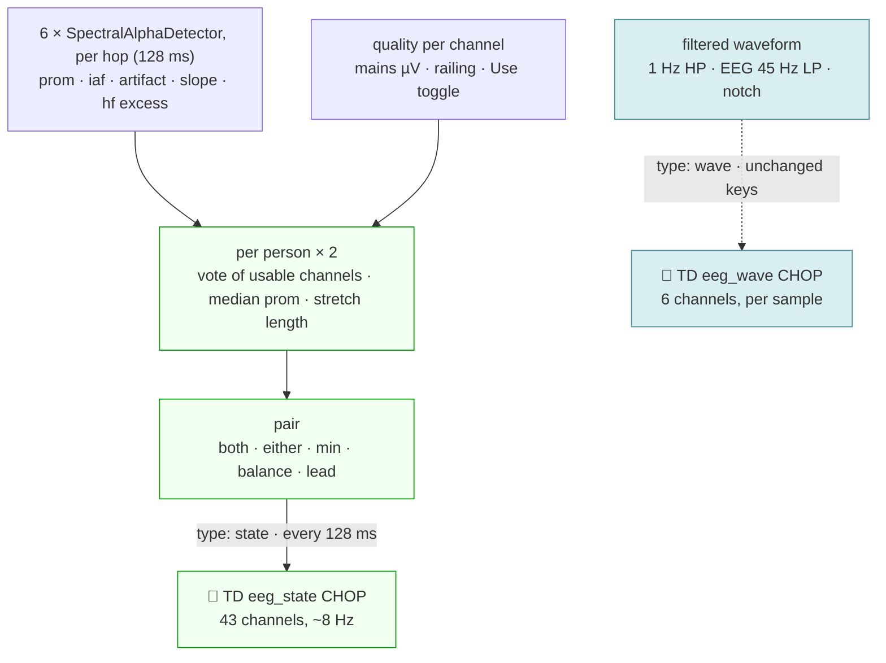

**Two message types, told apart by a `type` field.** `wave` carries the existing six waveform keys, with the band keys removed (T2). Its rate is left unchanged for now (T1), because TD visuals depend on it; see open question 3 in [§6.6](#66-changes-and-open-questions). `state` is new: one message every 16th stream-clock tick (128 ms), carrying everything below. **Every key is present in every message**, so TD channels never appear or disappear.

**A person counts as in alpha when at least half of their usable channels are on**: 2 of 3, 1 of 2 or 1 of 1. A channel is usable when its Use toggle is on and its quality is not red. The vote rule is a proposal to check in P8.

| Key | Unit | Meaning |
|---|---|---|
| `type`, `v`, `ts` | — | `"state"`, schema version `2`, `performance.now()` in ms |
| **Per person** (`d1_`, `d2_`) | | |
| `d1_alpha` | 0/1 | person-level flag, by the vote above |
| `d1_alpha_prom` | dB | median prominence over usable channels; for continuous visuals |
| `d1_alpha_iaf` | Hz | peak frequency on the most prominent channel; 0 while `d1_alpha` is 0 |
| `d1_alpha_s` | s | length of the current alpha stretch; 0 when off |
| `d1_muscle_db` | dB | high-frequency excess over the 1/f line, median over usable channels |
| `d1_aperiodic` | — | 1/f exponent (−slope), EMA over ~10 s |
| `d1_quality` | 0/1/2 | good / amber / red: worst of mains (> 20 / > 50 µV), artifact share of the last 10 s, and usable-channel count |
| `d1_usable` | 0–3 | channels in the vote |
| **Per channel** (`d1_ch0_` … `d2_ch2_`) | | |
| `d1_ch0_is_alpha` | 0/1 | **unchanged name and meaning**, so existing TD networks keep working |
| `d1_ch0_alpha_prom` | dB | that channel's prominence |
| `d1_ch0_artifact` | 0/1 | the window was rejected and the flag is being held |
| **Pair** | | |
| `pair_valid` | 0/1 | both `quality` ≤ 1; **TD should ignore the pair fields when this is 0** |
| `pair_both`, `pair_either` | 0/1 | both / at least one person in alpha |
| `pair_both_s` | s | length of the current both-on stretch |
| `pair_min_prom` | dB | the lower of the two person prominences: how far *both* are into alpha |
| `pair_balance` | dB | `d1_alpha_prom − d2_alpha_prom`, clipped to ±15; for left/right weighting |
| `pair_lead`, `pair_lead_s` | −1/0/1, s | who switched on first in the current both-on stretch, and by how long; 0 when not both on |

That is 45 keys (43 TD channels once `type` and `v` are dropped) every 128 ms: about 1 kB of JSON, ~8 kB/s.

```json
{"type":"state","v":2,"ts":81234.5,
 "d1_alpha":1,"d1_alpha_prom":8.4,"d1_alpha_iaf":10,"d1_alpha_s":6.3,"d1_muscle_db":1.2,"d1_aperiodic":1.61,"d1_quality":0,"d1_usable":3,
 "d2_alpha":1,"d2_alpha_prom":5.9,"d2_alpha_iaf":9,"d2_alpha_s":2.1,"d2_muscle_db":4.8,"d2_aperiodic":1.38,"d2_quality":1,"d2_usable":2,
 "d1_ch0_is_alpha":1,"d1_ch0_alpha_prom":8.1,"d1_ch0_artifact":0, "…": "15 more per-channel keys",
 "pair_valid":1,"pair_both":1,"pair_either":1,"pair_both_s":2.1,"pair_min_prom":5.9,"pair_balance":2.5,"pair_lead":1,"pair_lead_s":4.2}
```

*Illustrative values, not measured.*

**Deliberately left out:**

- **Inter-brain correlation, coherence or phase synchrony.** When both people follow the same instruction, both flags rise together, and synchrony measures report that shared task as coupling (clinical review §7). A 2 s window per person also gives too little data to estimate such measures. `pair_*` describes co-occurrence and nothing more.
- **Onset and offset events.** TD derives them from the 0/1 channels with a Trigger CHOP. Sending them too would duplicate state.
- **Theta and delta in any form**, for the reasons in [§6.1](#61-what-two-3-channel-headsets-can-report).

**On the TD side**, the callback routes by `type` and writes `state` keys into a CHOP by name. A new field then needs no script change:

```python
# touchdesigner_websocket.py, v2. 'eeg_state' is a Constant CHOP with 43 channels;
# 'eeg_wave' keeps the existing 6-channel mapping (band keys removed).
STATE_KEYS = []

def onWebSocketReceiveText(dat, client, data):
    msg = json.loads(data)
    if msg.get('type') == 'state':
        chop = op('eeg_state')
        if not STATE_KEYS:                                   # name channels once
            STATE_KEYS.extend(k for k in msg if k not in ('type', 'v'))
            for i, k in enumerate(STATE_KEYS):
                setattr(chop.par, f'name{i}', k)
        for i, k in enumerate(STATE_KEYS):
            setattr(chop.par, f'value{i}', msg.get(k, 0))
    else:
        chop = op('eeg_wave')
        for i, k in enumerate(('d1_ch0', 'd1_ch1', 'd1_ch2', 'd2_ch0', 'd2_ch1', 'd2_ch2')):
            setattr(chop.par, f'value{i}', msg.get(k, 0))
```

Downstream, a Lag or Filter CHOP smooths `*_prom` for motion, and `pair_valid × pair_both` gates any "together" visual.

### 6.5 Code changes

| What | Where | Size |
|---|---|---|
| ✏️ Extend DFT to 43 bins (3–45 Hz); add `hfDb` and `slope` to `AlphaReading` | `SpectralAlphaDetector.ts` | ~25 lines |
| ➕ `DyadState`: person vote, stretch timers, pair fields | `src/components/DyadState.ts` | ~120 lines |
| ✏️ `sendState()` on every 16th tick; `type: "wave"`; drop band keys | `WebSocketStreamer.ts`, `page.tsx:1029-1058` | ~60 lines, −30 |
| ✏️ Alpha popover per [§6.2](#62-the-operator-ui) | `page.tsx:2433-2613` | ~80 lines, −180 |
| ✏️ Filter popover → one Mains selector; EXG fixed to EEG | `page.tsx:2324-2429` | ~20 lines, −100 |
| ✏️ TD callback v2 | `touchdesigner_websocket.py` | rewrite, ~40 lines |
| ➕ Fixture test for `DyadState` (vote, timers, `pair_valid`) | next to the P1 test | ~60 lines |

The extended DFT raises the per-hop cost by the bin ratio, 43/28, to about 4.3 ms of CPU per second of signal per channel [projected from §4.2], or about 2.6% of a core for six channels.

### 6.6 Changes and open questions

This work folds into existing phases: contract v2 into **P4**, the UI into **P5**, and the removal of the Filter popover's per-channel rows and the θ/δ overlays into **P7**. The new fields (`muscle_db`, `aperiodic`, the person vote) are added to the P8 scoring.

**Open questions for whoever maintains the TD network:**

1. **Does any visual use `d*_ch*_alpha`, `_theta` or `_delta`?** After v2 they read 0. If the alpha one is used, keep it as `d1_ch0_alpha_wave` from a 4th-order filter.
2. **Is anything in TD per channel,** or can it all move to the per-person keys? If nothing is, the 18 per-channel keys can drop in a later version.
3. **Is the waveform drawn as a trace, or used only as a modulator?** A trace needs every sample, which means batched arrays in a Script CHOP. A modulator only needs the latest value, so `wave` could drop to the TD frame rate and fix T1.
4. **Should the pair fields drive the piece's main moment**, or should each person's own alpha? This changes which fields matter most in P8 validation.

---

## 7. Testing and reproducing the numbers

```sh
cd docs/alpha-v2/analysis
python -m venv .venv && .venv/bin/pip install numpy scipy matplotlib
mkdir data && for i in 00 01 02 03 04 05 06 08 09 10 11 12 13 14 15 16 17 18 19 20; do
  curl -sfL -o data/subject_$i.mat https://zenodo.org/api/records/2348892/files/subject_$i.mat/content; done
.venv/bin/python prefetch.py 7      # feature cache, parallel (~1.5 min)
.venv/bin/python evaluate.py        # grid search on even subjects, report on odd → results.json
.venv/bin/python robustness.py      # threshold curve, device-model variants, splice latency
.venv/bin/python personal.py        # optional personal check
.venv/bin/python artifacts.py       # artifact stress test
.venv/bin/python verify_ts.py       # TypeScript vs Python, hop for hop (needs node ≥ 22.18)
.venv/bin/python make_figures.py    # every figure in both documents
```

| File | What it is |
|---|---|
| `chords_dsp.py` | exact port of the app's filters, legacy ratio, rhythmicity harness, Stage C; the proposed detector |
| `data.py` | dataset loader, block labels, 1/f noise, blink model |
| `SpectralAlphaDetector.ts` | the detector to ship, verified against `chords_dsp.SpectralAlpha` |
| `results.json`, `robustness.json`, `artifacts.json`, `personal.json`, `verify_ts.json` | every number in both documents |

**Device model** (`to_device_counts`): mid-rail 2048, ×1470 gain, 3.3 V / 12-bit, round and clip, 3 counts rms white ADC noise [assumption], optional mains sinusoid. Robustness to 4× the ADC noise, the ×882 gain and 200 µV mains is within 5 points (clinical review §6.8).

---

## 8. Risks and open questions

| Risk | Impact | Mitigation |
|---|---|---|
| NPG Lite ADC non-linearity / offset (v0.1 silicon) | low: the method uses ratios below 30 Hz | P8 recordings; v0.2 boards if available |
| Weak-alpha participants (3 of 20 here) | flag rarely on | P6 personal check; occipital placement |
| Eyes-open alpha in relaxed people | flag on with eyes open | expected physiology; clinical reviewers asked how to treat it |
| Blink-rich sessions | ~16 points less eyes-closed detection under stress | occipital placement; optional 1–3 Hz gate ([§5.4](#54-evidence)) |
| 2 s window | ~1.3 s on / ~1.9 s off | `win` 1000 is the tuned optimum; shorter windows raise false alarms |
| "Both in alpha" read as brain synchrony | over-claiming | describe it as co-occurrence (clinical review §7) |
| BLE sample loss (counter gaps logged, not filled) | small spectral smearing | count gaps per minute in the quality chip |
| Contract v2 removes the band keys a TD visual may use | that visual goes flat | ask first ([§6.6](#66-changes-and-open-questions) Q1); bump `v` and keep `is_alpha` names |
| `muscle_db` or `aperiodic` presented as brain states | over-claiming | name them as muscle and background texture in TD and in public text; validate in P8 |
| Person vote too strict when one electrode is loose | person rarely flagged | `usable` count drops red channels from the vote; the operator can switch off Use |

---

## 9. Status

| Status | Item |
|---|---|
| ✅ | Current detectors reproduced and defects D1–D8 measured |
| ✅ | Proposed detector designed, tuned on 11 subjects, tested on 9 held out |
| ✅ | TypeScript implementation verified identical to the reference (4 recordings, incl. detached electrode) |
| ✅ | Recording scorer for NPG Lite sessions, self-tested on the app's CSV format |
| ⚠️ | Clinical review pending (`ALPHA_DETECTION_CLINICAL_REVIEW.md`) |
| ✅ | UI reduction and TouchDesigner contract v2 specified ([§6](#6-simplifying-the-ui-and-the-touchdesigner-contract)) |
| ⚠️ | `muscle_db`, `aperiodic` and the person vote are unmeasured proposals; TD-network questions open ([§6.6](#66-changes-and-open-questions)) |
| 🔴 | P1–P8 not started; no NPG Lite validation recordings yet |

---

## Glossary

| Term | Meaning |
|---|---|
| `hpOutput` | raw ADC counts after the app's 1 Hz highpass (`page.tsx:954`); the detector's input |
| Hop | one detector update: 64 samples = 128 ms at 500 Hz |
| Prominence (`promDb`) | 8–13 Hz power ÷ fitted 1/f background over 8–13 Hz, in dB |
| 1/f (aperiodic) background | straight line fitted to log-power vs log-frequency over 3–7 and 14–30 Hz |
| Welch spectrum | average of the power spectra of overlapping, Hann-tapered segments |
| Schmitt trigger | on/off decision with separate enter and exit levels, so values near a level do not flicker |
| Stage C | the existing step in `runStageC` that turns per-sample verdicts into `is_alpha` and the highlight |
| AUC | probability that a random eyes-closed hop scores above a random eyes-open hop |
| Held-out subjects | the 9 odd-numbered subjects, never used to choose parameters |
| TD | TouchDesigner, the visuals engine receiving the WebSocket stream |
| `state` / `wave` message | the two v2 WebSocket message types: features every 128 ms / the filtered waveform per sample |
| Usable channel | a channel whose Use toggle is on and whose quality is not red; only these vote |
| High-frequency excess (`muscle_db`) | 32–45 Hz power above the extrapolated 1/f line, in dB; mostly muscle |
| 1/f exponent (`aperiodic`) | minus the slope of the fitted log-log background line |
| Pair fields (`pair_*`) | values computed from both people's person-level alpha; co-occurrence, not coupling |
