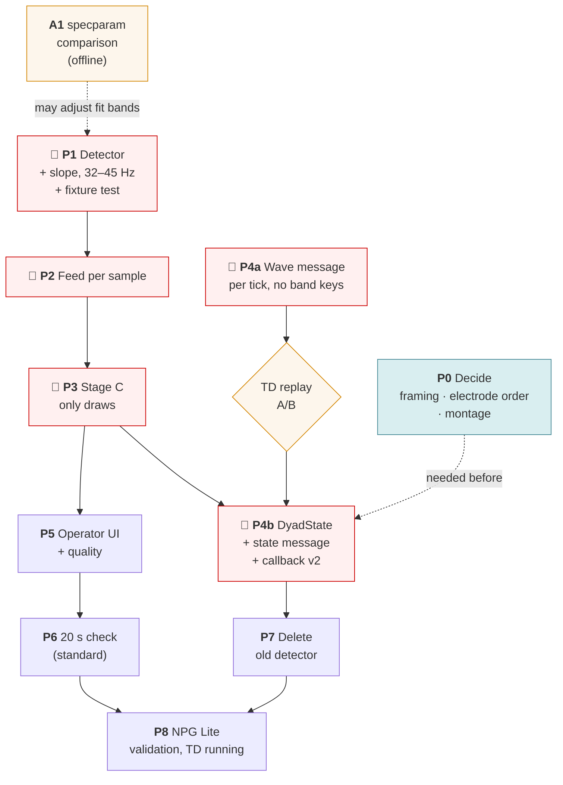
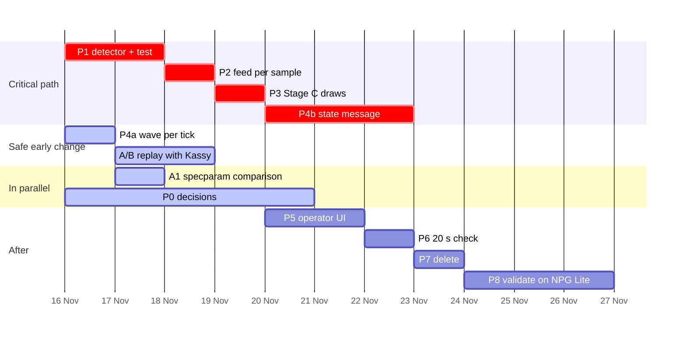

# Alpha Detection v2: Branch Implementation Plan

The build plan for `docs/alpha-detection-v2`: what to change in the app, in what order, and how each step is checked. It takes the phases P1–P8 of the engineering plan and updates them with the clinical review and the TouchDesigner analysis. Code changes are the same in substance; what moves is the order, two acceptance tests, and the shape of the data sent to TouchDesigner.

> *Based on: `ALPHA_DETECTION_ENGINEERING_PLAN.md` (2026-10-29), `CLINICAL_REVIEW_FEEDBACK.md`, `TOUCHDESIGNER_NETWORK_ANALYSIS.md` and `TD_CONTRACT_AND_INTERACTION_PLAN.md` (all 2026-11-12). Line references are to `main` @ `810ed2a` and were re-checked against the branch on 2026-11-12: the branch has no code changes yet. Effort is an estimate in working days.*

---

## 1. Summary

**The critical path is unchanged: P1 → P2 → P3 → P4.** After P4 the `is_alpha` flag TouchDesigner receives is the new detector's, and the "lots of noise" problem is gone. Red boxes are that path; amber boxes are checks that can stop it.

**What is new since the engineering plan:**

| # | Change | Why | Source |
|---|---|---|---|
| N1 | **P4 splits in two.** P4a ships a smaller, safe change to the existing message first; P4b adds the `state` message | P4a can be tested against the unmodified show file, alone | TD analysis §8 |
| N2 | **A replay A/B test gates P4b** | the message rate drops from ~1000/s to 125/s; the analysis predicts no visible change, and this proves it | TD contract §5 |
| N3 | **Every message keeps the six waveform keys**, including `state` | the TD callback writes 0 for a missing key | TD analysis §3 |
| N4 | **Band keys go now**, not after asking | no operator in TD V13–V15 reads them | TD analysis §7 |
| N5 | **P1 exposes the 1/f slope and 32–45 Hz excess** from the start | P4b needs them; adding them later re-opens a verified file | engineering plan §6.5 |
| N6 | **Contract adds `alpha_level`, `artifact_share`, `calibrated`, `pair_level`** | review notes C7, C9, C16, C18; TD maps through 0–1 ranges | TD contract §1, R4–R6 |
| N7 | **P6 becomes a standard session step**, not an option | reviewer note C16 | review §4, A2 |
| N8 | **A1, the specparam comparison, runs alongside P1–P3** | reviewer notes C9, C11, C14 | review §4.1 |
| N9 | **P0: three decisions before P4b** | the pair keys' names and the TD mapping depend on them | review A6, A7; TD contract K6 |

| Phase | Effort | Was | Critical |
|---|---|---|---|
| P0 Decide | — | — | before P4b |
| P1 Detector | 1.5 d | 1 d | 🔴 |
| A1 specparam comparison | 1 d | — | parallel |
| P2 Feed per sample | 1 d | 1 d | 🔴 |
| P3 Stage C draws | 1 d | 1 d | 🔴 |
| P4a Wave message | 0.5 d + A/B | — | 🔴 |
| P4b State message | 2.5 d | 2 d (as P4) | 🔴 |
| P5 Operator UI | 2 d | 2 d | |
| P6 20 s check | 1 d | 1 d | |
| P7 Delete | 1 d | 1 d | |
| P8 Validate | 3 d | 3 d | |
| **Total** | **≈ 14.5 d** | 12 d | |

---

## 2. Schedule

**Illustrative dates**, assuming one developer from Monday 2026-11-16 and Kassy available for the A/B test. P4a is independent of the detector and can ship first; it is the smallest change that touches the live show, so it is the one to test earliest.

---

## 3. Phases

Each phase lists its files, what changes from the engineering plan, and the test that closes it. *EP* refers to sections of `ALPHA_DETECTION_ENGINEERING_PLAN.md`.

### 3.1 P0: decisions

| # | Decision | Options | Blocks |
|---|---|---|---|
| D-a | What "together" means in the piece | co-occurrence (both in alpha at once) or a synchrony claim; the detector supports only the first | pair key names, public text, renaming the TD "Sync Trigger" control |
| D-b | Which electrode is channel 0, 1, 2 on each headset | the TD network gives each channel a different job: 0 = position and noise, 1 = the sync comparison, 2 = one rotation axis | the TD mapping; P8 protocol |
| D-c | Reference and ground sites | linked mastoids, one earlobe, or Cz, as the reviewer suggested; limited by what the NPG Lite accepts | P8 protocol; hardware table in the clinical review |

**The plan assumes co-occurrence for D-a.** If the team chooses synchrony, P4b's pair keys stay as specified but a separate research task is needed, outside this branch.

### 3.2 P1: the detector

| File | Change |
|---|---|
| `src/components/SpectralAlphaDetector.ts` (new) | copy of `docs/alpha-v2/analysis/SpectralAlphaDetector.ts`, plus the EP §6.5 extension: DFT over 43 bins (3–45 Hz); `AlphaReading` gains `slope` and `hfDb` |
| `src/components/SpectralAlphaDetector.test.ts` (new) | fixture test, run with `node --test` (Node 22.21 here runs TypeScript directly) |
| `tests/fixtures/alpha_s03_oz.json` (new) | 60 s of `hpOutput` and raw counts for subject 3, Oz, with the reference readings |
| `docs/alpha-v2/analysis/chords_dsp.py`, `verify_ts.py` | the reference gains `slope` and `hfDb`, so the verification covers them |
| `package.json` | `"test": "node --test src/**/*.test.ts"` |

**Done when** the test passes with prominence within 1 × 10⁻⁴ dB of the reference and 100% agreement on state, artifact and peak Hz; and `verify_ts.py` passes on its four recordings with the extended DFT. The extension changes the cost to about 4.3 ms of CPU per second of signal per channel [projected, EP §6.5]; re-measure it.

**The fit bands stay 3–7 and 14–30 Hz** unless A1 finds a reason to change them. If it does, the change is to two constants and the fixture is regenerated.

### 3.3 A1: compare the fit with specparam

Offline, in `docs/alpha-v2/analysis/`. Not on the critical path, but its result should be known before P8.

| Step | What |
|---|---|
| 1 | Add `specparam.py`: for every hop of the 20-subject dataset, fit specparam over 1–40 Hz on the same 2 s Welch spectrum, and on 10 s windows |
| 2 | Compare our `promDb` with specparam's alpha peak height, and our slope with its exponent, on clean windows and on the artifact stress test |
| 3 | Write the result into `CLINICAL_REVIEW_FEEDBACK.md` §5 and send it to the reviewer with questions 6 and 8 (review action A10) |

**Decision rule:** within about 1 dB on clean windows, keep our fit and say so. A systematic gap on windows with slow artifacts is a reason to try a wider fit band or a robust fit, re-tuned on the even subjects and reported on the odd ones as before.

### 3.4 P2: feed per sample

As EP §5.2, unchanged. One detector per device per channel, fed from `ingestSample` with `hpOutput` and the raw count.

| Where | Change |
|---|---|
| `page.tsx`, per-device refs | `d1AlphaRef`, `d2AlphaRef`, and their reading refs |
| `page.tsx:976-1003` in `ingestSample` | `push(hpOutput, sample)`; store the reading; push `isAlpha` into a hop-state ring for the highlight |
| `page.tsx:900` `resetSignalChain` | `reset()` every detector |
| sampling-rate change | rebuild detectors with the new `fs` |

**Done when** a live session and a replay of its recording give identical readings, hop for hop (fixes D5), checked by logging both to the console under `?debug=1`.

### 3.5 P3: Stage C only draws

As EP §5.3. `runStageC` (`page.tsx:1832`) stops deciding. It reads the latest reading, draws the highlight over the most recent ON run, and hands the reading to the streamer. `scanLongestRun` and the label rings stop being called; they are deleted in P7.

**Done when** changing the chart's time base no longer changes `is_alpha` (fixes D7), and the flag clears within about 2 s of eye opening on a replayed recording (fixes D4).

### 3.6 P4a: the wave message

The smallest change that touches the show. It can ship before P1.

| Where | Change |
|---|---|
| `page.tsx:1029-1058` | stop calling `sendFiltered` from `ingestSample`; keep the `setDevice*Filtered` calls |
| `page.tsx:1945` `onStreamTickRef` | call `streamer.sendWave('touchdesigner')` on every tick (8 ms) |
| `WebSocketStreamer.ts:105-140` | rename `sendFiltered` to `sendWave`; add `type: "wave"`, `v: 2`; remove the band loop (`117-129`) |
| `page.tsx:960-967` | stop calling `setDevice*BandData` |

**`is_alpha` stays in the wave message for now**, from the old detector, so nothing the app sends today disappears. It moves to the `state` message in P4b.

**Gate: the replay A/B test.** With Kassy, play one recording from the app's Replay mode into the unmodified show file (`20260108_Iterface2V15_Otherworld.toe`), once from `main` and once from this branch. Screen-record both. If the visuals differ, restore the per-sample rate and find out why before P4b. The TD analysis predicts no difference, because TouchDesigner only ever used the latest value per frame [infer].

### 3.7 P4b: the state message

| File | Change |
|---|---|
| `src/components/DyadState.ts` (new) | per-person vote, `alpha_level`, stretch timers, `artifact_share`, `quality`, `usable`, `calibrated`; pair keys including `pair_level` and `pair_valid` |
| `src/components/DyadState.test.ts` (new) | fixtures for the vote (2 of 3, 1 of 2, 1 of 1), stretch timers, `pair_valid`, and `alpha_level` with and without calibration |
| `WebSocketStreamer.ts` | `sendState()`: the six waveform keys plus every key of TD contract §3.2–§3.4, all present in every message; per-channel `is_alpha` moves here from the wave message |
| `page.tsx` `onStreamTickRef` | `sendState` on every 16th tick (128 ms) |
| `touchdesigner_websocket.py` | callback v2 from TD contract §4, which writes the waveform slots only when the key is present and writes everything else into `eeg_state` by name |

**Done when** a replay shows 58 keys per state message at about 7.8 per second, no key ever missing; the `DyadState` tests pass; and, with Kassy, a Null CHOP after `eeg_state` shows 49 named channels moving (TD contract §8, step 4).

### 3.8 P5: operator UI and signal quality

As EP §5.5 and §6.2: 75 controls become 8, a per-channel chip (prominence, peak Hz, quality colour), a single Mains setting, a µV axis labelled approximate. Two additions from the review:

- **Show restlessness to the operator.** The chip includes `artifact_share` and the 32–45 Hz excess, so the operator can see when someone is moving, clenching or sweating (review notes C7, C9, C18).
- **A participant script** in the page's help text: sit still, let the eyes rest even when closed, relax the jaw (review action A4).

### 3.9 P6: the 20-second check, standard

As EP §5.6, with one change: it is on by default, and a session without it sets `d*_calibrated = 0` so TouchDesigner knows `alpha_level` is using the default range. Store each person's eyes-closed median and peak frequency; A3 (a personal alpha band) can then be tested offline on P8 recordings without another session.

### 3.10 P7: delete

As EP §5.7. The band keys in the TD message are already gone (P4a). Remaining: the metric harness, `DetectionParams`, the label rings, `alphaRhythmicity`, `scanLongestRun`, the legacy ratio, θ/δ detection envelopes and their UI. About −250 lines of `page.tsx`.

**Done when** `npm run build` and `npm run lint` pass, and `grep -n "alphaRhythmicity\|scanLongestRun\|minRunFrac" src` finds nothing.

### 3.11 P8: validate on the NPG Lite, with TouchDesigner running

The protocol in clinical review §9, plus three things from this round:

| Addition | Why |
|---|---|
| Use the montage chosen in D-c and the channel order from D-b | review notes C2, C17 |
| Run TouchDesigner during the session and screen-record it | the pair state should match what the two people were doing; that is the piece's real acceptance test |
| Score `artifact_share`, `muscle_db` and the person vote alongside `is_alpha` | they are unmeasured proposals until now |

`docs/alpha-v2/analysis/score_recording.py` already scores the app's recordings; it needs the person vote and the new fields added.

---

## 4. Commit sequence

One pull request per row, each leaving `main` working. Nothing is committed yet; the documents in `docs/alpha-v2/` are untracked on the branch.

| # | Pull request | Contains | Show risk |
|---|---|---|---|
| 1 | Docs | `docs/alpha-v2/`: the four documents, the reviewer's annotated PDFs, figures, analysis scripts | none |
| 2 | P4a | wave message per tick; band keys removed | low; gated by the A/B test |
| 3 | P1 | detector, fixture, test runner | none: not wired |
| 4 | P2 + P3 | detector wired; Stage C draws | medium: `is_alpha` changes meaning, for the better |
| 5 | P4b | `DyadState`, state message, callback v2 | none for today's show file (rule N3) |
| 6 | P5 + P6 | UI, quality chip, 20 s check | none |
| 7 | P7 | deletions | none |

**Pull request 4 is the moment the installation changes behaviour.** Before it, TouchDesigner receives the old `is_alpha`, which nothing in the show file reads. After it, `is_alpha` comes from the new detector. Since the show file does not read `is_alpha` either way, the audience sees no change until Kassy wires the state values in.

---

## 5. Risks specific to this branch

| Risk | Effect | Mitigation |
|---|---|---|
| The rate drop in P4a changes how the visuals move | the piece feels different | A/B gate; easy to revert |
| A state message reaches today's callback without waveform keys | visuals blank 8 times a second | rule N3; covered by the P4b check |
| A1 shows our fit is biased | prominence values shift | only two constants change; re-run the evaluation; `alpha_level` absorbs a constant shift for TD |
| Electrode order changes with the new montage | the piece's left/right and sync roles move to different electrodes | decision D-b before P8 |
| No test runner in the repo | P1 and P4b tests not run in CI | `node --test` locally; add to CI later |
| The callback v2 parameter names are wrong for this TD build | `eeg_state` stays at zero | Kassy checks in TD before P4b ships; the waveform path is unaffected |

---

## Glossary

| Term | Meaning |
|---|---|
| Critical path | the phases that must finish, in order, before `is_alpha` is trustworthy |
| `DyadState` | planned module turning six channel readings into person and pair values |
| Hop | one detector update: 64 samples, 128 ms at 500 Hz |
| `hpOutput` | the raw counts after the app's 1 Hz high-pass; the detector's input |
| Prominence | 8–13 Hz power over the fitted 1/f background, in dB |
| Replay A/B | playing the same recording through two versions of the app into the same TouchDesigner file, and comparing |
| Stage C | `runStageC` in `page.tsx`, which today decides `is_alpha` and after P3 only draws |
| `wave` / `state` | the two message types: waveform every 8 ms; detection values every 128 ms |

| Status | Item |
|---|---|
| ✅ | Engineering plan, clinical review, review feedback, TD analysis and contract written |
| ✅ | Line references re-checked against the branch, 2026-11-12 |
| ⚠️ | P0 decisions open |
| 🔴 | No code changes on the branch; P1–P8 and A1 not started |
