# Clinical Review of the Alpha Detector: Erica's Notes

What the clinical reviewer said about `ALPHA_DETECTION_CLINICAL_REVIEW.md`, transcribed from the annotated PDF, and what each note changes. The review supports the method. It asks for no change to the detector's core, and it raises one method question, three session-protocol points and one framing decision that the team still has to make.

> *Sources: `review/ALPHA_DETECTION_CLINICAL_REVIEW_EF.pdf` (the annotated copy) and `review/ALPHA_DETECTION_CLINICAL_REVIEW_EF_comments_summarized.pdf` (the same copy with a comment-summary page after each annotated page). Annotations dated 2026-11-02, 18:43 to 19:41. Transcribed 2026-11-12.*

---

## 1. At a glance

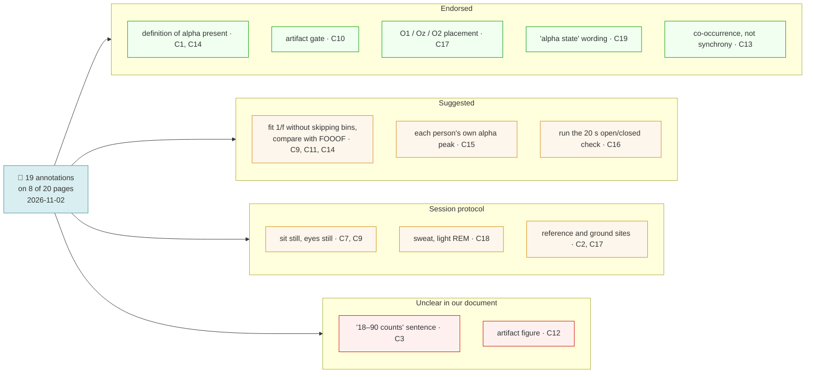

**The reviewer accepts the working definition.** The first note, on the sentence that defines the method, reads "This seems sound to me." The answer to question 1 is "I think so?", qualified by one suggestion about how the 1/f background is fitted. The 1/f (aperiodic) background is the smooth fall of EEG power with frequency, on which a rhythm such as alpha sits as a bump.

**One method question is open.** Our detector fits the background from 3–7 Hz and 14–30 Hz only, and skips everything below 3 Hz. The reviewer thinks a fit that does not skip bins may be more reliable, points to FOOOF (now called specparam, a published method that models the whole spectrum as a background plus peaks), and offers to check whether our fit agrees with it.

**Three notes are about how a session is run, not about code.** Participants should keep their body and their closed eyes still. Sweat and, in very relaxed people, light REM (rapid eye movement) add artifacts. Reference and ground electrode sites matter and were missing from our document.

**One note is a decision for the team.** The reviewer agrees that two alpha flags on at once is not brain-to-brain synchrony, and asks how much the piece cares about showing "real" synchrony. This matters more than it looks: the TouchDesigner project's central moment is called "Sync Trigger" (see `TOUCHDESIGNER_NETWORK_ANALYSIS.md` §5).

| | Count |
|---|---|
| Annotations in total | 19 (16 sticky notes, 2 comments on highlighted text, 1 reply) |
| Pages annotated | 2, 5, 6, 9, 10, 15, 17, 18 of 20 |
| Reviewer questions answered | 6 of 7 (question 6 has no note) |
| Notes that endorse without change | 7 |
| Notes that lead to an action | 11 ([§4](#4-what-changes)) |

---

## 2. How the notes were recovered

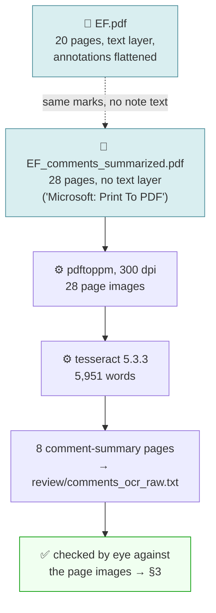

**Only the summarised PDF holds the note text, and only as pixels.** The annotated copy shows the purple note icons and highlights, but the notes themselves were flattened away when it was saved. The summarised copy prints each note on a page of its own, after the page it belongs to. It was produced by a print driver, so it has no text layer and needed OCR (optical character recognition).

**The transcription in [§3](#3-the-notes-in-full) is the OCR output corrected by eye.** Tesseract read the capital "I" as a vertical bar throughout and garbled the note icons. Those are fixed. The reviewer's own spelling and punctuation are kept as written. The uncorrected OCR text is in `review/comments_ocr_raw.txt`.

**The reviewer is Erica**, whose name is in each annotation's author field; the file names carry the initials EF. The rest of this document refers to "the reviewer".

**Where a note sits was read off the page images.** Each note icon carries a small number that matches the summary page. Two notes are attached to highlighted text; the rest are sticky notes placed beside the passage they refer to.

---

## 3. The notes in full

Each table lists the notes on one page of the reviewed PDF. *Section* is the section of `ALPHA_DETECTION_CLINICAL_REVIEW.md` the note sits in. IDs C1 to C19 are ours, in page order. The image under each table is the scanned summary page it was read from.

### 3.1 Page 2: the method in one sentence

| ID | Time | Section | Attached to | Note |
|---|---|---|---|---|
| C1 | 18:43 | §1 | "does the 8–13 Hz part of the spectrum stand clearly above the 1/f background estimated from its neighbouring frequencies?" | This seems sound to me. |

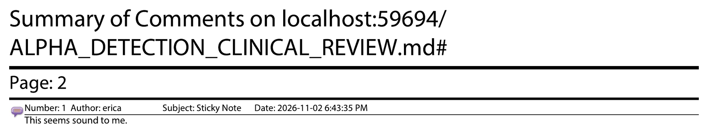

### 3.2 Page 5: hardware and target

| ID | Time | Section | Attached to | Note |
|---|---|---|---|---|
| C2 | 18:48 | §2.1 | the *Electrodes* row of the hardware table | wonder where the ground & reference electrodes are placed? May influence how alpha is detected? |
| C3 | 18:49 | §2.1 | highlighted: "Alpha of 10–50 µV is roughly 18–90 counts, far above the ADC step size. But absolute microvolt values are only approximate." | dont know what this means |
| C4 | 18:51 | §3 | the figure source line, "Oz electrode … our model of the NPG Lite" | I suspect the detection will be better with the occipital electrodes than otherwise, so how will the algorithm perform with the current setup? |
| C5 | 19:40 | §3 | reply to C4 | NVM i see later that now proposing occipital electrodes. |

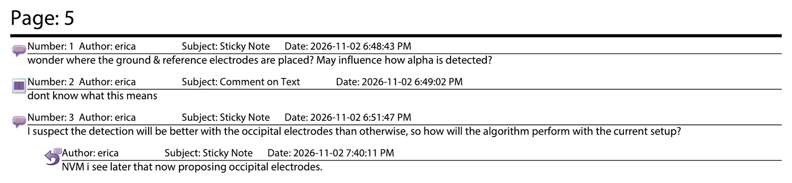

### 3.3 Page 6: what alpha is not

| ID | Time | Section | Attached to | Note |
|---|---|---|---|---|
| C6 | 18:53 | §3 | "Mu rhythm … reacts to movement, not to eye opening" | or planned movements, or imagined/observed movements as well. |
| C7 | 18:54 | §3 | "Slow eye-blink deflections" | but also eye movements. So, important to tell participants to also not move eyes even when closed. You also might see heart rate but it is pretty slow. |

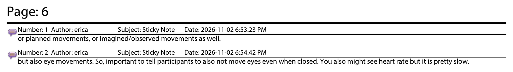

### 3.4 Page 9: the method, step by step

| ID | Time | Section | Attached to | Note |
|---|---|---|---|---|
| C8 | 19:03 | §5 | the spectrum panel of the method figure (log-power axis) | Showing the log power is fine but im used to seeing the 1/f noise in its raw form, so seeing the logirithmic component, which also makes it easier to determine whether it looks like real brain activity or not, but overall this seems fine. |
| C9 | 19:07 | §5, step 3 | "Delta (below 3 Hz) is excluded because blinks and movement live there." | sometimes movement can also create higher frequency artifacts or non-linear artifacts that are hard to clean in real time, so would tell participants to sit still. Also I think there are ways to estimate the 1/f component without having to ignore certain frequencies, which might be more reliable than ignoring the lowest frequencies where it is strongest... e.g., see the FOOOF algorithm: https://fooof-tools.github.io/fooof/ |

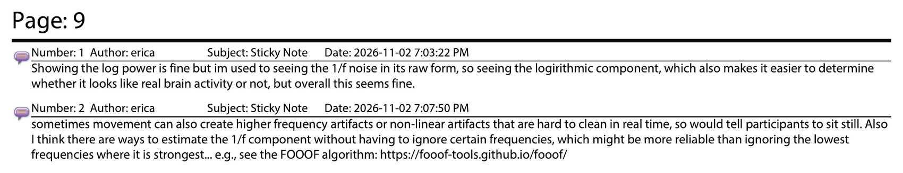

### 3.5 Page 10: artifact gate and prior work

| ID | Time | Section | Attached to | Note |
|---|---|---|---|---|
| C10 | 19:09 | §5, step 6 | "Gate artifacts … the previous decision is held" | nice! |
| C11 | 19:10 | §5.1 | the FOOOF / specparam row of the table | Oh nice, I just commented this one above haha. I might check this algorithm a bit more to see if this is in line with what you are doing, since it is reputed. |

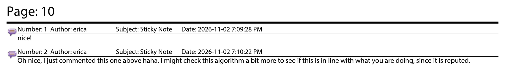

### 3.6 Page 15: the artifact stress test

| ID | Time | Section | Attached to | Note |
|---|---|---|---|---|
| C12 | 19:24 | §6.6 | the caption under the artifact figure | wait so this figure is showing detection of alpha even with eyeblinks and jaw clenching present? doesnt the lower part show detection where it shouldnt be? |

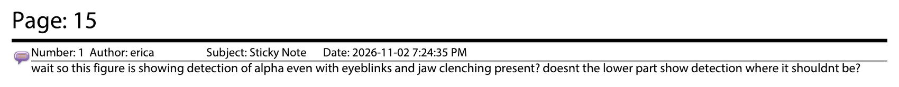

### 3.7 Page 17: limits

| ID | Time | Section | Attached to | Note |
|---|---|---|---|---|
| C13 | 19:30 | §7 | highlighted: the whole "Two flags on at once is not synchrony" paragraph | This is v much in line with what I was saying about 'synchrony' the first time I saw the system work but also not sure how much you guys care about showing 'real' synchrony vs not. |

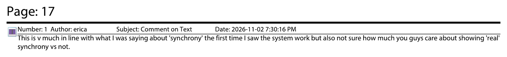

### 3.8 Page 18: answers to our questions

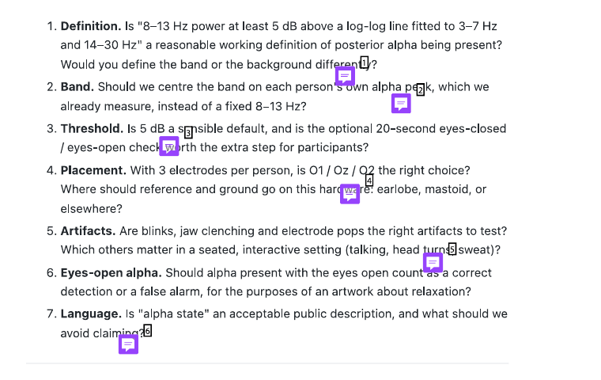

The question each note answers is given in the *Attached to* column. Notes are listed in question order; the reviewer wrote the answer to question 4 last.

| ID | Time | Attached to | Note |
|---|---|---|---|
| C14 | 19:31 | Q1 Definition | I think so? Though as I mentioned before I think there are ways to do the 1/f fitting without avoiding certain frequency bins. |
| C15 | 19:33 | Q2 Band | there is quite variability in individual alpha peak so you could select the max frequency bin within that range for each participant. I am not sure how much that will benefit you but could help strengthn the signal. but also then keep in mind definition of the 'synchrony' will be between potentially 2 different frequencies for the two subjects, so their peaks will not necessarily align. |
| C16 | 19:34 | Q3 Threshold | honestly not sure... depends on the scale that the data are recorded. You might want to try to the 20 s open vs closed just to have a ground truth/to get the algorithm to detect individual alpha? |
| C17 | 19:41 | Q4 Placement | Yea I would use these if you can, and earlobe or mastoid would be fine probably. Mastoids might be the better choice but you might want to have two ground electrodes then (one behind each earlobe) so that you can take the average and not have a bias to one hemisphere. OR put the ground at CZ (middle/centre of the head on top). Also keep in mind that the occipitals and CZ would have to be placed somehow securely through peoples' hair, so that might be an issue. |
| C18 | 19:38 | Q5 Artifacts | Sweat can introduce some v annoying slow frequency artifacts but usually those are filtered out with the high pass filter, so might be fine but definitely a concern (esp if doing at summer festivals). Also eye movements....if folks become relaxed enough they might start showing light REM which creates artifacts. |
| C19 | 19:39 | Q7 Language | I think this is valid. |

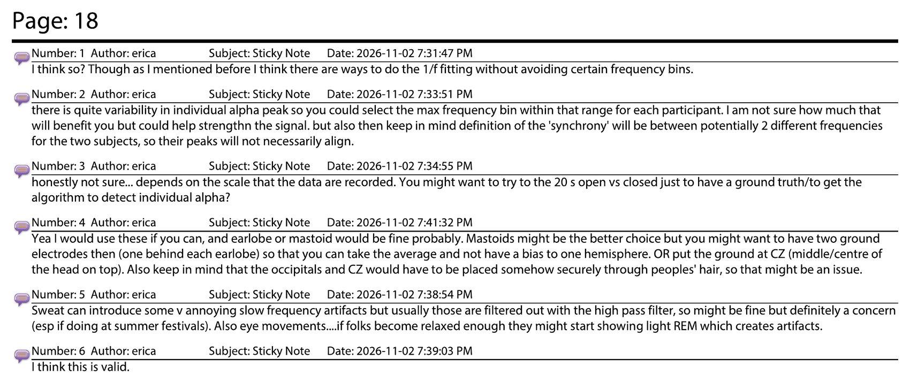

**Question 6 has no note.** It asked whether alpha present with the eyes open should count as a correct detection or a false alarm.

**Question 8 was never seen.** The reviewed copy lists seven questions. Question 8, on the muscle-tension and 1/f-exponent values, was added to the repository copy afterwards.

---

## 4. What changes

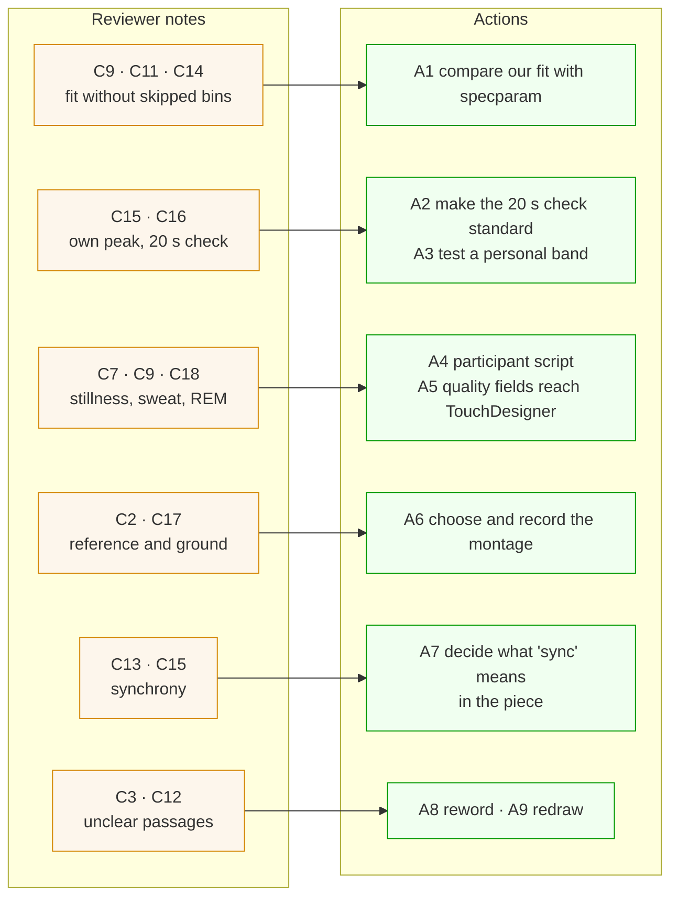

The table lists every action. *Area* says where the work lands: **doc** is the clinical review document, **detector** is `SpectralAlphaDetector` and its analysis scripts, **protocol** is how a session is run, **contract** is the data sent to TouchDesigner, and **TD** is the TouchDesigner project. *Phase* refers to phases P1–P8 of `ALPHA_DETECTION_ENGINEERING_PLAN.md` §5.

| # | Action | From | Area | Phase |
|---|---|---|---|---|
| A1 | Fit the same windows with specparam offline and compare prominence and exponent with our straight-line fit. Report the difference before changing anything. | C9, C11, C14 | detector | before P1 ships |
| A2 | Make the 20-second eyes-closed / eyes-open check a standard step of every session, not an option. | C16 | protocol, detector | P6 |
| A3 | Test a per-person alpha band centred on the peak found in A2 against the fixed 8–13 Hz band. | C15 | detector | P6 |
| A4 | Write a participant script: sit still, keep closed eyes still, relax the jaw. Give the operator a way to see when it is not being followed. | C7, C9, C18 | protocol | P5 |
| A5 | Send signal quality, artifact and muscle values to TouchDesigner so the piece can react to bad data instead of treating it as "no alpha". | C7, C9, C18 | contract | P4 |
| A6 | Choose reference and ground sites, record the choice in the hardware table, and test it on the NPG Lite. | C2, C17 | protocol, doc | P8 |
| A7 | Decide what the piece claims when both people are in alpha, and name the TouchDesigner control to match. | C13, C15 | TD, public text | before P4 |
| A8 | Reword the "18–90 counts" sentence. | C3 | doc | next revision |
| A9 | Redraw or recaption the artifact figure. | C12 | doc | next revision |
| A10 | Send question 6 again, with question 8, and the result of A1. | Q6, Q8 | doc | next revision |

### 4.1 The method: one comparison to run

**A1 is a check, not a redesign.** The reviewer's point is that the background is strongest at the lowest frequencies, so a fit that ignores them throws away its best data. Our reason for skipping below 3 Hz stands: blinks, eye movements, sweat drift and electrode movement all put energy there (C7, C18 confirm this). The two views are compatible. Specparam fits the whole range and models peaks explicitly, so a slow artifact shows up as a poor fit rather than a tilted line.

**What to measure.** On the 20-subject open dataset already used, compute for each 2 s window: our prominence, specparam's alpha peak height above its aperiodic fit, and the two exponents. If they agree within about 1 dB on clean windows, the simpler fit stays and the document says so. If they disagree on windows with slow artifacts, that is evidence for widening the fit band or for a robust fit. Specparam on a 2 s window at 1 Hz resolution is itself noisy, so the comparison should also be run on 10 s windows [inference: 2 s gives about 28 usable bins].

**A3 has a cost the reviewer names.** A personal band may strengthen the signal. It also means the two people's flags describe rhythms at two different frequencies. That is fine for "both are in alpha". It rules out any pair measure that compares phase or frequency, which the plan already excludes.

### 4.2 The session: what participants are asked to do

| Source of artifact | Reviewer's note | What we already do | What to add |
|---|---|---|---|
| Body movement | C9: higher-frequency and non-linear artifacts, hard to clean live | artifact gate holds the last decision | "sit still" in the script; muscle value visible to the operator |
| Eye movement with eyes closed | C7: move the eyes and it shows, even when closed | delta excluded from the fit | "let your eyes rest" in the script |
| Heartbeat | C7: possible, but slow | 1 Hz high-pass | nothing |
| Sweat | C18: slow drift; a concern at summer festivals | 1 Hz high-pass | watch the artifact share in hot venues; re-gel between sessions |
| Light REM in very relaxed people | C18 | none | treat a long relaxed session as a known limit; note it in §7 of the review document |
| Watching the other person move | C6: mu rhythm reacts to observed and imagined movement too | occipital placement avoids the sensorimotor strip | keep electrodes off central sites; this piece has two people facing each other, so C6 applies directly |

**Reference and ground (A6).** The reviewer's preference, in order: mastoids (the bone behind each ear), ideally one on each side so the reference is not biased to one hemisphere; or the earlobes; or Cz (top centre of the head). Occipital and Cz electrodes have to sit securely through hair. Whether the NPG Lite can take two linked reference electrodes is a hardware question we have not checked.

### 4.3 The framing: what "sync" means

**The reviewer and the document agree, and the installation does not yet.** The clinical document says two flags on at once is co-occurrence caused by a shared instruction. The reviewer writes that this matches what they said the first time they saw the system. The TouchDesigner project compares the two people's signals and fires its main transition from a control labelled "Sync Trigger".

**A7 is a decision, with two honest options:**

- **Co-occurrence.** The piece shows when both people are in an alpha state at the same time, and says so. This is what the detector can support today.
- **Synchrony.** The piece claims a link between two brains. That needs a different measurement, longer windows, and a control condition that separates shared instruction from interaction. None of it exists in the plan.

The contract plan (`TD_CONTRACT_AND_INTERACTION_PLAN.md`) is written for the first option.

### 4.4 The document: two passages to fix

**A8, the counts sentence (C3).** The sentence compared the size of alpha with the size of one step of the device's analog-to-digital converter. A reader from neuroscience has no reason to know what a count is. Suggested wording: "Alpha is typically 10–50 µV. The device measures in steps of about 0.55 µV, so alpha spans many steps and is well resolved. The device's microvolt scale is not calibrated, though, so we never compare against a fixed microvolt value."

**A9, the artifact figure (C12).** The reviewer read the green bar as detection where there should be none.

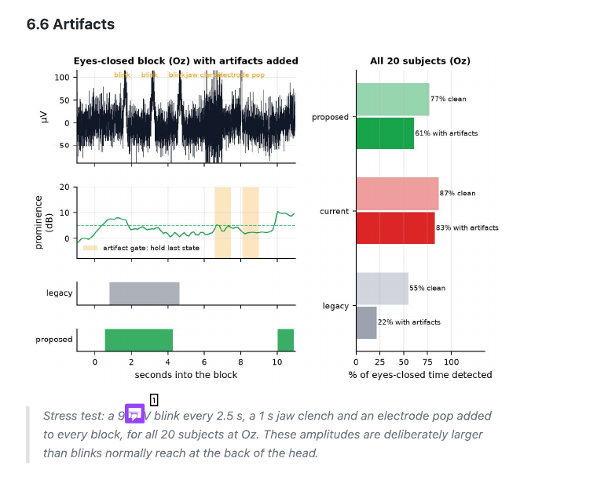

The block shown is eyes closed from start to finish, so alpha is really there and the green bar is a correct detection. The point of the figure is that added blinks and a jaw clench do not create alpha and only partly hide it. The title says "eyes-closed block" but nothing on the panel says that detection is the wanted result. The fix is a band across the top reading "eyes closed: alpha expected throughout", and a second example from an eyes-open block where the bar stays off.

---

## 5. Still open with the reviewer

| # | Question | Why it is open |
|---|---|---|
| 1 | Does our straight-line fit agree with specparam closely enough? | reviewer offered to look (C11); A1 gives them numbers to look at |
| 2 | Should eyes-open alpha count as a correct detection? | question 6 was not answered |
| 3 | Are the muscle-tension and 1/f-exponent values fair readings at O1/Oz/O2? | question 8 was added after the review |
| 4 | Is 5 dB a sensible default? | C16: "depends on the scale". The value is a ratio in dB and does not depend on the recording scale; the document should say so and ask again |
| 5 | Which reference: linked mastoids, one earlobe, or Cz? | C17 gives options; the hardware limits the choice |

---

## Glossary

| Term | Meaning |
|---|---|
| 1/f (aperiodic) background | the smooth fall of EEG power with frequency, on which rhythms sit as bumps |
| ADC count | one step of the device's 12-bit analog-to-digital converter; about 0.55 µV on the NPG Lite |
| Co-occurrence | two people's alpha flags being on at the same moment, with no claim about why |
| Cz | the electrode site at the top centre of the head |
| FOOOF / specparam | a published method that fits a power spectrum as an aperiodic background plus peaks (Donoghue et al. 2020) |
| Mastoid | the bone behind the ear; a common reference electrode site |
| Mu rhythm | an 8–13 Hz rhythm over the sensorimotor cortex, reduced by real, planned, imagined or observed movement |
| OCR | optical character recognition: turning an image of text into text |
| Prominence | 8–13 Hz power divided by the fitted background in the same band, in dB |
| REM | rapid eye movement, here the slow rolling eye movements of light sleep |
| Synchrony | a measured statistical link between two signals; here, between two people's EEG |

| Status | Item |
|---|---|
| ✅ | Annotated PDFs stored in `docs/alpha-v2/review/` |
| ✅ | All 19 notes transcribed and placed ([§3](#3-the-notes-in-full)), 2026-11-12 |
| ✅ | Method endorsed in principle by the reviewer (C1, C14) |
| ⚠️ | A1 specparam comparison not run |
| ⚠️ | A7 "sync" framing not decided |
| ⚠️ | Questions 6 and 8 not answered |
| 🔴 | A8 and A9 not applied; `ALPHA_DETECTION_CLINICAL_REVIEW.md` is unchanged |
