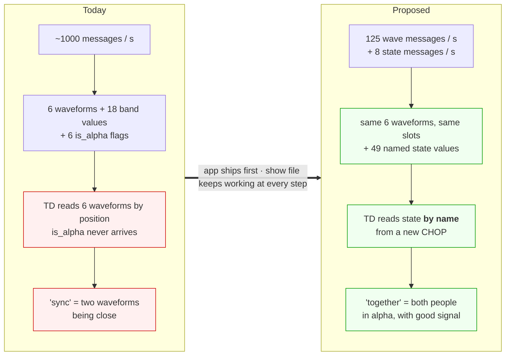
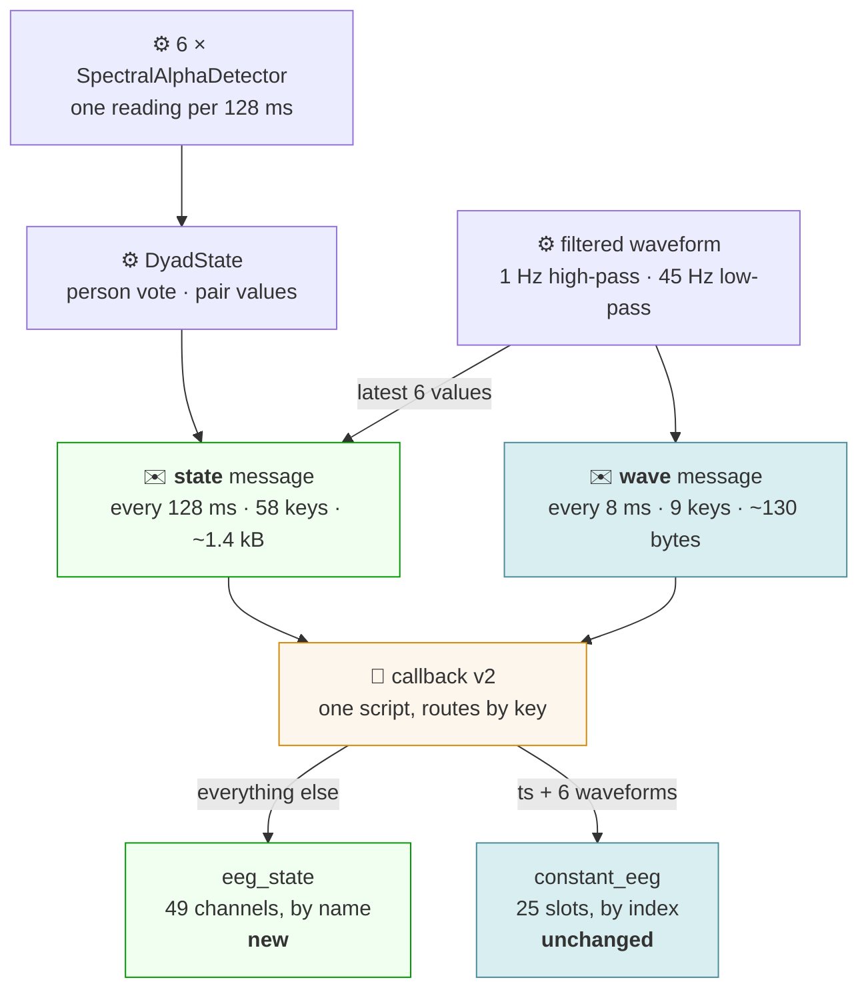
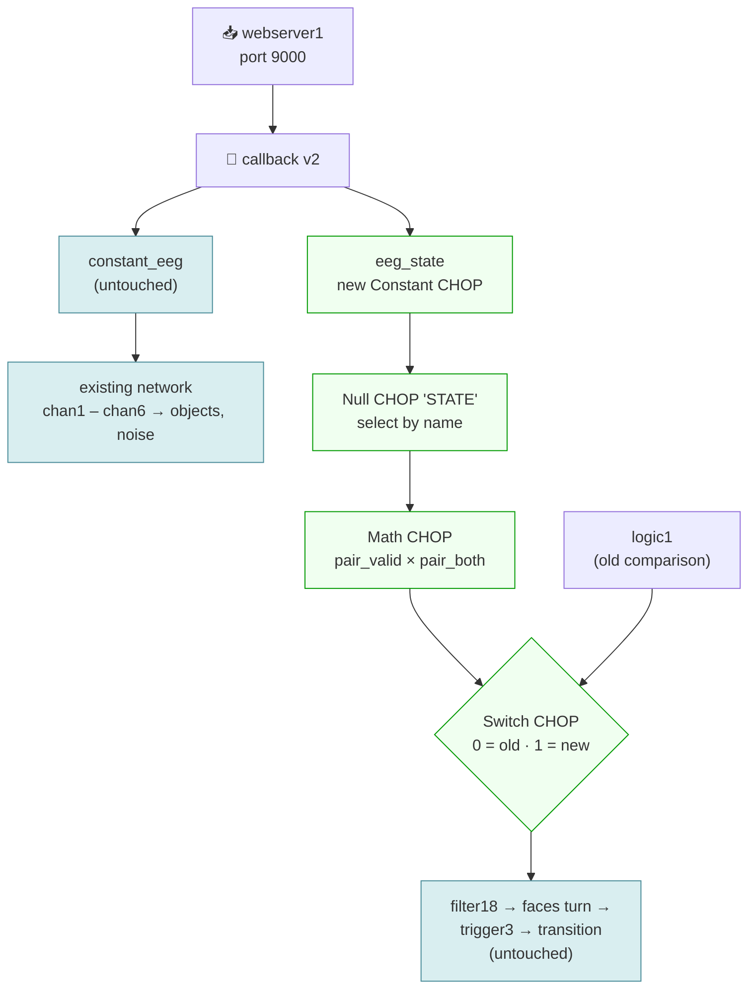
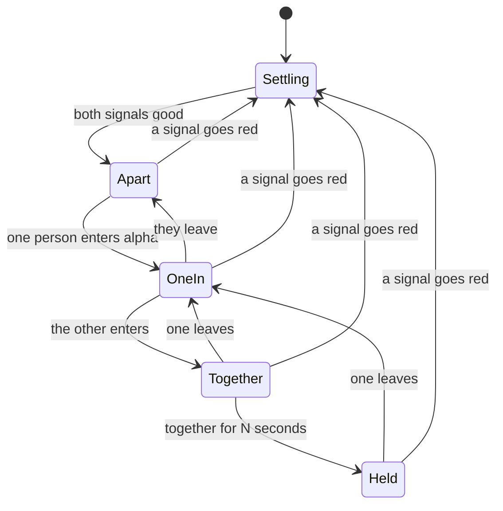
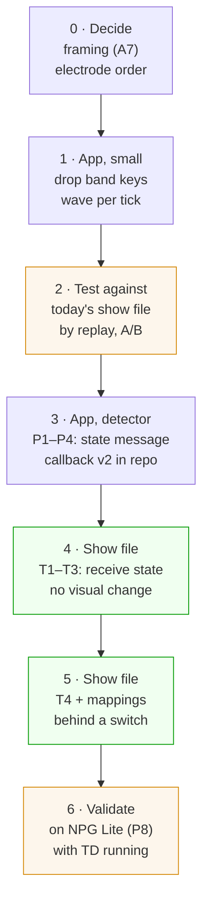

# TouchDesigner Data Contract and Two-Person Interaction Plan

How to send the new alpha detection to Kassy's TouchDesigner project without breaking what runs today, and how the piece can use it to show two people more truthfully. This revises the contract sketched in the engineering plan in the light of two things learned since: what the clinical reviewer said, and what the TouchDesigner files actually read.

> *Builds on: `ALPHA_DETECTION_ENGINEERING_PLAN.md` §6.4 (contract v2, 2026-10-29), `CLINICAL_REVIEW_FEEDBACK.md` (review of 2026-11-02) and `TOUCHDESIGNER_NETWORK_ANALYSIS.md` (project file of 2026-09-11). Written 2026-11-12. Nothing here is implemented or tested in TouchDesigner; field values in examples are illustrative.*

---

## 1. Summary



**The existing piece keeps working at every step.** The six waveform values stay in the same message keys and the same TouchDesigner slots. The app can ship its changes before anyone touches the show file, and the show file can be updated before the app, in either order ([§5](#5-compatibility-the-four-combinations)).

**The new detection arrives as named values.** A second kind of message, eight times a second, carries each person's alpha state, signal quality and a small set of pair values. TouchDesigner (TD) writes them into a new CHOP (channel operator: a node carrying streams of numbers) and reads them by name, so adding a field later never rewires anything.

**The piece's central moment gets a better input.** TD already stages a "sync" moment well: a 0/1 signal eases over 3 seconds, two faces turn to each other, a transition plays. That staging stays. Its input changes from "two waveforms are close" to "both people are in alpha and both signals are good".

**Three changes to the earlier contract come from the TD files, four from the review:**

| # | Change to engineering plan §6.4 | Why |
|---|---|---|
| R1 | Every message carries the six waveform keys, including `state` messages | the current callback writes 0 for any key a message lacks; a state message without them would blank the visuals 8 times a second |
| R2 | Waveform messages drop from one per sample (~1000/s) to one per 8 ms tick (125/s) | TD samples the latest value 60 times a second; the rest is discarded |
| R3 | The alpha, theta and delta band keys are removed now, not "after asking" | no operator in V13–V15 reads them |
| R4 | Add `alpha_level` (0–1) per person and `pair_level` for the pair | TD maps everything through 0–1 ranges; dB needs translating somewhere, and the app knows each person's range |
| R5 | Add `calibrated` per person; the 20-second check becomes standard | reviewer note C16 |
| R6 | Add `artifact_share` per person | reviewer notes C7, C9, C18: stillness and sweat are the main risks, and the piece should be able to show them |
| R7 | Pair values are named and described as being in alpha *at the same time*, never as synchrony | reviewer notes C13, C15 |

---

## 2. Constraints

Each row is a fact about the system as it stands, and what it forces.

| # | Constraint | Source | Consequence for the contract |
|---|---|---|---|
| K1 | The callback writes 25 slots by index; a Rename CHOP then calls them `chan0`–`chan24`; visuals select `chan1`–`chan6` | TD analysis §3, §4 | slots 0–6 are frozen: same keys, same order, same scale |
| K2 | The callback reads each key with `msg.get(key, 0)` | `touchdesigner_websocket.py:30-70` | a message missing a waveform key zeroes that slot (R1) |
| K3 | The callback target is `op('constant_eeg')` | same file, line 25 | the legacy CHOP keeps its name; new values go elsewhere |
| K4 | TD cooks 60 times a second and holds only the latest value | TD analysis §3.1 | anything faster than ~125 messages a second is wasted work (R2) |
| K5 | `.chan` recordings are 25 columns in slot order | TD analysis §6 | the legacy CHOP's layout must not change, or old recordings replay wrongly |
| K6 | Each of the 3 channels per person has a different job in the piece | TD analysis §4 | per-channel values stay in the contract; electrode plug order must be fixed and written down |
| K7 | Detection is reliable for posterior alpha only | engineering plan §6.1 | no theta, beta, "focus" or "meditation" fields |
| K8 | Two flags on together is co-occurrence, not coupling | clinical review §7; reviewer C13 | no correlation, coherence or phase fields; careful names (R7) |
| K9 | People's alpha peaks differ in frequency | reviewer C15 | pair values compare states, never frequencies or phase |
| K10 | The detector takes a median 1.3 s to switch on and 1.9 s to switch off | clinical review §6.5, measured 2026-10-24 on open data | TD smoothing on top of this should be short ([§7.3](#73-timing)) |

---

## 3. The contract



**Two message types on one socket, port 9000, as today.** Both are JSON text. Sizes are estimates from the key lists.

- **`wave`**: `type`, `v`, `ts` and the six waveform keys. Sent on every stream-clock tick (8 ms), carrying the latest filtered value of each channel.
- **`state`**: everything in `wave`, plus every key in [§3.2](#32-the-state-keys) to [§3.4](#34-pair-keys). Sent on every 16th tick (128 ms), which is the detector's own update interval. **Every key is present in every state message**, so TD channels never appear or disappear.

### 3.1 Keys that do not change

| Key | Slot in `constant_eeg` | Meaning |
|---|---|---|
| `ts` | 0 | `performance.now()` in ms |
| `d1_ch0`, `d1_ch1`, `d1_ch2` | 1, 2, 3 | person 1's filtered waveform, as sent today |
| `d2_ch0`, `d2_ch1`, `d2_ch2` | 4, 5, 6 | person 2's filtered waveform, as sent today |

Slots 7–24 remain in the CHOP and read 0. They are left in place so that old recordings and the Rename CHOP's `chan[0-24]` pattern keep working.

### 3.2 The state keys

Person keys are shown for `d1_`; `d2_` is identical. *Range* is what TD can expect, so that a Math CHOP can map it without guessing.

| Key | Range | Meaning |
|---|---|---|
| `type`, `v` | `"state"`, `2` | message type and schema version; not written to a channel |
| `d1_alpha` | 0 / 1 | this person is in alpha: at least half of their usable channels are on |
| `d1_alpha_level` | 0 – 1 | **new (R4).** How far into alpha, scaled to this person: 0 at their exit level, 1 at their eyes-closed level from the 20-second check (or 12 dB if not calibrated) |
| `d1_alpha_prom` | about −5 – 20 dB | median prominence over usable channels: how far 8–13 Hz power stands above the 1/f background |
| `d1_alpha_iaf` | 8 – 13 Hz, or 0 | this person's alpha peak frequency; 0 while `d1_alpha` is 0 |
| `d1_alpha_s` | seconds ≥ 0 | how long the current alpha stretch has lasted; 0 when off |
| `d1_muscle_db` | about −5 – 20 dB | 32–45 Hz power above the 1/f line; mostly jaw, neck and forehead muscle, not brain |
| `d1_aperiodic` | about 0.5 – 3 | the 1/f exponent, smoothed over ~10 s; experimental until the reviewer's fit comparison is done |
| `d1_artifact_share` | 0 – 1 | **new (R6).** Share of the last 10 s in which the artifact gate was holding: a restlessness and contact measure |
| `d1_quality` | 0 / 1 / 2 | good / amber / red, from mains pickup, `artifact_share` and usable-channel count |
| `d1_usable` | 0 – 3 | channels counted in the vote |
| `d1_calibrated` | 0 / 1 | **new (R5).** The 20-second eyes-closed / eyes-open check has been run for this person in this session |

### 3.3 Per-channel keys

Kept because the piece is built per channel (K6). Shown for `d1_ch0_`; there are six sets.

| Key | Range | Meaning |
|---|---|---|
| `d1_ch0_is_alpha` | 0 / 1 | this electrode's flag. **Name unchanged** from what the app sends today |
| `d1_ch0_alpha_prom` | dB | this electrode's prominence |
| `d1_ch0_artifact` | 0 / 1 | this electrode's current window was rejected and its flag is being held |

### 3.4 Pair keys

| Key | Range | Meaning |
|---|---|---|
| `pair_valid` | 0 / 1 | both people's `quality` is good or amber. **When 0, ignore every other pair key** |
| `pair_both` | 0 / 1 | both people are in alpha now |
| `pair_either` | 0 / 1 | at least one is |
| `pair_both_s` | seconds ≥ 0 | how long both have been in alpha together |
| `pair_level` | 0 – 1 | **new (R4).** The lower of the two `alpha_level` values: how far *both* are in |
| `pair_min_prom` | dB | the lower of the two prominences |
| `pair_balance` | −15 – 15 dB | `d1_alpha_prom − d2_alpha_prom`; positive means person 1 is further in |
| `pair_lead` | −1 / 0 / 1 | who entered alpha first in the current together-stretch: 1 = person 1, −1 = person 2 |
| `pair_lead_s` | seconds ≥ 0 | by how long |

**Totals.** A state message has 58 keys: 3 header, 6 waveform, 22 person, 18 channel, 9 pair. TD's `eeg_state` gets 49 channels (the person, channel and pair keys).

```json
{"type":"state","v":2,"ts":81234.5,
 "d1_ch0":-0.21,"d1_ch1":0.08,"d1_ch2":0.11,"d2_ch0":0.02,"d2_ch1":-0.14,"d2_ch2":0.05,
 "d1_alpha":1,"d1_alpha_level":0.72,"d1_alpha_prom":8.4,"d1_alpha_iaf":10,"d1_alpha_s":6.3,
 "d1_muscle_db":1.2,"d1_aperiodic":1.61,"d1_artifact_share":0.05,"d1_quality":0,"d1_usable":3,"d1_calibrated":1,
 "d2_alpha":1,"d2_alpha_level":0.44,"…":"10 more d2 keys, 18 per-channel keys",
 "pair_valid":1,"pair_both":1,"pair_either":1,"pair_both_s":2.1,"pair_level":0.44,
 "pair_min_prom":5.9,"pair_balance":2.5,"pair_lead":1,"pair_lead_s":4.2}
```

*Illustrative values, not measured.*

### 3.5 What is deliberately not sent

- **Theta, delta, beta, gamma, "focus", "meditation".** Three occipital electrodes and a 2-second window cannot support them (K7).
- **Any measure of one brain against the other**: correlation, coherence, phase locking. The reviewer's point C15 adds a second reason to the ones already in the plan: the two people's alpha may sit at different frequencies.
- **Events** such as "alpha started". TD derives them from the 0/1 channels with a Trigger CHOP.

---

## 4. The TouchDesigner side



**Four additions, no deletions.** Green nodes are new; blue nodes are what exists and is not edited.

| Step | In `/project1/SYNCD/container1websocket_example` unless stated | Risk to the running piece |
|---|---|---|
| T1 | Add a Constant CHOP named `eeg_state` with 49 channels | none: nothing reads it yet |
| T2 | Replace the text of `webserver1_callbacks1` with callback v2 from this repository | low: the waveform path is the same six lines as before |
| T3 | Add a Null CHOP `STATE` after `eeg_state`, and an Out CHOP so `SYNCD` can read it | none |
| T4 | In `SYNCD`: multiply `pair_valid` by `pair_both`, and put a Switch CHOP between `logic1` and `filter18` with the old comparison on input 0 and the new product on input 1 | none while the switch is on 0; one click to compare old and new |

**Callback v2, as a sketch.** It writes the waveform exactly as today, then writes any other numeric key into `eeg_state` by name. It does not depend on `type`, so it also works against today's app. *Untested: the parameter names `const0name` / `const0value` are taken from the expanded project file and should be confirmed in TD 2025.*

```python
import json

WAVE = ('ts', 'd1_ch0', 'd1_ch1', 'd1_ch2', 'd2_ch0', 'd2_ch1', 'd2_ch2')
SKIP = set(WAVE) | {'type', 'v'}
STATE_KEYS = []          # filled from the first state message, then fixed

def onWebSocketReceiveText(dat, client, data):
    try:
        msg = json.loads(data)
    except json.JSONDecodeError:
        return
    legacy = op('constant_eeg')
    for i, k in enumerate(WAVE):               # slots 0-6, as before
        if k in msg:                           # never write a 0 for a missing key
            legacy.par[f'const{i}value'] = msg[k]
    state = op('eeg_state')
    if state is None or msg.get('type') != 'state':
        return
    if not STATE_KEYS:
        STATE_KEYS.extend(k for k in msg if k not in SKIP)
        for i, k in enumerate(STATE_KEYS):
            state.par[f'const{i}name'] = k
    for i, k in enumerate(STATE_KEYS):
        state.par[f'const{i}value'] = msg.get(k, 0)
```

**Recording.** Leave `fileout1` on `constant_eeg`, so new recordings stay compatible with old ones. Add a second File Out CHOP on `eeg_state` if state should be recorded in TD. The app's own recorder remains the reference recording, because it stores raw samples and can re-run the detector.

---

## 5. Compatibility: the four combinations

The app and the show file will not be updated at the same moment. Each cell says what the audience sees.

| | **Show file as it is today** | **Show file with T1–T4** |
|---|---|---|
| **App as it is today** | today's piece | today's piece; `eeg_state` stays at 0, so `pair_valid` is 0 and the switch should stay on old |
| **App with the new contract** | today's piece, unchanged: the waveform keys are in every message (R1), band slots read 0 and nothing uses them (R3), state keys are ignored | the new piece |

**The cell that matters is top-right to bottom-left: neither order of deployment breaks the show.** That holds only if R1 is honoured. A state message without the waveform keys, fed to today's callback, would write six zeros into the slots that drive every visual.

**One behaviour does change with the new app and the old show file: the message rate (R2).** The analysis predicts no visible difference, because TD only ever kept the latest value per frame. This is the one prediction to test before a show ([§8](#8-rollout), step 2).

---

## 6. What the review changes in the contract

| Reviewer note | Effect on what is sent |
|---|---|
| C16: run the 20-second open/closed check as ground truth | `d*_calibrated`; `alpha_level` is scaled to the person's own range when it is 1 |
| C15: use each person's own alpha peak; the two peaks will differ | `d*_alpha_iaf` stays, per person. No pair key compares frequencies |
| C7, C9: participants must keep body and eyes still | `d*_artifact_share` and `d*_muscle_db` let the piece and the operator see restlessness |
| C18: sweat drift, light REM when very relaxed | `d*_quality` turns amber or red on a high artifact share; `pair_valid` protects the pair moment |
| C2, C17: reference and ground sites affect detection | not a contract matter, but the electrode-to-channel order must be fixed (K6) once the montage is chosen |
| C9, C11, C14: check the 1/f fit against specparam | `d*_aperiodic` is marked experimental until that comparison is done; `alpha_prom` may shift by a constant if the fit changes, which is another reason TD should prefer `alpha_level` |
| C13: how much does the piece care about real synchrony? | pair keys describe co-occurrence only ([§7.4](#74-what-the-piece-can-honestly-say)) |

---

## 7. The two-person experience

### 7.1 States the pair can be in



Each state is a plain reading of the pair keys. *N* is an artistic choice; the current network effectively uses about 3 seconds.

| State | Condition | Meaning |
|---|---|---|
| Settling | `pair_valid` = 0 | at least one headset has poor contact, heavy movement or no calibration |
| Apart | `pair_valid` = 1, `pair_either` = 0 | both signals good, neither person in alpha |
| One in | `pair_either` = 1, `pair_both` = 0 | one person is in alpha; `d1_alpha` / `d2_alpha` say who |
| Together | `pair_both` = 1 | both in alpha now |
| Held | `pair_both_s` ≥ N | both have stayed in alpha |

**The current piece has two of these five states.** It distinguishes "close" from "not close". It cannot show one person waiting for the other, and it cannot tell a lost signal from a quiet one. Those two additions are where the new data changes the experience most.

### 7.2 Mapping the data onto the existing network

Every row is a proposal for Kassy, not a requirement. *Feeds* names an operator that exists in V15, so each can be tried by re-pointing one input.

| Moment | Data | Feeds | Suggested look |
|---|---|---|---|
| Each person's raw liveliness | `d1_ch0`…`d2_ch2` waveform | as now | unchanged: texture and motion |
| A person settling into alpha | `d1_alpha_level`, `d2_alpha_level` | scale the output of `ScolorSpeedR` / `ScolorSpeedL` by (1 − 0.7 × level) | that person's object slows and steadies as they go in |
| One person is in, the other is not | `d1_alpha`, `d2_alpha` | `FrotatepositionR` / `FrotatepositionL`, separately | the face of the person in alpha turns half-way; the other stays turned away. An invitation |
| Both in | `pair_valid × pair_both` | `filter18` (through the T4 switch) | as now: both faces complete the turn |
| Both stay in | `pair_both_s` | the threshold of `trigger3`, or a new Trigger CHOP | the transition fires on time held together, not on an angle |
| How deep, together | `pair_level` | `Noise10exponent` or the bloom level | the shared image clarifies as both go further in |
| Who is further in | `pair_balance` | left/right weight of the two noise layers | the image leans gently toward the deeper person |
| Who arrived first | `pair_lead` | direction of the `switch1` cross-fade | the transition sweeps from the side that was waiting |
| Tension or movement | `d1_muscle_db`, `d1_artifact_share` | `Noise2HarmonicGain` (currently set to 0) | roughness on that person's side: a visible cue to be still |
| Lost contact | `d1_quality` = 2 | saturation or level of that person's object | that side fades to grey rather than acting calm |
| Each person's own rhythm | `d1_alpha_iaf` | a slow hue offset per side | two slightly different colours; makes C15 visible instead of hiding it |

### 7.3 Timing

```mermaid
gantt
    dateFormat ss
    axisFormat %S s
    todayMarker off
    section Today's staging
    detector switches on (median 1.3 s)      :crit, a1, 00, 1300ms
    filter18 eases over 3 s, trigger at 5°   :active, a2, after a1, 2700ms
    section Shorter ease
    detector switches on (median 1.3 s)      :crit, b1, 00, 1300ms
    filter18 at 1.5 s                        :active, b2, after b1, 1350ms
```



**The detector already waits before it speaks.** It needs about 1.3 s after eye closure to switch on and 1.9 s after eye opening to switch off (median, open data, 2026-10-24). When two people close their eyes together, "both" follows the slower of the two [infer].

**The 3-second ease was tuned for a noisy input.** With today's staging, the faces would meet roughly 4 seconds after both people settle [projected: 1.3 s plus about 2.7 s of a 3 s ease]. Because the new 0/1 input no longer flickers, the ease can be shortened to taste. Halving it brings the moment to about 2.7 s. The detector's own 1.3 s cannot be shortened without losing reliability.

**Leaving is slower than arriving.** The flag takes longer to clear than to set. A piece that punishes leaving alpha abruptly will feel late; one that lets "together" fade over a couple of seconds will feel right.

### 7.4 What the piece can honestly say

| Say | Avoid |
|---|---|
| "both of you are in an alpha state at the same time" | "your brains are in sync" |
| "your alpha rhythm" | "your brainwaves are matching" |
| "relaxed, eyes-closed alpha" | "meditation", "focus", "calm score" |
| "muscle tension" for `muscle_db` | "gamma" or "high brain activity" |

**The operator control "Sync Trigger" should be renamed if the team chooses co-occurrence** (review action A7). "Together" or "Hold time" describe what it would then set.

---

## 8. Rollout



| Step | Who | What | Done when |
|---|---|---|---|
| 0 | team | choose the framing; fix which electrode is channel 0, 1, 2 | written into both documents |
| 1 | app | `WebSocketStreamer.sendFiltered`: remove band keys; call it from the stream-clock tick instead of per sample; add `type` and `v` | messages are 9 keys at 125/s |
| 2 | app + Kassy | play one app recording through Replay into the unmodified V15, once with the old app and once with step 1; screen-record both | no visible difference; if there is one, restore the per-sample rate and investigate before going on |
| 3 | app | engineering plan P1–P4: detector, `DyadState`, `sendState()`; update `touchdesigner_websocket.py` to callback v2 | state messages match [§3](#3-the-contract); fixture test for vote, timers and `pair_valid` |
| 4 | Kassy | T1–T3 | `STATE` shows 49 named channels moving during a replay |
| 5 | Kassy | T4, then mappings from [§7.2](#72-mapping-the-data-onto-the-existing-network) | old and new can be compared with one switch |
| 6 | team | engineering plan P8 with TD running: eyes open / closed blocks, one person then both | "Together" matches what the two people were doing |

**Kassy can build without headsets.** The app's Replay mode pushes a recorded session through the same detector and the same socket, so steps 4 and 5 need only a recording and a browser.

**Code touched in this repository** (unchanged from engineering plan §6.5, plus R1–R6):

| File | Change |
|---|---|
| `src/services/WebSocketStreamer.ts` | `sendWave()` on tick; `sendState()` on every 16th tick, including the waveform keys; band setters removed |
| `src/components/DyadState.ts` (new) | person vote, stretch timers, pair keys, `alpha_level`, `artifact_share` |
| `src/components/SpectralAlphaDetector.ts` | expose slope and 32–45 Hz excess |
| `src/app/dual-stream/page.tsx` | stop calling the streamer per sample; pass personal-check results to `DyadState` |
| `touchdesigner_websocket.py` | callback v2 |

---

## 9. Open questions

**For Kassy:**

1. Is the 3-second ease on the faces an artistic choice, or was it there to hide a flickering input?
2. Channel 1 of each person is the one compared for sync, and channel 0 sets position. Was that deliberate? With O1 / Oz / O2 placement, which electrode should be which channel?
3. Should a participant see that their signal is poor, or only the operator?
4. Does the second scene (`Wave-container`, "Otherworld") need EEG?
5. Are the `.chan` recordings used for anything besides testing visuals?

**For the team:**

6. Co-occurrence or synchrony (review action A7)?
7. Is the 20-second check acceptable at the start of every session (R5)? Without it, `alpha_level` uses a default range and weak-alpha people will look shallower than they are.
8. What should *N* be for "Held"?

**Not yet known:**

9. Whether `alpha_level`'s default ceiling of 12 dB is right. It is a guess from the 5–15 dB range seen on open data.
10. Whether the rate change (R2) is truly invisible. Step 2 tests it.
11. Whether `const0name` / `const0value` are the right parameter names to set from Python in this TD build.

---

## Glossary

| Term | Meaning |
|---|---|
| Alpha level | prominence rescaled to 0–1 for one person, between their exit level and their eyes-closed level |
| Callback | the Python script TouchDesigner runs for each WebSocket message |
| CHOP | channel operator: a TouchDesigner node carrying streams of numbers |
| Co-occurrence | both people's alpha flags on at the same moment, with no claim about why |
| Cook | one update of the TouchDesigner network; 60 a second in this project |
| `DyadState` | the planned app module that turns six channel readings into person and pair values |
| Prominence | 8–13 Hz power divided by the fitted 1/f background in the same band, in dB |
| Slot | one of the 25 indexed values of the `constant_eeg` CHOP |
| Stream-clock tick | the app's background-safe 8 ms timer (`workers/streamClockWorker.ts`) |
| Usable channel | a channel switched on by the operator whose quality is not red |
| `wave` / `state` | the two message types: waveform every 8 ms, detection values every 128 ms |

| Status | Item |
|---|---|
| ✅ | TD constraints established from the project files (K1–K6) |
| ✅ | Review notes mapped to contract changes ([§6](#6-what-the-review-changes-in-the-contract)) |
| ⚠️ | Contract specified here; not implemented in the app |
| ⚠️ | Callback v2 is a sketch, not run in TouchDesigner |
| ⚠️ | `alpha_level`, `artifact_share`, `muscle_db`, `aperiodic` and the person vote are unmeasured proposals |
| 🔴 | Framing decision (A7) and electrode order (K6) not made |
| 🔴 | No end-to-end test with headsets and TD together |
