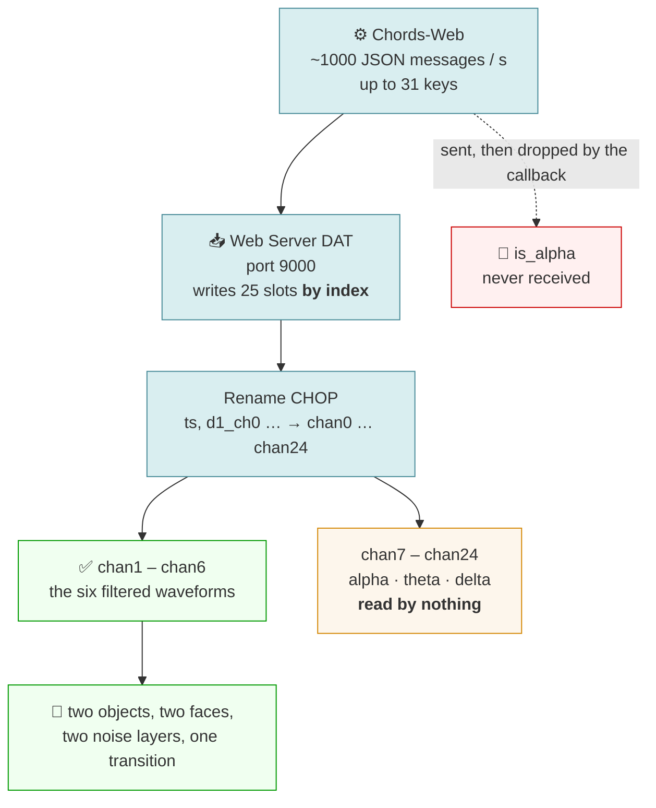
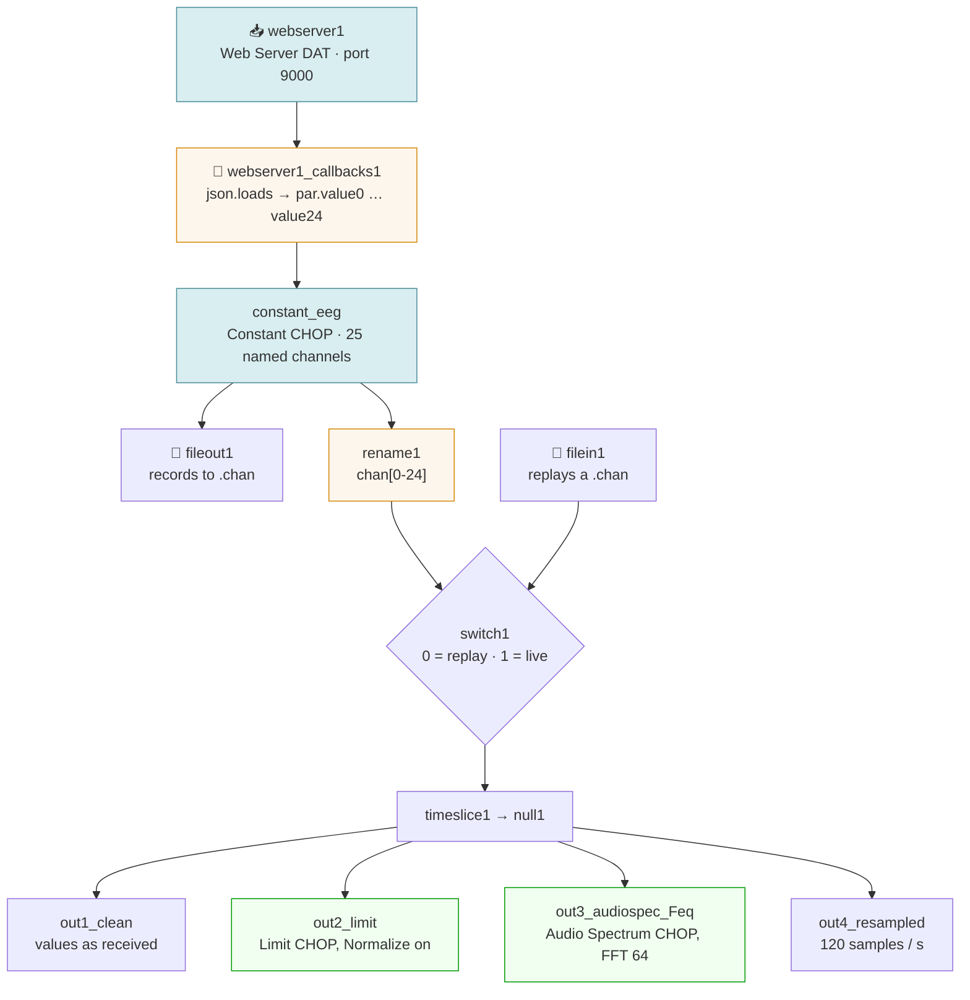
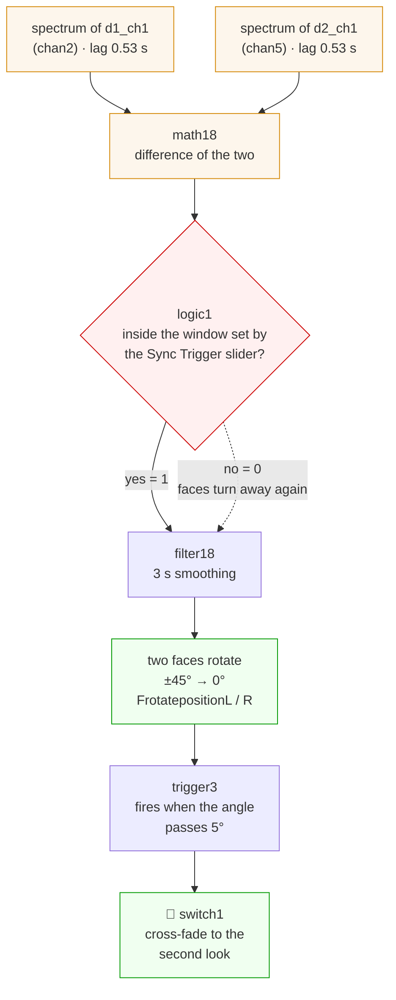

# How the TouchDesigner Project Uses the EEG Stream

A reading of Kassy's TouchDesigner project files, to find out exactly which values from Chords-Web the artwork consumes and how. The project reads the stream by position, uses six of its 25 values, and builds its central "sync" moment from a comparison the new alpha detector can replace. Those facts set the rules for changing the data contract without breaking the piece.

> *Source: `TD.zip`, received 2026-11-12 (287 MB, 187 files). Project files were expanded to text with TouchDesigner's own `toeexpand` tool, taken from the official 2025.33230 installer. Everything below is read from `20260108_Iterface2V15_Otherworld.toe`, saved 2026-09-11, unless a version is named. Nothing was opened in TouchDesigner itself, so statements about what appears on screen are marked [infer].*

---

## 1. Summary

**The artwork runs on the six filtered waveforms and nothing else.** Every visual that reacts to EEG reads `chan1` to `chan6`, which are `d1_ch0` … `d2_ch2`: one filtered voltage trace per electrode. The 18 alpha, theta and delta slots are filled and recorded, and no operator reads them. The `is_alpha` flag, the only detection result the app produces, is not in the callback and never arrives.

**The stream is consumed by position.** The callback writes each JSON key into a fixed numbered slot. A Rename CHOP (a CHOP, or channel operator, is TouchDesigner's node type for streams of numbers) then discards the names and calls the slots `chan0` to `chan24`. Every downstream operator selects by those numbers. Moving, inserting or removing a slot among the first seven would silently rewire the piece.

**The central moment is a comparison of two people's waveforms.** A control named "Sync Trigger" sets how close person 1's and person 2's second-electrode signals must be. When they are close, two faces turn toward each other and a transition plays. This is not an alpha measure, and the clinical reviewer has cautioned against calling it synchrony (`CLINICAL_REVIEW_FEEDBACK.md` §4.3).

**The four open questions in the engineering plan now have answers** ([§7](#7-answers-to-the-engineering-plans-open-questions)): no visual uses the band keys; the piece is per channel, not per person; the waveform is a modulator, not a drawn trace; and the main moment is a pair moment.

| Fact | Value |
|---|---|
| Project file analysed | `20260108_Iterface2V15_Otherworld.toe`, 630 operators |
| TouchDesigner build / platform | 2025.31310, saved on Windows |
| Cook rate (how often the network updates) | 60 per second |
| Receiver | Web Server DAT, port 9000, WebSocket text |
| Slots written per message | 25, by index |
| Slots read by any visual | 6 (`chan1`–`chan6`) |
| Operators that select EEG channels | 16 Select CHOPs |
| Callback script | byte-identical to `touchdesigner_websocket.py` in this repository |

---

## 2. What is in the folder

| Item | Count | Notes |
|---|---|---|
| Project versions (`.toe`) at top level | 31 | `Iterface2-0` (2026-01-18) to `V15_Otherworld` (2026-09-11) |
| Autosaved versions in `Backup/` | 78 | increments of the same files |
| EEG recordings (`.chan`) | 17 | 2026-03-29 to 2026-05-10; 25 columns each ([§6](#6-recording-and-replay-inside-touchdesigner)) |
| Face and object models (`.obj` + `.mtl`) | 24 pairs | `Face-mono`, `Face-duo`, `Face-Tri` …; `SPHERE`, `SQUARE`, `TRI`, `DECH` "object only" |
| Blender sources (`.blend`) | 5 | up to 314 MB each |
| Generated figures (`.glb`) | 5 | Meshy AI people and trees |
| Component (`.tox`) | 1 | `Wave-container.tox`, a second scene |
| `howto/` note | 1 | steps to start Chords-Web on the show machine |

**Nothing from the zip was copied into the repository.** The models and Blender files are 825 MB unpacked. The `howto` note contains a machine account password in plain text; it should be removed from the shared folder and is not reproduced here.

### 2.1 Version history of the EEG wiring

The table tracks one thing across versions: whether the receiver exists and whether any visual is wired to it.

| Version | Saved | Operators | Receiver | Visuals wired to EEG |
|---|---|---|---|---|
| `Iterface2-0` | 2026-01-18 | 359 | none | none (audio-driven) |
| `V6.5` | 2026-03-31 | 885 | ✅ port 9000, 25 slots | none yet |
| `V13` | 2026-05-14 | 492 | ✅ | ✅ 16 selects |
| `V14` | 2026-06-01 | 630 | ✅ | ✅ 16 selects |
| `V15_Otherworld` | 2026-09-11 | 630 | ✅ | ✅ same network as V14 |

**V15 differs from V14 only in a table and some annotation text**, so the wiring described here has been stable since June. The first recordings are dated 2026-03-29, two days before V6.5, so the receiver was in place by then [infer].

---

## 3. The receiver

> *Source: `/project1/SYNCD/container1websocket_example` in V15.*

**One component receives everything.** It is a container named `container1websocket_example` inside `SYNCD`, the component that holds the whole EEG piece. A DAT (data operator; here a Web Server DAT) listens on port 9000. Its callback script is the one kept in this repository as `touchdesigner_websocket.py`, unchanged. A second DAT in the container, `webserver1_callbacks`, is TouchDesigner's default echo template and is not connected.

**The callback writes by index.** For each message it sets `constant_eeg.par.value0` from `ts`, `value1` from `d1_ch0`, and so on to `value24` from `d2_ch2_delta`. Each read is `msg.get(key, 0)`: **a key missing from a message is written as zero**. That detail decides how new message types must be introduced ([§8](#8-what-this-means-for-the-contract), rule 2).

**The names are thrown away immediately.** `rename1` renames all 25 channels to `chan0` … `chan24`. From there on, `chan1` means "whatever was in slot 1".

**Four versions of the signal leave the container.** Only two are used by visuals:

| Output | What it is | Used by |
|---|---|---|
| `out2_limit` → `null18_limited` | the latest values through a Limit CHOP with Normalize on | 7 selects: positions and noise shape |
| `out3_audiospec_Feq` → `null17_audiospec_freq` | an Audio Spectrum CHOP (FFT size 64) run on the six waveforms | 9 selects: rotation, colour speed, the sync comparison |
| `out1_clean` → `null17_clean` | values as received | a monitoring Trail only |
| `out4_resampled` → `null18_resampled` | resampled to 120 per second | a monitoring Trail only |

### 3.1 What TouchDesigner actually sees of the waveform

**The Constant CHOP holds one value per slot, and the network reads it 60 times a second.** Chords-Web sends a message for every sample of either headset, about 1000 a second (`ALPHA_DETECTION_ENGINEERING_PLAN.md` §6.3, T1). Each message overwrites the last. When the network cooks, it sees whichever value arrived most recently. The other 940 or so messages per second are parsed by the Python callback and then discarded [infer: follows from a Constant CHOP having no history and a cook rate of 60].

**The "spectrum" is therefore a spectrum of a 60-per-second series, not of the EEG.** A signal sampled 60 times a second can represent frequencies up to 30 Hz. The app's filtered waveform contains energy up to 45 Hz, so the top of it folds back onto lower bins. With an FFT size of 64, the Audio Spectrum CHOP is looking at roughly one second of data [infer]. The visuals respond to it and it looks alive, but it should not be read as alpha, theta or any named band.

**Most consumers read a single number from it.** Expressions such as `op('ScolorSpeedR')['chan1']` evaluate one sample of a multi-sample channel. For a spectrum that is one bin, most likely the lowest [infer: not verified in a running project].

---

## 4. Slot by slot

How to read the table: *Slot* is the index the callback writes and the `chanN` name used downstream. *Readers* are the named Null CHOPs that Kassy's network uses as hand-off points, with the parameter each finally drives.

| Slot | Key | Person | Readers and what they drive |
|---|---|---|---|
| 0 | `ts` | — | passed out of `SYNCD` as `out1`; no visual |
| 1 | `d1_ch0` | 1 | `SpositionR` → right object height · `Noise10exponent` → noise layer A contrast · `Noise2HarmonicGain` → noise layer B (gain set to 0) · `ScolorSpeedR` → right object rotation X · `Noise2harmonicSpeed` → noise layer B spread |
| 2 | `d1_ch1` | 1 | `ScolorSpeedR` → right object rotation Y · **sync comparison** · face colour speed · both-rotation speed |
| 3 | `d1_ch2` | 1 | `ScolorSpeedR` → right object rotation Z |
| 4 | `d2_ch0` | 2 | `SpositionL` → left object height · `Noise10period` → noise layer A scale · `BNoise2period` → noise layer B scale · `NOise2exponent` → noise layer B contrast · `ScolorSpeedL` → left object rotation X |
| 5 | `d2_ch1` | 2 | `ScolorSpeedL` → left object rotation Y · **sync comparison** · face colour speed · both-rotation speed |
| 6 | `d2_ch2` | 2 | `ScolorSpeedL` → left object rotation Z |
| 7–9 | `d1_ch*_alpha` | 1 | ⚠️ none |
| 10–15 | `d1_ch*_theta`, `_delta` | 1 | ⚠️ none |
| 16–18 | `d2_ch*_alpha` | 2 | ⚠️ none |
| 19–24 | `d2_ch*_theta`, `_delta` | 2 | ⚠️ none |
| — | `d*_ch*_is_alpha` | — | 🔴 not in the callback; dropped |

**Person 1 is on the right and person 2 on the left.** Device 1's slots drive the operators suffixed `R` and an object placed at x = +9. Device 2's drive the `L` operators and an object at x = −9.

**Every path is smoothed.** Each select feeds a Filter CHOP with a width between 0.28 s and 10 s before it reaches a parameter, and most then pass through a Math CHOP that maps −1…1 onto the parameter's range. The piece is built to move slowly on a fast, noisy input.

**The electrodes are not interchangeable.** Channel 0 of each person sets position and noise. Channel 1 of each person is the one compared for sync. Channel 2 only adds one rotation axis. Which electrode is plugged into which input therefore changes the piece.

---

## 5. The "sync" moment

> *Source: `select16`, `select17`, `math13`, `math14`, `math18`, `logic1`, `filter18`, `math15`, `math16`, `trigger3`, `Ftransition`, `switch1` in `/project1/SYNCD`.*

**How it works.** One value from each person's second electrode is scaled to 1–10 and subtracted. A Logic CHOP outputs 1 while the difference lies inside a window whose width comes from the "Sync Trigger" slider on the operator's control panel (saved at 0.505). That 0/1 is smoothed over 3 seconds and mapped to an angle: two face models, loaded from `Face-mono2.obj`, turn from 45° apart to facing forward together. When the angle falls below 5°, a Trigger CHOP fires an envelope that cross-fades the image to a second look.

**What it measures.** Two smoothed numbers being close to each other. Two quiet signals are close. So are two equally noisy ones, or two headsets that have both lost contact. It does not look at alpha, and it does not compare timing or phase [infer from the operators; the direction of the window bounds was not verified in a running project].

**Why this matters now.** The staging is good and worth keeping: a 0/1 "together" signal, a 3 s ease, faces that turn, and a transition once they meet. Only the first box needs replacing. The new detector produces a per-person alpha flag and a "both in alpha" flag that can feed `filter18` directly ([§8](#8-what-this-means-for-the-contract), rule 6).

---

## 6. Recording and replay inside TouchDesigner

**The project records what it receives.** A File Out CHOP writes `constant_eeg` to a `.chan` text file: a header naming the 25 channels, then one row per write. A File In CHOP can play a recording back through the same Rename CHOP, selected by `switch1`. The project is saved pointing at `20260402_EEG_K1.3.chan`, with the switch on live.

**What the 17 recordings show** (profiled 2026-11-12):

| Recordings | Device 2 columns | Band columns | Rows per second |
|---|---|---|---|
| 6 files, 2026-03-29 | all zero | device 1 alpha/theta/delta non-zero | 6–9 |
| 4 files, 2026-04-02 | present | all non-zero | 3–9 |
| 7 files, 2026-05-10 | present | all non-zero | 2–11 |

- **Replay is positional too.** A recording is 25 columns in a fixed order. A contract change that reorders or drops columns makes old recordings play into the wrong slots.
- **The band columns hold small signed values**, for example −0.0046 and 0.0084 in the first row of one May file. That matches the engineering plan's finding T2: they are the instantaneous band-passed waveform, swinging around zero, not a band power.
- **The recordings are sparse**, at 2–11 rows a second against roughly 1000 messages. They are useful for checking that visuals move, and not for analysing EEG.

---

## 7. Answers to the engineering plan's open questions

`ALPHA_DETECTION_ENGINEERING_PLAN.md` §6.6 left four questions "for whoever maintains the TD network". The files answer all four.

| # | Question | Answer | Evidence |
|---|---|---|---|
| 1 | Does any visual use `d*_ch*_alpha`, `_theta` or `_delta`? | **No.** They can go. | no operator in V13, V14 or V15 selects `chan7`–`chan24` |
| 2 | Is anything in TD per channel? | **Yes, everything is.** There is no per-person combination anywhere. | [§4](#4-slot-by-slot): channels 0, 1 and 2 of each person have different jobs |
| 3 | Is the waveform drawn as a trace, or used as a modulator? | **A modulator.** Only the latest value is used, smoothed over 0.3–10 s. | Constant CHOP input; Trail CHOPs exist only as monitors |
| 4 | Do the pair fields drive the main moment, or each person's own alpha? | **The pair.** The piece's transition is a two-person event. | [§5](#5-the-sync-moment) |

---

## 8. What this means for the contract

Six rules follow from the files. `TD_CONTRACT_AND_INTERACTION_PLAN.md` builds the revised contract on them.

| # | Rule | Because |
|---|---|---|
| 1 | **Never move slots 0–6.** `ts` and the six waveform keys keep their names, order and meaning. | every visual selects `chan1`–`chan6` by number |
| 2 | **Every message must carry the six waveform keys** until the callback in the show file is replaced. | the current callback writes 0 for a missing key; a message without them would blank all visuals for one frame, 8 times a second |
| 3 | **New values go in a new, named CHOP**, not in slots 7–24 of `constant_eeg`. | reusing dead slots would work today, but it keeps the positional habit and corrupts replay of old recordings |
| 4 | **The alpha, theta and delta keys can be dropped from the app now.** | nothing reads them; the callback will write zeros into slots nothing uses |
| 5 | **The message rate can fall from ~1000 to 125 a second or fewer with no visible change.** | the network samples the latest value 60 times a second [infer: confirm by replaying one recording at both rates] |
| 6 | **Feed the existing sync staging from the new pair flag** rather than rebuilding it. | `filter18` onward already expects a 0/1 input |

**Two cautions for the person editing the project.** The callback finds its target with `op('constant_eeg')`, so that operator must keep its name. And the wiring depends on which physical electrode is channel 0, 1 and 2 on each headset; if occipital placement (O1 / Oz / O2) changes the plug order, the piece changes with it.

---

## Glossary

| Term | Meaning |
|---|---|
| CHOP | channel operator: a TouchDesigner node that carries streams of numbers |
| Constant CHOP | a CHOP whose channels are fixed values set by parameters; here, set by the callback on every message |
| Cook rate | how many times a second TouchDesigner recomputes the network; 60 in this project |
| DAT | data operator: a TouchDesigner node that carries text or tables; the Web Server DAT is one |
| Slot | one of the 25 numbered values of `constant_eeg` |
| Select CHOP | a CHOP that picks named channels out of another CHOP |
| `SYNCD` | the component inside the project that holds the EEG-driven piece |
| `.toe` / `.tox` | TouchDesigner project file / reusable component file; both binary |
| `toeexpand` | the tool shipped with TouchDesigner that unpacks a `.toe` into text files |
| `.chan` | a plain-text recording of CHOP channels, one row per sample |

| Status | Item |
|---|---|
| ✅ | V15 expanded and its EEG wiring traced end to end, 2026-11-12 |
| ✅ | V13, V14 and V6.5 checked for band-slot use and receiver presence |
| ✅ | Callback confirmed identical to the repository script |
| ⚠️ | Statements marked [infer] not verified in a running TouchDesigner |
| ⚠️ | The second scene (`Wave-container.tox`) and the audio-driven parts were not analysed; neither reads EEG |
| 🔴 | Plain-text password in the shared `howto` note |
