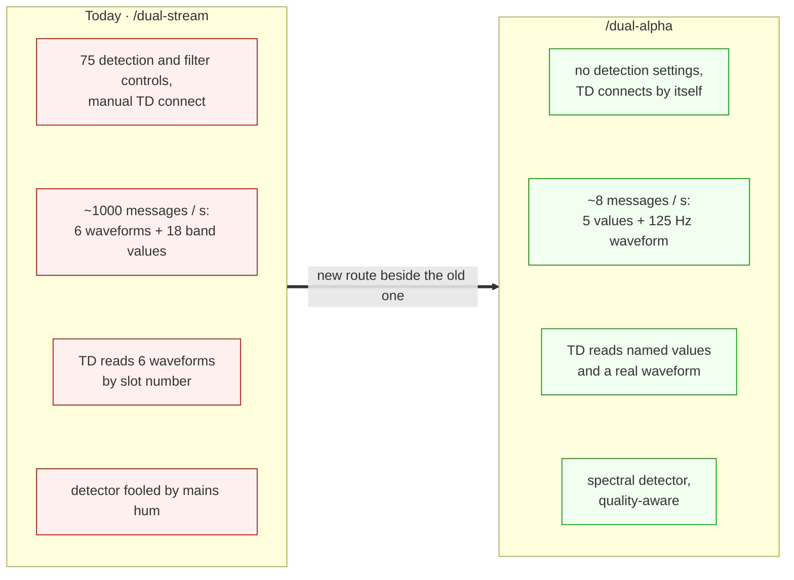
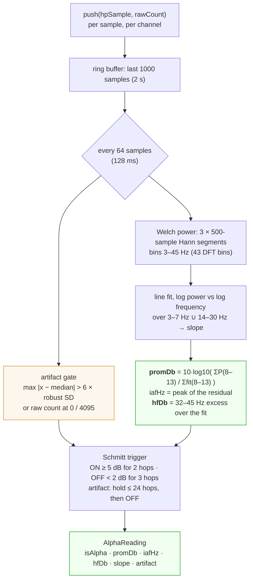
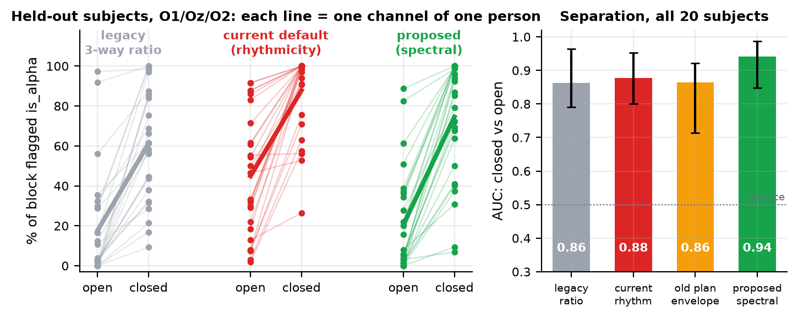
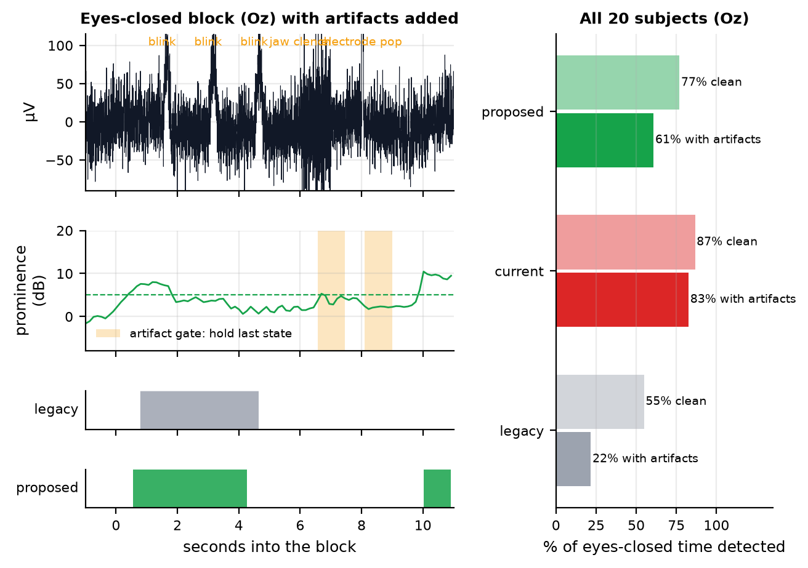
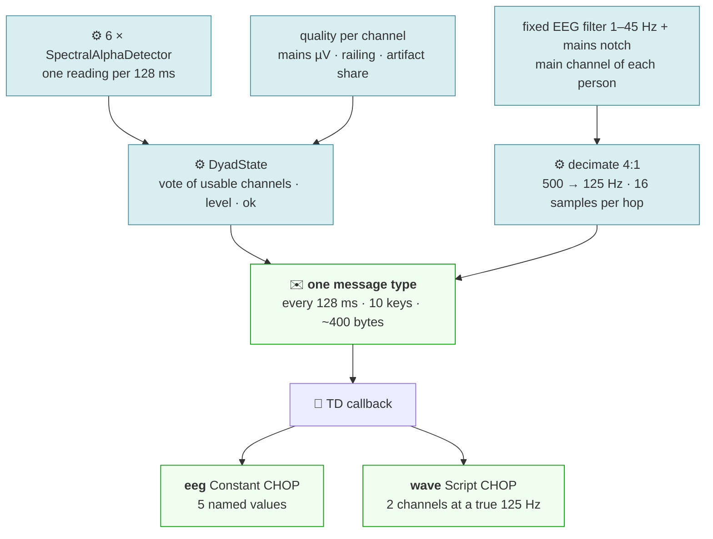
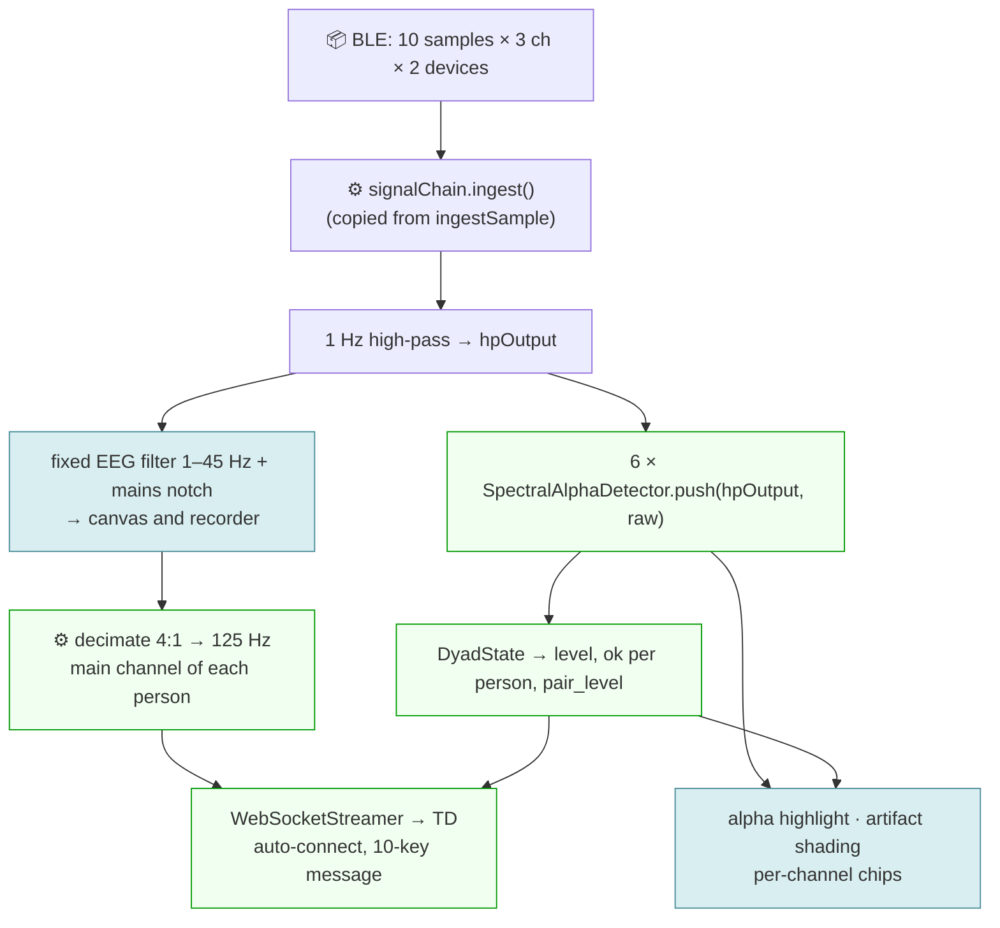
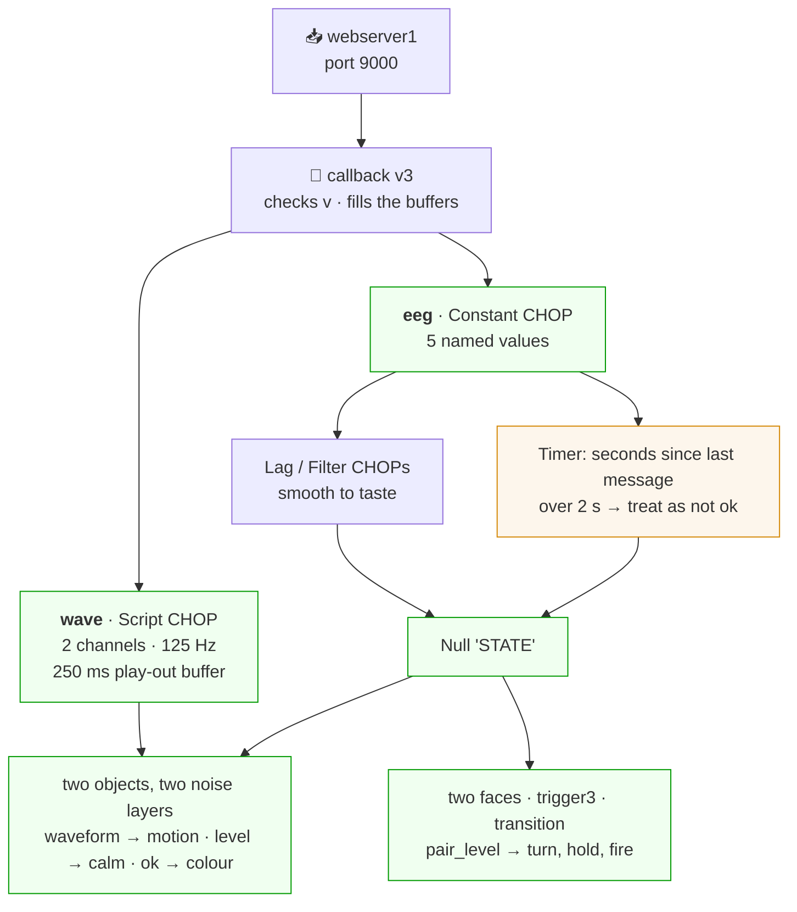
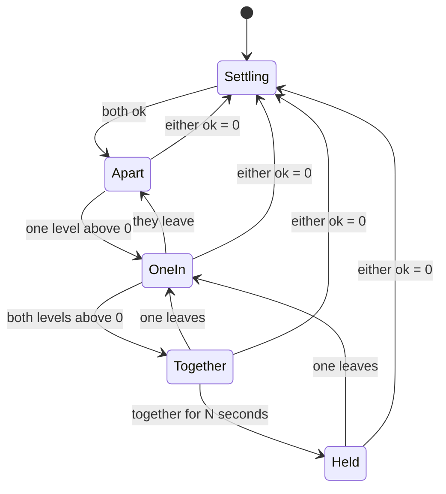
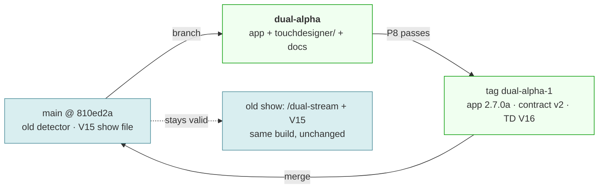
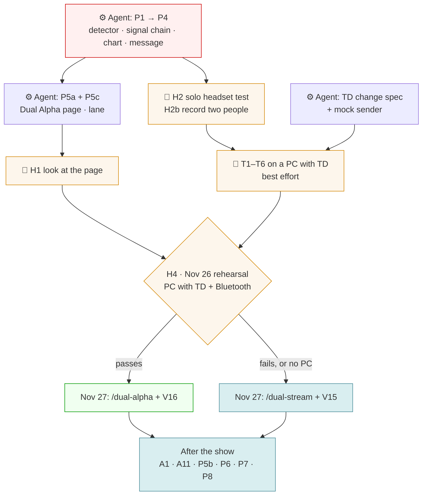

# Dual-Alpha Route: Engineering Plan for Chords-Web and TouchDesigner, 2026-11-18

The single plan for the `dual-alpha` branch: a new, lean **Dual Alpha** page in Chords-Web (`/dual-alpha`), built beside the existing Dual Stream page, that detects each person's alpha rhythm and sends each person's main waveform and five alpha values to a TouchDesigner (TD) project that is versioned with it. It merges the four earlier documents (the engineering plan, the branch plan, the TD analysis and the TD contract), applies the clinical reviewer's notes, and applies five changes of direction: a leaner interface, no band overlays, a much smaller TD input, automatic streaming, and a new route beside the old one.

> *Based on: `ALPHA_DETECTION_ENGINEERING_PLAN.md` (2026-10-29), `BRANCH_IMPLEMENTATION_PLAN.md`, `TOUCHDESIGNER_NETWORK_ANALYSIS.md`, `TD_CONTRACT_AND_INTERACTION_PLAN.md` and `CLINICAL_REVIEW_FEEDBACK.md` (all 2026-11-12), plus the team's direction and answers of 2026-11-16 to 2026-11-18, the reviewer's annotated PDF in `review/`, and the manufacturer's figures. Every source is listed in [Sources](#sources). Code references are to `main` @ `810ed2a`, re-checked on 2026-11-18: the code has not changed since. Effort is a rough guess in agent hours. Nothing here is implemented, and nothing was opened in TouchDesigner. **No further questions go to the reviewer or the manufacturer** (team, 2026-11-18): where an answer is missing, the plan states its own default and how a test checks it.*

---

## 1. Summary



**Why the installation reports "lots of noise".** The default detector, `alphaRhythmicity`, is an autocorrelation test on a band-passed signal. From about 30 µV of 50/60 Hz mains pickup it reports alpha in pure noise, and at 100 µV it flags 100% of a signal that holds no EEG at all. The replacement measures how far 8–13 Hz power stands above the smooth 1/f background (the fall of EEG power with frequency), fitted every 128 ms. On nine held-out people it flags 75% of eyes-closed and 21% of eyes-open time, and 0.4% of pure noise ([§3](#3-the-detector)).

**Five changes of direction since the earlier plans** (team, 2026-11-16 and 11-18):

| # | Direction | What it does to the plan |
|---|---|---|
| X1 | Use way less interface: fewer controls, easier to operate | all detection and filter settings go; the detector and filters run automatically ([§5](#5-chords-web-changes)) |
| X2 | Keep artifacts and relevant signals on the graph; drop the band waves and their settings | no θ, δ or α band-pass overlay traces; the graph shows the trace, an improved alpha state highlight and what makes the data untrustworthy ([§5.2](#52-what-the-graph-shows)) |
| X3 | Reduce TD to bare essentials; keep the main waveform, with a defined sample rate | one main waveform per person, batched at 125 Hz, plus five alpha values; no 25 slots, no band values ([§4](#4-the-lean-contract)) |
| X4 | Introduce the modified TD file under a new `dual-alpha` branch, versioned with this Chords-Web | the file lives in the repo; it need not work with the old page or V15 ([§7](#7-branch-and-versioning)) |
| X5 | Build the work as a new **Dual Alpha** route instead of changing Dual Stream; link both from the Chords-Web home page | `/dual-stream` stays as it is, so the old page and V15 remain a working pair in the same build ([§5](#5-chords-web-changes)) |

X3 and X4 remove the constraints the earlier plans were built around: the 25 frozen slots, the old `.chan` recording layout, and the need for the new app to work with the old show file. The app and the TD file now ship as a pair. The waveform stays, as a batch with a sample rate ([§4.4](#44-the-waveform-and-its-sample-rate)), and the replay A/B test becomes a look check. **The next show is Nov 27**, so the plan is split into a show cut and the rest, with a go/no-go rehearsal on Nov 26 ([§8](#8-implementation-plan)).

**What the audience will see.** The look and motion of V15 stay: the objects, noise layers and colour still move with each person's live signal. What changes is when the heads move, and what they mean ([§4.1](#41-the-keys), [§6.3](#the-heads-turning-and-colour)):

- a person in alpha **turns their head to face forward, then reaches toward the other and dips back**, further the longer and deeper they stay in, while their object calms;
- when both are in alpha, **the heads turn to face each other**, the deeper one a little further and **cycling colour a little faster**;
- after **Hold time** together (0–5 s, default 3 s; 0 forces it as a cheat code) **the transition plays**;
- a lost signal **fades that side to grey** instead of looking calm.

Kaz can make the sync easier live with Hold time, Relative alpha sync and Forgiveness, as he did with the old slider ([§9.3](#93-what-the-piece-may-say)).

**What the clinical reviewer settled.** Erica endorsed the working definition of alpha, the artifact gate, the O1/Oz/O2 placement and the "alpha state" wording (notes C1, C10, C17, C19). She asked for one method comparison (specparam, [§3.3](#33-what-is-still-to-measure)), a standard 20-second eyes-closed/eyes-open check, and a participant script about stillness. She raised one decision for the team, whether the piece shows co-occurrence or "real" synchrony; the team chose to call it relative alpha synchrony and to define it ([§9.3](#93-what-the-piece-may-say)). **Her review is treated as complete:** there is no time to go back to her, so her open questions are answered by the plan's own defaults ([§12.4](#124-what-the-reviewer-did-not-answer-and-the-plans-default)).

**How this is sized.** The work is done agentically, so the table gives rough *agent hours* (an unmeasured guess, to be replaced by actuals as phases finish) and, more importantly, what each step **waits on**. The pace is set by the steps that need a person, a headset or TouchDesigner, not by the code.

| Phase | Agent time (guess) | Waits on |
|---|---|---|
| **Show cut** | | |
| Branch + mock sender | 1 h | your go-ahead to create the branch |
| P1 Detector (+ `hfDb`) | 2–4 h | nothing: tests and recordings are in the repo |
| P2 Signal chain and per-sample feed (new modules) | 1–2 h | P1 |
| P3 Chart draws the improved highlight | 1–2 h | P2 |
| P4 DyadState, lean message, 125 Hz waveform, auto-stream, `td_stream.jsonl` writer | 4–6 h | P3 |
| P5a The Dual Alpha page, quality chip, home-page buttons | 3–5 h | P3 |
| P5c Detector lane | 2–3 h | P3 |
| TD change spec and `mock_sender.py` (offline, in the repo) | 3–4 h | the contract in [§4](#4-the-lean-contract); the V15 inventory already in the repo |
| T1–T6 applied and tuned on a PC | 3–6 h | **a PC with TouchDesigner** (best effort), the V15 `.toe`, the recorded stream; applied by you, Kaz or a Claude session on the PC |
| **Human gates in the show cut** | | |
| H1 You look at the app on a replay (page, lane, chips) | 15–30 min | P5a, P5c |
| H2 Solo headset smoke test: one person, one headset | 30–60 min | P4 |
| H2b Record a two-person session on the Dual Alpha page (the test input for the PC) | 1 h | P4, two headsets, two people |
| H3 Run the TD file against the recorded stream on a PC and compare with V15 (T6), best effort | 1–2 h | the spec, H2b, any PC with TD |
| **H4 Rehearsal, Nov 26: two people, headsets, a PC with TD and Bluetooth** | half a day | H1 and H2 pass; the PC secured; the TD file applied (H3 is best effort, not a gate) |
| **After the show** | | |
| A1 specparam comparison | 2–3 h | nothing; the decision rule in [§3.3](#33-what-is-still-to-measure) is ours |
| A11 forehead and temple check (offline) | 1–2 h | A1's harness |
| P5b Signal panel, graph shading, live spectrum | 3–4 h | H4 |
| P6 20 s check | 2–3 h | H4; a person to test the guided step |
| P7 Decide on `/dual-stream` (share modules or leave) | 1–2 h | P5b, P6 |
| P8 Validate on NPG Lite with TD | agent: analysis only | **sessions with people and mastoid electrodes**; scheduling is the cost |

**Total agent work: about 30–45 hours**, most of it parallelisable (the lane, the chip and the TD callback do not depend on one another). **The wall-clock is set by the human gates**, not by this total.

---

## 2. Where we start

> *Source: `ALPHA_DETECTION_ENGINEERING_PLAN.md` §2–3; `TOUCHDESIGNER_NETWORK_ANALYSIS.md` §1–5. All reproduced with the app's own filter coefficients, 2026-10-24.*

**The hardware, from the manufacturer.** The NPG Lite (Neuro PlayGround Lite, Upside Down Labs) is a three-channel bio-amplifier on an ESP32-C6.

| Property | Value | Source |
|---|---|---|
| Channels | 3 per device | manufacturer documentation |
| Sampling rate | 500 Hz per channel | firmware `NPG-LITE-BLE.ino`, `SAMP_RATE 500.0` |
| Resolution | 12-bit (0–4095 counts), range about 3.3 V | firmware, ESP32-C6 |
| Amplifier gain | ×1470 by default (×882 selectable) | manufacturer, email 2026-04-11 |
| One count | 3.3 V / 4095 / 1470 ≈ 0.55 µV | derived |
| Calibration | none built in. Our units are v0.1 silicon: "I do not have high hopes for v0.1 silicon for ADC linearity and we might see high voltage offset without calibration" | manufacturer, email 2026-04-11 |
| Firmware ADC correction | the firmware scales the raw reading by 4095/3249, so the real step is about 1.26 counts (about 0.7 µV) [derived] | stated by us in the email, confirmed in general terms ("You are correct about all of the things") |
| Intended use | not recommended for medical applications; "a great choice for bio-feedback applications and general research" | manufacturer, email 2026-04-11 |
| Newer hardware | newer batches use v0.2 silicon; a data-quality comparison was promised and has not been received. 24-bit systems are available | manufacturer, email 2026-04-11 |
| Offered improvements | a calibration step before recording, and software oversampling for a cleaner signal: ideas, not delivered | manufacturer, email 2026-04-11 |
| Electrodes | wet (gel) snap electrodes | manufacturer documentation |
| Reference and ground inputs | **not confirmed, and not being asked.** The plan assumes each channel is measured against a reference shared by the three channels, with a separate ground, and uses one mastoid each. A one-minute test at H2 checks it ([§12.6](#126-what-the-manufacturer-did-not-answer-and-the-plans-default)) | email thread does not cover it |

**What follows from it.** Absolute microvolts are approximate, so the detector uses ratios (prominence in dB) and the chart's µV axis is labelled approximate. The email thread is transcribed in `review/MANUFACTURER_EMAIL_2026-04.md`, with a table of what it does and does not establish. The piece is biofeedback, which is the use the manufacturer recommends the board for; nothing in this plan makes a clinical or microvolt claim.

**The pipeline today.** BLE (Bluetooth Low Energy) notifications carry 10 samples per channel. `ingestSample` (`page.tsx:924`) high-passes each at 1 Hz to give `hpOutput`, and forks it into the display filters and into the detection envelopes. A web-worker clock ticks every 8 ms, and every 8th tick `alphaRhythmicity` is recomputed. The verdict is stamped into a ring buffer as long as the visible chart, and `is_alpha` is true whenever the ring holds a long enough run.

| # | Defect | Where | Effect |
|---|---|---|---|
| D1 | Rhythmicity lag window 77–125 ms holds whole multiples of the mains period | `page.tsx:1774-1798` | hum from ~30 µV reads as alpha |
| D2 | Detection reads `hpOutput`, before the notch | `page.tsx:954, 983` | the notch toggle never protects detection |
| D3 | The "8–12 Hz" band-pass is a 2nd-order high-pass plus low-pass | `filters.tsx:255-302` | real passband 6.1–15.6 Hz; 59% of output is outside 8–13 Hz |
| D4 | `is_alpha` means "a 0.48 s run exists anywhere in the visible window" | `page.tsx:1800-1830` | flag lingers; median 4.2 s to clear |
| D5 | Verdict computed on wall-clock ticks and stamped onto samples | `page.tsx:1473-1501` | replay results depend on replay speed |
| D6 | Legacy rule: alpha ≥ 50% of α+θ+δ power | `page.tsx:1882-1887` | blinks drop eyes-closed detection from 55% to 22% |
| D7 | Detection state lives in rings sized by the chart's time base | `page.tsx:348-370` | changing zoom changes detection |
| D8 | `noiseFloor = 1e-6` in counts² | `page.tsx:213-219` | inert |

**What the TouchDesigner project does with the stream.** The Web Server DAT (data operator, a node that carries text) on port 9000 runs a Python callback that writes 25 values into a Constant CHOP (channel operator, a node that carries streams of numbers) *by slot number*. A Rename CHOP then calls them `chan0`–`chan24`. Only six are read: `chan1`–`chan6`, the six filtered waveforms, which act as smoothed modulators (0.3–10 s filters) for position, rotation, colour speed and noise. The 18 band values and `is_alpha` are read by nothing. The central moment is a "Sync Trigger" comparison of the two people's second-electrode waveforms, which eases a 0/1 over 3 s so that two faces turn toward each other and a transition plays. TD cooks at 60 per second and sees only the latest value per frame, so most of the ~1000 messages a second are discarded.

These facts matter in this plan in two ways. The TD staging (a 0/1 "together" input, a 3 s ease, faces that turn, a transition) is good and is kept. The input to it, "two waveforms are close", is not a measure of alpha, and it is replaced.

---

## 3. The detector

> *Source: `ALPHA_DETECTION_ENGINEERING_PLAN.md` §4–5.4. Reference code: `docs/alpha-v2/analysis/SpectralAlphaDetector.ts`, verified against the Python reference on four recordings, 2026-10-24.*



**The design in one line:** call alpha present when 8–13 Hz power stands clearly above a 1/f background fitted from the neighbouring bands. This is the approach of BOSC (Whitten et al. 2011) and spectral parameterisation (Donoghue et al. 2020), reduced to run eight times a second per channel in the browser. The reviewer's first note reads "This seems sound to me" (C1).

### 3.1 Evidence

Parameters were tuned on 11 subjects (even IDs) subject to at most 1% false alarms on pure noise, and reported on the other 9, through a model of the NPG Lite's ADC (analog-to-digital converter) on a public 20-subject dataset.

| Held-out, O1/Oz/O2 | Eyes closed | Eyes open | + 50 µV mains, eyes open | Pure noise |
|---|---|---|---|---|
| Legacy ratio | 61% | 18% | 20% | 0% (61–99% at 200 µV) |
| Current default | 88% | 45% | 53% 🔴 | 4% (100% at ≥ 100 µV) 🔴 |
| **Proposed** | **75%** | **21%** | **21%** ✅ | **0.4%** (≤ 1.5% at 50–200 µV) ✅ |



| Oz, 20 subjects, artifact stress test | Eyes closed: clean → with artifacts | Eyes open with artifacts |
|---|---|---|
| Legacy ratio | 55% → 22% 🔴 | 3% |
| Current default | 87% → 83% | 31% ⚠️ |
| **Proposed** | 77% → **61%** | **9%** |

The reviewer asked whether the artifact figure showed detection where there should be none (C12). It did not: the block is eyes-closed throughout, so alpha is expected, and the point is that added blinks and a jaw clench only partly hide it. The figure's caption is to be fixed in the clinical review document (A9 in [§8.2](#82-reviewer-actions-and-where-they-land)).



**Latency.** The flag switches on a median 1.3 s after eye closure and off 1.9 s after eye opening (open data, 2026-10-24); the floor is the 2 s window. Anything downstream should add little to that.

**Known weakness.** Blinks are slow and lift the 3–7 Hz fit band, which lowers prominence. Occipital placement, far from the eyes, is the real remedy.

### 3.2 What changes from the code in the earlier plan

| Change | Why |
|---|---|
| DFT extended from 28 bins (3–30 Hz) to 43 (3–45 Hz); `AlphaReading` gains `hfDb` and `slope` | `hfDb`, the 32–45 Hz excess, is mostly muscle. It is the best available cue for the reviewer's "sit still" concern (C7, C9) and costs about 4.3 ms of CPU per second of signal per channel [projected, re-measure] |
| The 1/f exponent is computed but **not shown and not sent** | it is noisy in a 2 s window and nothing in the piece needs it |
| Fit bands stay 3–7 and 14–30 Hz | unless A1 finds a reason to change them; then two constants change and the test fixture is regenerated |

### 3.3 What is still to measure

**A1: compare our fit with specparam, offline.** The reviewer noted that the 1/f background is strongest at the lowest frequencies, so a fit that skips below 3 Hz discards its best data, and pointed to FOOOF (specparam) (C9, C11, C14). Our reason for skipping stands: blinks, eye movement, sweat drift and electrode movement all put energy there (C7, C18). Specparam models peaks explicitly, so a slow artifact shows up as a poor fit and not as a tilted line.

| Step | What |
|---|---|
| 1 | Add `specparam.py`: for every hop of the 20-subject set, fit specparam over 1–40 Hz on the same 2 s Welch spectrum, and on 10 s windows (a 2 s window gives only about 28 usable bins, so specparam is itself noisy there [infer]) |
| 2 | Compare our `promDb` with specparam's alpha peak height, on clean windows and on the artifact stress test |
| 3 | Record the result in this document and apply the decision rule below. It is not sent to the reviewer |

**Decision rule (ours, with no reviewer sign-off).** Within about 1 dB on clean windows: keep our fit and say so. A systematic gap on windows with slow artifacts: try a wider fit band or a robust fit, re-tuned on the even subjects and reported on the odd ones.

**Not measured yet, and treated as proposals until P8:** the person vote rule, `hfDb` as a muscle measure on the NPG Lite, the `level` ceiling of 12 dB, and the thresholds that turn a person's signal red ([§4.2](#42-how-each-value-is-computed)).

---

## 4. The lean contract



**One message type: five alpha values and each person's main waveform.** The earlier contract had two message types and 58 keys (49 TD channels). The lean one drops everything TD can compute itself and everything the piece cannot use. It keeps the waveform, and gives it a defined sample rate so that it is a real waveform in TD ([§4.4](#44-the-waveform-and-its-sample-rate)). The app sends JSON text on port 9000, as today.

### 4.1 The keys

*Range* is what TD can expect, so that a Math CHOP can map it without guessing. *In the piece* is what the value does to the visuals: a proposal built on operators that exist in V15, set out in full in [§6.3](#63-what-drives-the-visuals-now) and [§6.4](#64-the-states-a-pair-can-be-in), and tuned by eye on a PC. Person keys are shown for `d1_`; `d2_` is identical and drives the other side of the image.

| Key | Range | Meaning | In the piece |
|---|---|---|---|
| `v` | `2` | schema version; TD refuses a message with another version. Not written to a channel | nothing visible when right. A wrong version lights `contract_error`; no values are taken, so after 2 s both sides go grey. A mismatched app and TD file are obvious |
| `d1_level` | 0 – 1 | **how far into alpha this person is**, scaled to them. **0 means not in alpha**; any value above 0 means in alpha. It also reads 0 when the person's signal is not ok | above 0, **that person's head turns to face forward**, then **reaches toward the other side and dips back**, further the longer and deeper they stay in (an invitation). Their object **slows and steadies** as the value rises. The **deeper of the two heads turns a little further and cycles colour a little faster** ([§6.3](#the-heads-turning-and-colour)) |
| `d1_ok` | 0 / 1 | this person's signal can be trusted: electrodes in contact, mains low, not too restless, device streaming | at 0, **that person's side fades to grey** instead of looking calm, and the pair returns to "settling". A lost signal never looks like relaxation |
| `d2_level`, `d2_ok` | as above | person 2 | the same, on the other side |
| `pair_level` | 0 – 1 | the lower of the two levels, and **0 unless both people's signals are ok**. Above 0 means *both are in alpha at the same time, with good signal*: the piece's **relative alpha synchrony** ([§9](#9-the-session-and-what-the-piece-claims)) | above 0, **both heads turn past forward to face each other** over the existing 3 s ease. Held above 0 for *N* seconds, **the transition fires**. While it is up, its value **clarifies the shared image** (noise and bloom) as both go deeper |
| `fs` | `125` | sample rate of the waveform arrays, in Hz | nothing visible; it tells the `wave` CHOP how fast to play |
| `n` | integer | index of the first sample of this batch in the 125 Hz stream; it rises by 16 per message, so a jump means messages were lost | nothing visible; a gap holds the last sample so the motion does not jump. More than 2 s with no message turns both people not ok (grey) |
| `d1_w`, `d2_w` | 16 numbers each | the person's **main waveform** for the last 128 ms: the middle occipital electrode (Oz, channel 1 of the headset), after the Chords-Web default filter chain (1 Hz high-pass, 45 Hz EEG low-pass, mains notch; [§4.4](#44-the-waveform-and-its-sample-rate)), at 125 Hz. Scaling is today's, so the existing Math CHOPs keep their ranges (to be confirmed in P4 against the current `d*_ch1` output) | **the live texture and motion, as today**: the object's position, its noise layer and its colour-speed rotations, each through its own smoothing (0.3–10 s) so they do not move in lockstep. It no longer decides "sync" |

**The pair, read as states.** Combined, the values put the image in one of five states ([§6.4](#64-the-states-a-pair-can-be-in)):

| State | Values | What the audience sees |
|---|---|---|
| Settling | either `ok` = 0 | that side grey; faces turned away; no transition |
| Apart | both `ok`, both levels 0 | faces turned away; objects moving with each person's live signal |
| One in | one level above 0 | that person's head faces forward, then reaches toward the other and dips back; their object calmer; the other head stays turned away |
| Together | `pair_level` above 0 | both heads turn to face each other over about 3 s, the deeper one a little further and cycling colour faster; the shared image clears as they go deeper |
| Held | `pair_level` above 0 for *N* seconds (Hold time, default 3 s; 0 forces it) | the transition plays |

That is 10 keys at about 7.8 messages a second: roughly 3 kB/s.

```json
{"v":2,"fs":125,"n":81232,
 "d1_level":0.72,"d1_ok":1,"d2_level":0.44,"d2_ok":1,"pair_level":0.44,
 "d1_w":[-0.21,-0.19,-0.15,"…13 more"],"d2_w":[0.02,0.01,-0.03,"…13 more"]}
```

*Illustrative values, not measured.*

**Why two waveforms for two people, when the headsets have six channels.** Each NPG Lite headset has three electrodes (O1, Oz, O2), so two people give six channels. All six go to the detector, which uses the vote of the usable ones. TD gets one main waveform per person, the middle electrode, because the three occipital traces are largely common to each other [infer] and the piece's job for the other two is to move parameters, not to show a third trace. Today channel 0 sets position and noise, channel 1 is compared for sync, and channel 2 turns one axis. After this plan, the one waveform feeds all of those through separate smoothing and delay ([§6.3](#63-what-drives-the-visuals-now)). **Confirmed by the team (2026-11-18):** one waveform per person, and it still drives every visual that today depends on any of the three electrodes. Each of those parameters takes a different aspect of the same waveform: its latest value, its own spectrum band, its own smoothing width or delay, so position, noise and the three rotations keep moving independently ([§6.3](#63-what-drives-the-visuals-now)). If the look check finds them too uniform, the width is a constant (`WAVE_CHANNELS`) and can go back to three per person.

**Why not fewer than five alpha values.** `d*_level` and `d*_ok` are both needed, because a quiet person and a lost signal must not look alike (the current piece cannot tell them apart). `pair_level` could be computed in TD from the other four. It is kept in the app so that the rule "both in alpha with good signal" is defined once, is unit-tested, and is the same number the operator sees.

**What TD derives itself** (Math, Logic, Trigger and Timer CHOPs, no app change needed):

| TD wants | Computed as |
|---|---|
| a person is in alpha | `d1_level > 0` |
| both are in alpha | `pair_level > 0` |
| one is in, the other waits | exactly one of the two levels is above 0 |
| who is further in | `d1_level − d2_level` |
| who arrived first, and for how long | a Trigger or Timer CHOP on the two 0/1 signals |
| how long they have stayed together | a Timer CHOP on `pair_level > 0` |
| the app stopped sending | no message for 2 s, from TD's own clock |

### 4.2 How each value is computed

The logic lives in a new module, `src/components/DyadState.ts`, with a test file next to it.

| Step | Rule | Status |
|---|---|---|
| Usable channel | on and its quality is not red; the operator can click a channel chip to exclude it | rule decided |
| Person in alpha | at least half of the usable channels have `isAlpha` on: 2 of 3, 1 of 2, 1 of 1 | proposal, check in P8 |
| Channel quality red | mains pickup above 50 µV (amber above 20), electrode railed, or artifact gate holding for more than half of the last 10 s | thresholds are proposals, tune in P8 |
| Person `ok` | at least one usable channel, person's worst quality is not red, device sending within the last second | rule decided |
| `level` | if in alpha and `ok`: `clamp((median promDb − offDb) / (ceiling − offDb), 0.05, 1)`; otherwise 0. `offDb` is the exit level, 2 dB. `ceiling` is the person's eyes-closed median from the 20 s check, or 12 dB if they skipped it | the 12 dB default is a guess from the 5–15 dB seen on open data |
| `pair_level` | `min(d1_level, d2_level)` if both `ok`, else 0 | decided |

**Prominence is in dB and `level` is the unit-free version of it.** The reviewer wrote that a threshold "depends on the scale that the data are recorded" (C16). A dB prominence is a ratio and does not depend on the recording scale. `level` then makes weak-alpha people look as deep as strong-alpha people when each is measured against their own range, so the piece does not favour people who happen to have strong alpha. That is why the 20 s check is a standard step ([§9](#9-the-session-and-what-the-piece-claims)).

### 4.3 What was removed from the earlier contract, and why

| Removed | Why |
|---|---|
| Four of the six waveform keys (channels 0 and 2 of each headset), and `ts` | one main waveform per person is kept; the other two per person move parameters the main one can move ([§4.1](#41-the-keys)). `n` replaces `ts` |
| The 25-slot layout and the per-tick `wave` message at 125 per second | replaced by one message every 128 ms carrying a batch with a defined sample rate |
| 18 band keys (`_alpha`, `_theta`, `_delta`) | no operator in V13–V15 reads them |
| Per-channel keys (`_is_alpha`, `_alpha_prom`, `_artifact`) | nothing in TD needs a per-channel alpha flag; the operator sees per-channel readings in the app |
| `alpha_iaf`, `alpha_s`, `alpha_prom`, `muscle_db`, `aperiodic`, `artifact_share`, `calibrated` | the operator needs them, TD does not. They stay in the app's readout, and `ok` already folds artifact share, mains and railing into one value |
| `pair_valid`, `pair_both`, `pair_either`, `pair_both_s`, `pair_min_prom`, `pair_balance`, `pair_lead`, `pair_lead_s` | `pair_level` covers validity and "both"; the rest TD derives (table in [§4.1](#41-the-keys)) |
| Theta, delta, beta, gamma, "focus", "meditation" | three occipital electrodes and a 2 s window cannot support them |
| Any measure of one brain against the other | when both people follow one instruction, their flags rise together, and a phase or coherence measure would report shared instruction as coupling; the two peaks may also sit at different frequencies (C15) |

### 4.4 The waveform and its sample rate

> *Source: `TOUCHDESIGNER_NETWORK_ANALYSIS.md` §3.1. The aliasing statement is an inference from the Constant CHOP having no history; it has not been checked in a running project.*

**Today TD does not see a waveform, it sees a value that changes.** The app sends one message per sample, about 1000 a second, and each overwrites the last. TD cooks (updates its network) 60 times a second and takes whichever value arrived most recently, so it sees a 60-per-second series with no defined rate. The Audio Spectrum CHOP run on it is a spectrum of that series, in which energy above 30 Hz folds back onto lower bins.

**What "the main waveform" is: the Chords-Web default trace, unchanged.** The plan does not invent a new signal. It sends the same trace the Chords-Web chart draws for a channel with the EEG filter switched on, which is also what `sendFiltered` sends to TD today. Source: `src/app/dual-stream/page.tsx` (`ingestSample`) and `src/components/filters.tsx`.

| Stage | What it does | Today | In this plan |
|---|---|---|---|
| 1. Board | Each electrode channel is measured **against its reference** (and the ground) by the amplifier on the NPG Lite, so the board hands the app one number per channel per sample, already "positive minus reference". The app subtracts nothing itself [infer from the code; checked by the shorted-input test at H2, [§12.6](#126-what-the-manufacturer-did-not-answer-and-the-plans-default)] | 500 samples a second, 12-bit | unchanged |
| 2. High-pass | 2nd-order Butterworth, **1 Hz** (`HighPassFilter`): removes the slow drift and the DC offset | always on | unchanged, always on |
| 3. EEG filter | 2nd-order Butterworth **low-pass at 45 Hz** (`EXGFilter`, type 3 "EEG"): removes muscle and mains harmonics. It also rescales the ADC value to volts (× 2/4096). This is the stage that makes the line smoother and less noisy | **off until the operator presses "EEG" for each channel** | **on by default, with no button** |
| 4. Notch | 2-stage notch at the mains frequency (`Notch`, 50 or 60 Hz) | off until pressed | **on by default** at 60 Hz (North American mains); `?mains=50` switches it. The chip measures pickup at both 50 and 60 Hz and warns if the other one dominates |
| 5. Decimate | average each group of 4 samples: 500 → 125 Hz, 16 samples per message | not done: one message per sample | new (table below) |

Stages 2 to 4 are the signal the operator already sees on the chart, so the waveform in TD and the line on the screen are the same trace. The detector does not use it: it works from the high-passed signal. That the filters are opt-in today is a hazard in itself: if the operator forgets to press EEG, TD gets a noisier line. Making them fixed removes that choice from the interface.

**The plan sends a waveform with a rate.**

| Step | Rule |
|---|---|
| In the app | the main channel after the default chain above (1 Hz high-pass, 45 Hz EEG low-pass, mains notch) is decimated 4:1, from 500 to 125 Hz, by averaging each group of four samples. 125 Hz holds everything up to 62.5 Hz, above the 45 Hz cut-off |
| In the message | 16 samples per person per message (64 samples per detector hop ÷ 4), with `fs` and a running sample index `n` |
| In TD | the callback appends each batch to a 2 s ring buffer per person. A Script CHOP, `wave`, plays the buffer out at `rate = 125`, about 250 ms behind the newest sample, so playback stays continuous when a message arrives late. A gap in `n` repeats the last sample for the missing count |
| Downstream | the Limit, Filter, Lag and Math CHOPs behave as before. The Audio Spectrum CHOP now sees a real 125 Hz series: with FFT size 64 that is a 0.5 s window, 1.95 Hz bins up to 62.5 Hz, and the folding is gone |

**Costs and checks.** The waveform arrives about 0.4 s later than today (128 ms batching plus the 250 ms play-out buffer), small against the 0.3–10 s smoothing the piece applies. The old FFT window was roughly 1 s [infer]; setting FFT size 128 at 125 Hz keeps that, and Kaz should judge the look. Averaging four samples is a mild low-pass, so the decimator is tested with a 70 Hz tone to confirm it does not leak into the band below 45 Hz (a P4 test, [§10](#10-testing-and-acceptance)). The spectrum is no longer aliased, so the visuals can look a little different from V15; T6 in [§6.2](#62-steps-in-order) records both side by side.

### 4.5 Rate

**One message per detector hop, about 7.8 a second.** A detector updates every 128 ms, so sending faster repeats numbers, and the waveform is batched to the same beat. TD smooths everything over 0.3 s or more and eases the central moment over 3 s, so a lower rate for the alpha values would also work, but the waveform batch sets the floor. The earlier plans had the app sending about 1000 messages a second. A constant (`STATE_EVERY_TICKS`) sets it.

---

## 5. Chords-Web changes

**The work is a new page, Dual Alpha, beside the existing Dual Stream page** (team, 2026-11-18; route renamed from `/inter-face-alpha` the same day). The lean interface, the new detector and contract v2 live at `/dual-alpha`. `/dual-stream` is not edited: it keeps the old detector, the band overlays and the old TD messages, so it still drives the V15 file. Both are reached from buttons on the Chords-Web home page.

| | Dual Stream (`/dual-stream`) | Dual Alpha (`/dual-alpha`) |
|---|---|---|
| Code | `src/app/dual-stream/page.tsx`, unchanged | `src/app/dual-alpha/page.tsx`, new |
| Detector | the old rhythmicity detector | `SpectralAlphaDetector` and `DyadState` ([§3](#3-the-detector)) |
| Controls | all of today's (about 75) | the lean set ([§5.1](#51-the-operators-interface)) |
| TD messages | today's: per sample, 6 waveforms and band values | contract v2 ([§4](#4-the-lean-contract)), automatic |
| TD file | V15 | V16 (`dual-alpha-V16.toe`) |
| Recordings | today's CSV | the same CSV columns, plus `td_stream.jsonl`, so either page can replay the other's raw recordings |

**Home page.** `src/components/LandingComp/HeadSection.tsx` gets two buttons next to "Visualize Now": **Dual Stream** and **Dual Alpha**. Today `/dual-stream` has no link from the home page at all; it is reached by typing the address. Each button carries a one-line caption (which TD file it pairs with), so the operator picks the right pair.

**How the code is shared.** The new page needs the Bluetooth connection, the filter chain, the chart and the recorder, which today live inside the 2,779-line `dual-stream/page.tsx`. For the show cut, the new page takes **copies** of what it needs, moved into small modules under `src/lib/dual-alpha/` (`useDualNpg`, `signalChain`, `recorder`); the old page is not refactored, so it cannot break. After the show, `/dual-stream` may switch to the same modules (P7), or simply be left as it is.

**Why this is better than changing Dual Stream in place.** The fallback for the show is in the same build: if the Nov 26 rehearsal fails, the operator opens `/dual-stream` with V15 instead of `/dual-alpha` with V16, with no branch switch and no redeploy. Commit `61e864a` is a second fallback ([§7.3](#73-the-v15-fallback-is-safe-without-changes)). The cost is some duplicated code until P7.



The detector is **sample-driven**, so a live session and a replay of its recording produce identical readings, hop for hop (fixes D5). The display filters stay for the chart and the recorder, and the same filtered signal, decimated, is the waveform sent to TD. None of it feeds detection.

### 5.1 The operator's interface

> *Source: `src/app/dual-stream/page.tsx` on `main` @ `810ed2a`: Filter popover 2324–2429, Bands popover 2433–2613, Settings 2616–2710, toolbar 2711–2775.*

The test for each control on today's Dual Stream page was whether an operator at a show would ever need to change it. If not, it is **not carried into Dual Alpha**: it runs automatically there, or is behind `?debug=1`. Every control stays on `/dual-stream`. *Count* is the rendered controls for 3 channels.

| Control | Count | Decision | How it runs instead |
|---|---|---|---|
| Alpha metric harness: AND/OR, Rhythm / Rel.rise / Power / Legacy, 3 threshold sliders | 8 | ➖ remove | the new detector has no harness |
| Dominance, Margin, Min run, Smoothing, Noise floor, per channel | 15 | ➖ remove | legacy ratio and Stage C parameters |
| Overlay θ and δ, all and per channel | 8 | ➖ remove | **X2**: band overlays are gone |
| Overlay α, all and per channel | 4 | ➖ remove | **X2**: the alpha *state* is still drawn, from the detector ([§5.2](#52-what-the-graph-shows)) |
| Detect all and per-channel Detect | 4 | ➖ remove | detection runs whenever a device streams; a channel with red quality drops out of the vote by itself |
| Gain per channel | 3 | ➖ remove | display only; the µV axis fixes its own scale |
| EXG type per channel: off / EMG / EEG / ECG / EOG | 20 | ➖ remove | fixed to EEG: 1 Hz high-pass, 45 Hz low-pass |
| Notch per channel: off / 50 / 60 | 12 | ➖ remove | on at 60 Hz by default; `?mains=50` switches it ([§4.4](#44-the-waveform-and-its-sample-rate)). The chip measures 50 and 60 Hz pickup with a Goertzel filter (a cheap single-frequency measurement) and warns if the notch is on the wrong one |
| Enter level, exit level | 2 | ➖ remove | 5 and 2 dB by default; `?enter=4` in the address lowers both for a show night; the 20 s check sets a personal pair |
| Connect to TouchDesigner button | 1 | ✏️ becomes a status dot | **X4/auto-stream** ([§5.3](#53-streaming-to-td-is-automatic)) |
| Console log | 1 | ✏️ behind `?debug=1` | developer tool |
| Per-channel chip: prominence, peak Hz, tension, quality colour | — | ➕ add (a readout; clicking it excludes or includes that electrode) | tells the operator whether to trust the flag and why |
| 20 s personal check | 1 | ➕ add | a guided step with one button ([§9](#9-the-session-and-what-the-piece-claims)) |
| Device connect, Channels, Zoom, Time base, Live data, Record, Replay | — | ✅ keep | session and display controls; in the new page Time base never affects detection (D7) |

**Result: about 75 detection and filter controls become one button (the 20 s check), a click on a chip, and a status dot.** Everything else on the page is a session or display control that Dual Stream already has. For the show cut the chips sit in a row above the chart (P5a) and the 20 s check is run by hand ([§9.2](#92-the-20-s-check)). After the show the chips move into a small **Signal** panel, grouped by person, with click-to-exclude (P5b), and the guided 20 s check arrives (P6).

### 5.2 What the graph shows

**The graph keeps the trace and the things that tell the operator to trust it or not.** It draws no band waves at all.

| On the graph | Source | Why it stays |
|---|---|---|
| Filtered EEG trace per channel, µV axis labelled approximate | display filters | the basic check that a headset is alive. The NPG Lite is uncalibrated and v0.1 silicon has ADC non-linearity (manufacturer, email 2026-04-11) |
| **Alpha highlight**: stays and is improved (below) | detector hop states, drawn by the chart's draw step | this is the result |
| **Artifact shading**: a grey band where the gate is holding the previous decision | `reading.artifact` | shows why a flag has stopped changing |
| **Railed marker** | raw count at 0 or 4095 | a detached or saturated electrode |
| Chip colour: mains µV (amber above 20, red above 50) | Goertzel at 50 and 60 Hz, once a second | tells the operator to re-seat an electrode |
| Chip: **tension** (`hfDb`) and artifact share | detector | the reviewer's main risks are body and eye movement, sweat and jaw (C7, C9, C18). The operator, and the participant, can see restlessness |

### The detector lane: alpha against the filtered signal

**The highlight alone cannot be judged, so each person gets a lane under their traces, on the same time axis.** The traces are the default Chords-Web signal ([§4.4](#44-the-waveform-and-its-sample-rate)): 1 Hz high-pass, 45 Hz EEG low-pass and the mains notch. The lane shows what the detector saw in the same seconds.

| In the lane | Source | What it tells the operator |
|---|---|---|
| **Prominence line** | the median `promDb` of the person's usable channels, each 128 ms hop (the same value `level` is computed from, [§4.2](#42-how-each-value-is-computed)) | how far alpha stands above the 1/f background |
| **Threshold lines** at 5 dB (on) and 2 dB (off) | detector settings, or the person's own after the 20 s check | why the flag switched, and how close a near-miss was |
| **State band** | the Schmitt state, painted back to the first confirming hop | the decision, aligned to the window it used |
| **Artifact shading and ok mark** | `reading.artifact`, `ok` | where the gate was holding the previous decision, and where the person was not ok |
| **Eyes-closed and eyes-open marks** | the 20 s check: from P6, after the show. At the rehearsal the operator marks the blocks by hand with two keys | ground truth beside the detector, which is the picture the reviewer asked for (C16) |

**What it does not show.** The lane shows when the detector decided, not the moment alpha began. The delay is the 2 s window plus about 0.26 s of confirmation, and a caption on the lane says so. It is also the same lane for the person's three channels: per-channel prominence stays in the chips.

**Optional "why" view, after the show.** The reviewer is used to reading the 1/f background in raw power and accepts log power (C8), so the view is drawn in log power with a switch to raw. A small live spectrum per person, 3–45 Hz, with the fitted 1/f line and the alpha bump above it. It replaces the band-pass overlays that are dropped, and uses the 43-bin spectrum from [§3.2](#32-what-changes-from-the-code-in-the-earlier-plan). It is part of P5b.

**Order of work.** The lane needs the per-hop readings from P3. If the show cut slips, the lane is the first thing dropped: the rehearsal then falls back to the chips and the `?debug=1` log.

**Left off the graph:** θ, δ and α band-pass lines, gain per channel, heart rate (the reviewer called it slow, C7), blink counts (small at occipital sites; the gate catches the large ones), and the 1/f exponent.

**The alpha highlight stays and is improved.** It was wrong before because it was drawn from the old rhythmicity verdict (D1, D4, D6): it fired on mains hum, lingered after eyes opened (a median 4.2 s to clear), and changed with the chart's zoom. It now draws the new detector's state, and gains:

- **One highlight per person** above that person's channels, from the vote, with the per-channel highlights beneath it, so the operator sees the decision and what it is made of.
- **Opacity follows `level`**: faint just after the flag switches on, solid deep in alpha.
- **It starts at the first confirming hop**, not when the flag finally switches. The flag needs two confirming hops (about 0.26 s), so this shows the onset where the detector first saw it [proposal].
- **An "uncalibrated" mark** while the person has no 20 s check stored (always, until P6).
- **No dependence on the time base** (D7).

### 5.3 Streaming to TD is automatic

**The page opens the TD socket itself.** There is no button to press.

- On entering `/dual-alpha` the streamer connects to `ws://localhost:9000`. (`/dual-stream` keeps its button.) `?td=host:port` overrides it, for a show machine that is not the laptop.
- It retries quietly with a back-off up to 5 s, and sends whenever it is connected. A toolbar dot is grey while searching and green while connected. Toasts appear only on the first connect and on a loss after one.
- Messages go out on each detector hop (about 7.8 a second) and only while at least one device streams. When a device stops, the next message carries `d*_ok = 0`, so TD shows "settling" and does not freeze on the last good value.

### 5.4 Code changes, by phase

Every file the plan creates or changes, the phase that does it, and the existing code it is built from. "Built from" means copied and trimmed; the original is not edited. Line numbers are in `src/app/dual-stream/page.tsx` at `810ed2a`.

**Folders.** To keep the table narrow, files are named without their folder:

| Short name in the table | Folder |
|---|---|
| `td/` | `touchdesigner/` |
| `comp/` | `src/components/` |
| `ifa/` | `src/lib/dual-alpha/` |
| `ui/` | `src/components/dual-alpha/` |
| `page` | `src/app/dual-alpha/page.tsx` |

| File (new unless noted) | Phase | What it holds | Built from |
|---|---|---|---|
| `td/mock_sender.py` | Branch | replays a recording CSV or a captured `td_stream.jsonl` as contract v2 messages; `--loop`, `--host` | new; contract in [§4](#4-the-lean-contract) |
| `td/TD_CHANGES.md`, `td/COMPAT.md`, `td/ASSETS.md` | Branch, TD spec | the TD change spec, the pairing table, the asset list | the TD audit document |
| `package.json` (changed) | Branch | a `test` script: `node --test` over `src/**/*.test.ts` (Node 22.21 here runs TypeScript directly); version bump on merge | — |
| `comp/ SpectralAlphaDetector.ts` and its `.test.ts`; fixture `alpha_s03_oz.json` | P1 | the reference class plus `hfDb` and `slope`; 60 s fixture: prominence within 1 × 10⁻⁴ dB, 100% agreement on state, artifact and peak Hz | the same file in `docs/alpha-v2/ analysis/` |
| `ifa/ signalChain.ts` | P2 | per sample: 1 Hz high-pass, then the fixed EEG low-pass and notch for display, and `detector.push(hpOutput, raw)`; `reset()`; rebuild on a sampling-rate change | `ingestSample` (924–1003), `resetSignalChain` (900), filter set-up (317–323). `filters.tsx` is imported, not copied |
| `ifa/ useDualNpg.ts` | P2 | Bluetooth connect and notifications for two devices, sample decoding, counter-gap count | `requestDevice` (1213), `processDeviceSample` (1098) |
| `ifa/ chart.ts` | P3 | the WebGL traces, the alpha highlight per person and per channel, artifact shading, railed marker | plot set-up (770), `animate` (1960), highlight drawing in `runStageC` (1832) |
| `comp/ DyadState.ts` and its `.test.ts` | P4 | vote, `level`, `ok`, `pair_level`; fixtures for 2 of 3, 1 of 2, 1 of 1, `ok` loss, calibrated and uncalibrated levels | new; rules in [§4.2](#42-how-each-value-is-computed) |
| `comp/ WaveDecimator.ts` and its `.test.ts` | P4 | 500 → 125 Hz by averaging groups of four; 16 samples per hop; the running index `n`; a 70 Hz leakage test | new |
| `WebSocketStreamer.ts` in `src/services/` (changed) | P4 | **adds** `connectAuto(url)` with back-off and `sendState(msg)`. Everything `/dual-stream` calls (`connect`, the `setDevice*` setters, `sendFiltered`; lines 21–176) stays | itself |
| `ifa/ recorder.ts` | P4 | record and replay in today's CSV layout through the IndexedDB worker, plus the `td_stream.jsonl` capture | `handleRecord` (1631), `stopRecording` (1663), `startReplay` (1534), `ingestRow` (1127) |
| `td/ callback_v3.py` | P4 | callback v3 and the Script CHOP code ([§6.1](#61-the-callback)). The root `touchdesigner_websocket.py` stays, because V15 uses it | the root callback |
| `page` | P5a | the lean page: device buttons, chart, chips row, status dot, record and replay, `?td=`, `?mains=`, `?enter=`, `?debug=1` | toolbar of the old page (2711–2775) |
| `ui/ SignalChip.tsx` | P5a | per-channel chip: prominence, peak Hz, tension, mains colour | new |
| `HeadSection.tsx` in `comp/ LandingComp/` (changed) | P5a | two buttons beside "Visualize Now" (line 67): Dual Stream and Dual Alpha, each with its TD-file caption | itself |
| `ui/ DetectorLane.tsx` | P5c | the lane ([§5.2](#the-detector-lane-alpha-against-the-filtered-signal)) | new |
| `ui/ SignalPanel.tsx`, `ui/ SpectrumView.tsx` | P5b | the Signal panel with click-to-exclude; the live spectrum | new |
| `ui/ TwentySecondCheck.tsx` | P6 | the guided 20 s check and the stored personal levels | new |
| `td/ dual-alpha-V16.toe`, `td/ expanded/` | T1–T6, on a PC | the show file and its text copy | V15 |
| **Unchanged:** `dual-stream/ page.tsx`, the root callback, `streamClockWorker.ts` | — | the old page, its TD callback and its clock worker | — |

**The background-tab question.** `/dual-stream` drives its detection clock from `workers/streamClockWorker.ts` (line 1507) so it keeps running when the tab is in the background. The new page is sample-driven and does not use it. Whether Bluetooth notifications keep arriving in a background tab is untested ([§12.5](#125-not-yet-known)); if they do not, the new page adopts the same worker.

**Nothing is deleted from Dual Stream.** The old detector, label rings, `alphaRhythmicity`, `scanLongestRun`, the band overlays and the per-channel filter rows all stay in `/dual-stream`. They are simply not copied into the new page. P7 becomes a choice made after the show: move `/dual-stream` onto the shared modules, or leave it alone.

---

## 6. TouchDesigner changes



**What this removes from the network.** The 25-slot `constant_eeg`, the Rename CHOP, the four `out*` branches (only two were used), the 18 band slots, the `.chan` record and replay path in its old layout, and the waveform comparison (`select16`, `select17`, `math13`, `math14`, `math18`, `logic1`) that decided "sync". **What is kept:** the objects, faces, noise layers, `filter18`, `trigger3`, `Ftransition` and `switch1`, so the piece's staging does not change. The operators that read `chan1`–`chan6` now read the `wave` CHOP instead.

### 6.1 The callback

The callback in the repo writes `par.value0` … `par.value24` today, so TD's Constant CHOP parameter names are `value{i}` (and `name{i}`). The earlier contract sketch used `const0value`, which does not match this file. The sketch below follows the repo's callback. **Untested in TouchDesigner.**

```python
import json
from collections import deque

KEYS = ('d1_level', 'd1_ok', 'd2_level', 'd2_ok', 'pair_level')   # channel order in 'eeg'
WAVE = ('d1_w', 'd2_w')
FS = 125
RING = {k: deque(maxlen=2 * FS) for k in WAVE}     # the last 2 s of each waveform

def onWebSocketReceiveText(dat, client, data):
    try:
        msg = json.loads(data)
    except json.JSONDecodeError:
        return
    if msg.get('v') != 2 or msg.get('fs') != FS:   # app and TD file out of step
        op('contract_error').par.value0 = 1
        return
    eeg = op('eeg')
    for i, k in enumerate(KEYS):
        if k in msg:
            eeg.par[f'value{i}'] = msg[k]
    for k in WAVE:                                 # the Script CHOP 'wave' plays these out at 125 Hz
        RING[k].extend(msg.get(k, ()))
    op('eeg_meta').par.value0 = absTime.seconds    # when we last heard; the Timer reads this
```

The five channel names are typed into the Constant CHOP once, by hand, in the same order. The Script CHOP's `onCook` reads the ring buffers, sets `scriptOp.rate = 125`, and outputs the samples that are due, about 250 ms behind the newest. Its exact calls are to be prototyped with the mock sender ([§6.6](#66-how-the-td-file-is-prepared-and-tested)).

### 6.2 Steps, in order

| Step | What | Risk |
|---|---|---|
| T1 | Copy V15 to the new file (`dual-alpha-V16.toe`); add `eeg`, `eeg_meta`, `contract_error`, a `STATE` Null CHOP | none |
| T2 | Replace the callback ([§6.1](#61-the-callback)); confirm `value{i}` and `name{i}` are right in TD 2025 | low |
| T3 | Add the `wave` Script CHOP; re-point every operator that read `chan1`–`chan6` to it, each through its own Lag, Delay or Math, so the jobs of channels 0, 1 and 2 stay separate | medium: the look can change |
| T4 | Map `level`, `ok` and `pair_level` ([§6.3](#63-what-drives-the-visuals-now)), including the head turn, reach and dip and the per-head colour speed ([the heads](#the-heads-turning-and-colour)); move `trigger3` off the face angle onto the hold Timer; replace the sync comparison with `pair_level`; replace the "Sync Trigger" slider with Hold time (0–5 s, default 3, 0 = forced), Relative alpha sync and Forgiveness, plus the operator-only "FORCED SYNC" label ([§9.3](#93-what-the-piece-may-say)); add the stale-data Timer | low |
| T5 | Delete the dead branch (list above); save, then expand with `toeexpand` for the diffable text copy | none |
| T6 | **Look check:** play one recording through V15 from `/dual-stream` and through V16 from `/dual-alpha`, screen-record both, and compare. The decimated waveform and the real spectrum may look slightly different; the check decides whether that is fine | none |

**The TD work needs a recorded stream, not headsets.** A small mock sender replays a recording to TD with no app running, and the page's own Replay mode pushes a recorded session through the same detector and socket ([§6.6](#66-how-the-td-file-is-prepared-and-tested)). All six steps need TouchDesigner, so they are done on a PC from the change spec.

### 6.3 What drives the visuals now

**The waveform keeps doing what it did; the alpha values add what it never could.** Each of the six waveforms moved one parameter, smoothed over 0.3–10 s. After this plan the one main waveform per person feeds those parameters through separate smoothing and delay, and the alpha values add calm, invitation and the pair moment. The behaviours are decided (decision 12); the operator each one uses and its tuning are proposals, set by eye on a PC. Each row names an operator that exists in V15.

| Moment | Value | Drives | Suggested look |
|---|---|---|---|
| Each person's liveliness | `d1_w`, `d2_w` (125 Hz) | every parameter channels 0, 1 and 2 drove: `SpositionR` and `Noise10exponent` from the waveform's level, the three `ScolorSpeedR` rotations from its spectrum (each from a different bin or band), and the left-hand equivalents. Each keeps its own Filter width, and a Delay where two would otherwise move together | as now: texture and motion from the live signal |
| Settling | `d1_level` | scale the output of `ScolorSpeedR` / `ScolorSpeedL` by (1 − 0.7 × level); noise layer A contrast | that person's object slows and steadies as they go in |
| One person is in, the other waits | `d1_level`, time in alpha (a Timer CHOP per side) | `FrotatepositionR` / `FrotatepositionL`, separately ([the heads, below](#the-heads-turning-and-colour)) | the person in alpha turns to face forward, then reaches toward the other side and dips back, further the longer and deeper they stay in. The other stays turned away. An invitation |
| Both in | `pair_level > 0` | `filter18` (the existing 3 s ease) into both `Frotateposition` operators | both faces turn past forward to face each other; the deeper person turns a little further |
| Both stay in | Timer on `pair_level > 0` | `trigger3`, now fed by the Timer instead of the face angle | the transition fires on time held together, not on an angle. This is required, not optional: one person alone now reaches the forward angle that used to fire it |
| How deep, together | `pair_level` | `Noise10exponent`, bloom level | the shared image clarifies as both go further in |
| Who is further in | `d1_level − d2_level` | that head's turn, and its colour speed on top of the shared value ([below](#the-heads-turning-and-colour)) | the deeper person's head turns a little further toward the other and cycles colour a little faster |
| Lost contact | `d1_ok = 0` | saturation of that person's object | that side fades to grey rather than acting calm |

#### The heads: turning and colour

**Agreed with the team on 2026-11-18; the angles, times and amounts are starting values to tune by eye on a PC.** Angles are each head's turn from facing the front: **+45° is turned away** (where V15 starts), **0° is facing forward** (where V15's faces meet), and **negative is turned toward the other person**, which V15 never reaches.

| Situation | That person's head | Built from |
|---|---|---|
| Not in alpha, or signal not ok | eases back to **+45°, turned away** | today's ease |
| **In alpha, the other is not** | 1. eases to **0°, facing forward** (the half-turn). 2. Then **reaches toward the other side** the longer they stay in: up to about −12° over about 8 s, **dipping back to forward** and reaching again, like a slow invitation. 3. **Depth adds to the reach**: up to about −8° more at `level` = 1. So a person who is deep and has waited long leans furthest toward the empty side | a Timer CHOP per side (time in alpha), a slow LFO for the reach and dip, `d1_level` |
| **Both in alpha** (`pair_level` > 0) | both heads turn past forward to **face each other**, about −20°, over the existing 3 s ease. **The deeper person turns a little further**, up to about 5° more | `filter18`, `d1_level − d2_level` |
| **Held** for *N* seconds (0–5 s, default 3) | the transition fires; the heads stay facing each other. At *N* = 0 this state is forced, whatever the data | `trigger3` on a Timer, with Forgiveness on its reset ([§9.3](#93-what-the-piece-may-say)) |

**Colour.** Today the faces' colour speed and rotation speed come from both people's waveforms together, so they act on the pair. **They stay shared**, as the pair's common liveliness. On top of the shared value, **the deeper person's head cycles colour faster**: its colour speed is the shared value × (1 + about 0.5 × how much deeper they are than the other), and the other head keeps the shared value. This needs one small change in TD: the shared colour-speed value is copied into two Math CHOPs, one per head, before it reaches the face. Whether the two faces use one shared material or two is not known from the audit, and is the first thing to check on the PC.

**One reading to confirm.** "Dipping back to facing forward" is taken here as a repeating reach-and-return while the person waits. The other reading is that the head returns to forward only when the person leaves alpha; that is a one-line change (no LFO).

### 6.4 The states a pair can be in



The current piece has two of these five states: "close" and "not close". It cannot show one person waiting for the other, and cannot tell a lost signal from a quiet one. Those two additions are where the new data changes the experience most. *N* is the **Hold time** control: 0–5 s, default 3 s (the current network effectively uses about 3 s), and 0 forces the sync as a cheat code ([§9.3](#93-what-the-piece-may-say)).

### 6.5 Exploring the 3 s ease

**The 3 s ease on the faces stays for the show.** The team decided to keep it and to explore options in this document. The input behind it changes from a flickering waveform comparison to a steady 0/1, so the reason for a long ease may be gone. The detector already waits before it speaks: about 1.3 s to switch on and 1.9 s to switch off (median, open data, 2026-10-24).

| Option | What it does | Time from both settling to the faces meeting |
|---|---|---|
| **A. Keep 3 s** (decided for the show) | `filter18` as it is | about 4 s [projected: 1.3 s + about 2.7 s] |
| B. Halve it, 1.5 s | the same staging, quicker | about 2.7 s |
| C. Asymmetric | 1.5 s in, 3 s out. Leaving is slower than arriving, so a fade on leaving reads as natural | about 2.7 s in |
| D. Follow the level | drop the ease and turn the faces by `pair_level` itself, so the angle rises as both go deeper | the detector's 1.3 s plus the rise of `level` |
| E. Hold, then fire | keep the ease, and fire `trigger3` on a Timer once `pair_level > 0` has held for *N* s | A plus *N* |

**How to choose.** Replay one recording through V16 at each setting, screen-record, and compare the five. The change is one Filter CHOP width, or two for C, so it costs minutes in TD. The detector's own 1.3 s cannot be shortened without losing reliability.

### 6.6 How the TD file is prepared and tested

**Decision of 2026-11-16: the TD side is best effort until it can be tested on a PC that has both TouchDesigner and Bluetooth.** TouchDesigner will not run on this Mac, and the PC the team has now has no Bluetooth. So the TD work is split into what can be made *ready* here and what needs TD to *run*. The goal is that when the file reaches a PC with both, only tuning is left, not building. That PC is the real test ([path C](#66-how-the-td-file-is-prepared-and-tested) below); the other two paths are stand-ins for it. On 2026-11-16 this Mac has no TouchDesigner and no `toeexpand` or `toecollapse`.

**1. The TD change spec (written here, now).** A file in the repo, `touchdesigner/TD_CHANGES.md`, that lists every change to the V15 network as an exact instruction, so that you, Kaz, or a Claude session on the PC can apply it without design decisions:

- the **operators to add**: `eeg`, `eeg_meta`, `contract_error`, `STATE` and the Script CHOP `wave`, with their names, parameters (`rate = 125`, the 2 s ring buffer, FFT size) and the pasted callback v3 and Script CHOP code; for the heads, a time-in-alpha Timer CHOP and a slow LFO per side, the angle maths, and one colour-speed Math CHOP per head ([§6.3](#the-heads-turning-and-colour)); the three live controls Hold time, Relative alpha sync and Forgiveness, and the operator-only "FORCED SYNC" label ([§9.3](#93-what-the-piece-may-say));
- the **operators to re-point** (T3, T4): each existing operator by name, the channel it read before, the channel it reads after, and the smoothing it keeps ([§6.3](#63-what-drives-the-visuals-now));
- the **operators to delete** or leave unwired (the 25-slot plumbing);
- for every step, a **check against the recorded stream**: the value or the picture to expect;
- every item marked [infer] listed as "confirm on first open" (parameter names such as `par.value{i}`, the Script CHOP time-slice behaviour, the FFT size).

**2. A recorded two-person stream, so the PC needs no headsets.** P4 adds a writer to the app: whenever recording is on, it also saves the exact contract v2 messages with their timestamps (`td_stream.jsonl`, one line per message), next to the raw recording. `touchdesigner/mock_sender.py` replays that file to TD at its original timing, with `--loop` and `--host`. The PC needs only Python and TD. One session with two people and two headsets, recorded on the Dual Alpha page on this Mac, becomes the test input for everything on the PC, and it can be repeated without anyone wearing a headset.

**3. Three ways to run it. C is the real test, A and B are what can be done sooner:**

| Path | Setup | What it proves | Needs |
|---|---|---|---|
| **A. Recorded stream on the PC** | `mock_sender.py` plays `td_stream.jsonl` to TD on the same PC | the whole TD side: the five channels, the 125 Hz `wave`, stale-data and `contract_error` handling (by stopping or corrupting the replay), the visual mapping, the look check | the PC with TD, the recording file, Python |
| **B. Live over the network** | the Mac, with Bluetooth, runs the app and the headsets; the PC runs TD; the app is pointed at it with `?td=<PC address>:9000` | the real path end to end, with live people, **without a PC that has Bluetooth** | same network, port 9000 open in the Windows firewall, the app served from `http://localhost` (a page loaded over `https` is not allowed to open an unencrypted `ws://` socket to another machine [infer, to check]) |
| **C. A borrowed PC with both** | everything on one machine | the same as B, plus the show-day setup | a loan |

Path B is the rehearsal setup if no single machine has both. It is why `?td=host:port` is in [§5.3](#53-streaming-to-td-is-automatic) and not an option for later. Both pages send to port 9000, so only one of them is open at a time.

**What stays unproven until TD runs on the PC:** callback v3, the Script CHOP, the 125 Hz play-out, the Audio Spectrum look at FFT 64 or 128, and the 3 s ease. All of them are marked [infer] and listed in the spec.

**The rule that follows.** Best effort is not a test. Dual Alpha goes to a show only after a **real test on a PC with TouchDesigner and Bluetooth** (path C) passes, with both headsets, the TD file and a screen recording. If that PC is secured in time, it is the Nov 26 rehearsal. If not, the show runs on `/dual-stream` and V15, and Dual Alpha waits for the first real test. Paths A and B reduce what that test can find; they do not replace it.

---

## 7. Branch and versioning



**Create `dual-alpha` from the current working tree.** The existing branch `docs/alpha-detection-v2` has no commits beyond `main` (both at `810ed2a`), and the review documents are untracked on it. So `git switch -c dual-alpha` carries them over, and the old branch can then be deleted. Nothing has been changed in git yet.

### 7.1 Layout

```
touchdesigner/
  dual-alpha-V16.toe  # the show file (V15 is 57 KB)
  expanded/           # toeexpand text copy, for diffs
  callback_v3.py      # callback v3 + Script CHOP code
  TD_CHANGES.md       # the change spec, V15 → V16
  mock_sender.py      # replays a recording to TD
  COMPAT.md           # which page, contract, TD file
  ASSETS.md           # where the models live
```

**The `.toe` is small and goes in the repo**, once it has been built on a PC; until then the folder holds the spec, the callback and the mock sender. The root `touchdesigner_websocket.py` stays where it is, because V15 uses it. The 825 MB of `.obj`, `.blend` and `.glb` files do not. `ASSETS.md` lists them and where to fetch them. Whether the file's model paths are relative is not yet checked (see [§12](#12-open-questions)).

**Keep the text copy in step.** `toeexpand` ships with TouchDesigner. A small script, `scripts/td-expand.sh`, regenerates `expanded/` and a pre-commit check fails if `expanded/` is older than the `.toe`.

### 7.2 Keeping the app and the TD file as a pair

| Item | Value | Where it is checked |
|---|---|---|
| App version | `package.json` `version`; `2.6.0a` today, `2.7.0a` on merge [proposal] | `COMPAT.md` |
| Page and TD file | `/dual-alpha` with V16; `/dual-stream` with V15 | `COMPAT.md`, the home-page captions |
| Contract version | `v: 2` in every message | the app sends it, the TD callback refuses any other value and lights `contract_error` |
| TD file | `dual-alpha-V16.toe`, with a Text DAT inside reading "contract v2 · app 2.7.0a" | `COMPAT.md` |
| Release | git tag `dual-alpha-1` when P8 passes | merge to `main` |

`/dual-stream` and V15 stay a working pair on the branch and after the merge, because the old page is not edited ([§7.3](#73-the-v15-fallback-is-safe-without-changes)). **The pairs are not interchangeable**: `/dual-stream` with the V16 file lights `contract_error`, and `/dual-alpha` with V15 does nothing visible. `COMPAT.md` is the warning.

### 7.3 The V15 fallback is safe without changes

**Kaz's last working show file, V15, was paired with an older commit of this repo, before the alpha-detection work on Dual Stream.** V15 stays outside the repo, as it is today. The question is whether today's `/dual-stream` (and therefore the branch, which does not edit it) still drives V15. It does, checked on 2026-11-18 against the git history:

| What V15 depends on | From `61e864a` (2026-03-23, "webserver dat config") to `810ed2a` (2026-05-25, current) |
|---|---|
| The TD callback, `touchdesigner_websocket.py` | **unchanged** since `61e864a` (last commit to touch it). The V15 copy is byte-identical to it (TD audit) |
| The keys V15 reads: the six filtered waveforms `d1_ch0` … `d2_ch2` (slots 1–6) | **unchanged** in `WebSocketStreamer.sendFiltered`. The only change is six added `d*_ch*_is_alpha` keys, which the callback does not read |
| How each waveform value is computed | **unchanged**: 1 Hz high-pass, then the operator's EXG filter, then the notch (`ingestSample` at `810ed2a`; the same chain at `61e864a`) |
| When it is sent | **unchanged**: one message per sample, from inside the per-sample path in both versions |

**So the fallback is `/dual-stream` on the show build with V15, operated as before** (press EEG and the notch per channel, then Connect to TouchDesigner). If anything about it misbehaves on the night, the older commit `61e864a` is a known-good second fallback: `git switch --detach 61e864a`, then `npm run dev`. No check with Kaz is needed. The one thing not verified here is V15's own behaviour, which nothing in this plan changes.

---

## 8. Implementation plan



**The show on Nov 27 sets the shape of the plan, and the people and hardware set the pace.** The code is fast to write and test; what takes calendar time is a person looking at the result, a headset on a head, and TouchDesigner being available. So the plan is a sequence of gates, and dates are fixed only for the human ones. The **show cut** is the critical path (P1 to P4), the new page with its chips and detector lane (P5a, P5c), and the TD file. It ends in a headset rehearsal on Nov 26. **Dual Alpha goes live on the 27th only if the rehearsal passes.** Otherwise the show runs on `/dual-stream` and V15, in the same build, which this plan never touches. Everything else, including the full lean panel, the 20 s check, the decision on `/dual-stream` and the NPG Lite validation, follows the show.

**The main schedule risk has moved.** It is no longer "can the code be written in time". It is: *hardware-only defects found at the rehearsal with one day left*, such as a Bluetooth drop, a swapped electrode plug, mains interference, or a headset that will not stay on. So the plan adds an **earlier solo smoke test (H2)**, as soon as P4 passes on replay: one person, one headset, the new page, with the outgoing messages checked by a socket listener (no TouchDesigner needed). It starts with the **shorted-input test**: clip one channel's active electrode to its reference electrode; the trace should go flat (a few counts), which shows the board measures each channel against its reference ([§12.6](#126-what-the-manufacturer-did-not-answer-and-the-plans-default)). Anything it finds is fixed before Nov 26.

### 8.1 Phases

Every phase builds new files; none edits `dual-stream/page.tsx`. The files, and the existing code each is built from, are in [§5.4](#54-code-changes-by-phase).

| Phase | What | Done when | Fixes |
|---|---|---|---|
| **Show cut** | | | |
| Branch | create `dual-alpha`, commit the docs, add `touchdesigner/` and `COMPAT.md`, add the `test` script | the branch builds | — |
| TD spec | `touchdesigner/TD_CHANGES.md`: every V15 → V16 change as an exact instruction, with the callback and Script CHOP code ([§6.6](#66-how-the-td-file-is-prepared-and-tested)) | each of T1–T6 has its operators, parameters and a check against the recorded stream; every [infer] item is listed as "confirm on first open" | lets the PC session be tuning, not building |
| Mock sender | `touchdesigner/mock_sender.py` replays a recording, or the captured `td_stream.jsonl`, as contract v2 messages ([§6.6](#66-how-the-td-file-is-prepared-and-tested)) | a socket listener receives 10-key messages at about 7.8 a second, `n` continuous, with no app running | lets TD work start without the app or headsets |
| 🔴 P1 | `SpectralAlphaDetector.ts` with `hfDb` and `slope`; fixture test; the Python reference gains the same two fields | the test passes within 1 × 10⁻⁴ dB; `verify_ts.py` passes on its four recordings; CPU re-measured | — |
| 🔴 P2 | `signalChain` and `useDualNpg`: one detector per device per channel, fed per sample with `hpOutput` and the raw count; `reset()` on reconnect; rebuild on a sampling-rate change | a replay of a recording, run twice and at two replay speeds, gives identical readings hop for hop (logged under `?debug=1`) | D1, D2, D3, D5, D8 |
| 🔴 P3 | `chart`: the traces and the **improved alpha highlight** ([§5.2](#52-what-the-graph-shows)), drawn from the detector's hop states. No label rings, no `scanLongestRun` | changing the time base or zoom does not change any reading; the flag clears within about 2 s of eye opening on a replayed recording | D4, D7 |
| 🔴 P4 | `DyadState` and `WaveDecimator` with tests; `WebSocketStreamer.connectAuto` and `sendState`; `recorder` with the `td_stream.jsonl` capture; callback v3 written to `touchdesigner/` | a replay produces 10-key messages at about 7.8 a second into a socket listener, none missing, `n` continuous; both test files pass; the captured file replays through `mock_sender.py` to the same stream | message defects T1–T5 of the engineering plan §6.3 |
| P5a | the `/dual-alpha` page assembled from the modules (devices, chart, record, replay, status dot), the per-channel chips (prominence, mains colour, tension), and the two home-page buttons | the operator sees the lean page; the chip says whether to trust a flag; `git diff main -- src/app/dual-stream` is empty | — |
| P5c | the detector lane under each person's traces ([§5.2](#the-detector-lane-alpha-against-the-filtered-signal)): prominence line, 5 and 2 dB threshold lines, state band back to the first confirming hop, artifact and ok marks | the operator and the team can see on one screen why each flag switched; at the rehearsal every flip can be explained from the lane | the highlight cannot be judged alone (D1, D4) |
| T1–T6 | the TD file, applied on a PC from the spec ([§6.2](#62-steps-in-order)); best effort before the rehearsal | TD shows 5 named channels and a 2-channel 125 Hz `wave` moving; the recorded stream drives the piece end to end; the stale-data and contract-error paths are tested by stopping and corrupting the replay; the look check is recorded | — |
| 🔴 Rehearsal (H4) | both headsets on two people, a PC with TD and Bluetooth, screen-recorded; eyes open and closed blocks marked by hand, one person then both; one run with the forehead site | `level`, `ok` and `pair_level` match what the two people were doing; no frozen visuals when a headset is unplugged | the go/no-go for Nov 27 |
| **After the show** | | | |
| A1 | specparam comparison ([§3.3](#33-what-is-still-to-measure)) | numbers recorded here; the decision rule applied | decides the fit bands |
| P5b | the Signal panel with click-to-exclude on a chip, the live spectrum per person (1/f fit and alpha bump), participant script in the help text | an operator can run a session with only the 20 s check, chips and the status dot | — |
| P6 | the 20 s check: 10 s eyes closed, then 10 s eyes open; store each person's medians and peak frequency; `onDb = max(4, (ecMedian + eoMedian) / 2)`, `offDb = onDb − 3`, `ceiling = ecMedian` | on by default; a skipped check uses the defaults and the chip says so; the lane shows the eyes-closed and eyes-open marks | weak-alpha people |
| P7 | decide on `/dual-stream`: move it onto the shared modules, or leave it unchanged ([§5.4](#54-code-changes-by-phase)) | `npm run build` and `npm run lint` pass; `grep -n "alphaRhythmicity\|scanLongestRun\|minRunFrac" src/app/dual-alpha src/lib` finds nothing | D6 (in the new page) |
| P8 | NPG Lite sessions with mastoid ground and reference, clinician marks, scoring, TD running and screen-recorded; left and right mastoid compared for hemispheric bias | acceptance in [§10](#10-testing-and-acceptance) | — |

**P6's effect, measured on open data:** at an equal eyes-open flag rate (about 22%), eyes-closed detection rises from about 82% to 89% on average, and from about 42% to 56% for the weakest 10% of channels (`analysis/personal.py`). A personal alpha band centred on the person's own peak (reviewer note C15) is a separate test, run offline on the P8 recordings. The reviewer's caution is that the two people's rhythms may then sit at different frequencies, which only matters for measures that compare frequency or phase, and the plan has none.

### 8.2 Reviewer actions, and where they land

| # | Action | From | Phase |
|---|---|---|---|
| A1 | Fit the same windows with specparam and compare | C9, C11, C14 | A1 |
| A2 | The 20 s check is a standard step | C16 | P6 |
| A3 | Test a personal alpha band offline | C15 | P8 recordings |
| A4 | Participant script: sit still, keep closed eyes still, relax the jaw | C7, C9, C18 | P5b |
| A5 | Let the piece react to bad data instead of treating it as "no alpha" | C7, C9, C18 | P4 (`ok`) |
| A6 | Reference and ground sites: **decided**, the mastoids. Compare left and right | C2, C17 | P8 |
| A7 | What the piece claims when both are in alpha: **decided**, relative alpha synchrony, defined in [§9](#9-the-session-and-what-the-piece-claims) | C13, C15 | T4 |
| A8 | Reword the "18–90 counts" sentence | C3 | **dropped**: the clinical review document is not being sent again |
| A9 | Recaption the artifact figure | C12 | **dropped**, as A8; the explanation is in [§3.1](#31-evidence) |
| A10 | Send questions 6 and 8, the result of A1 and the wording of A7 to the reviewer | Q6, Q8 | **dropped** (no further contact); the plan's defaults in [§12.4](#124-what-the-reviewer-did-not-answer-and-the-plans-default) stand instead |
| A11 | Run the detector on forehead and temple stand-ins (Fp1, Fz, FC5, T7, T8) of the open dataset; report beside Oz ([§9.1](#91-electrode-sites)) | team's site idea, C17 | after the show, with A1 |

A8, A9 and A10 are dropped because there is no further contact with the reviewer. `ALPHA_DETECTION_CLINICAL_REVIEW.md` stays as she reviewed it, and this document records where it is out of date.

### 8.3 Sequence and gates

Agent steps run as soon as their input exists. Only the human steps carry dates.

| Step | Who | Needs | Date |
|---|---|---|---|
| Create `dual-alpha`, commit the docs, add the mock sender | agent | your go-ahead | on go-ahead |
| P1 → P2 → P3 → P4 | agent | nothing external | follows the go-ahead, hours not days |
| P5a, P5c | agent, in parallel | P3 (P5a also needs P4 for record and the status dot) | after P3 |
| TD change spec and `mock_sender.py` | agent | the contract (no TD needed) | now, in parallel with P1–P4 |
| **H1** look at the app on a replay | you | P5a, P5c | as soon as ready |
| **H2** solo headset smoke test | you, one headset | P4 | proposed: by Nov 20 |
| **H2b** record two people on the Dual Alpha page | you and one more person, two headsets | P4, H2 | proposed: by Nov 21 |
| T1–T6 applied on a PC | you, Kaz or a Claude session on the PC | the spec, a PC with TD, the V15 `.toe`, H2b | best effort; when a PC is free |
| **H3** TD file run against the recorded stream, compared with V15 | you or Kaz, on any PC with TD (best effort) | T1–T6 | when a PC is free; not a gate |
| **H4 Rehearsal: the real test** | two people, both headsets, a **PC with TouchDesigner and Bluetooth** (path C), screen recording; path B (Mac to PC) if only that is possible, with the risk noted | H1, H2 pass; the PC secured | **Nov 26** if the PC is secured, otherwise the show runs on `/dual-stream` + V15 |
| **Show** | `/dual-alpha` + V16 if H4 passes, else `/dual-stream` + V15 (same build) | H4 | **Nov 27** |
| A1, A11, P5b, P6, P7 | agent | H4 | after the show |
| P8 NPG Lite validation | you and people, mastoid electrodes | P6 | scheduled when people are free |

**What would break this.** No PC with TouchDesigner and Bluetooth by Nov 26 (the show then runs on `/dual-stream` and V15, and the real test moves to the first available date), or H2 finding a hardware problem late. Neither is a coding delay. The fallback is the same: `/dual-stream` and V15, in the same build.

### 8.4 Commits

One pull request into `dual-alpha` per row. `dual-alpha` merges to `main` only after P8. A show on Nov 27 runs from the branch, tagged `dual-alpha-show`, and is not merged.

| # | Pull request | Contains | Phase |
|---|---|---|---|
| 1 | Docs and branch setup | `docs/alpha-v2/` (this document, the earlier ones, the reviewer's PDFs, figures, analysis scripts), `touchdesigner/` with `TD_CHANGES.md`, `COMPAT.md` and `mock_sender.py`, `test` script | show cut |
| 2 | P1 | detector, fixture, test; not wired | show cut |
| 3 | P2 + P3 | `signalChain`, `useDualNpg`, `chart` with the improved highlight; not yet on a page | show cut |
| 4 | P4 | `DyadState`, `WaveDecimator`, streamer additions, `recorder`, callback v3 | show cut |
| 5 | P5a + P5c | the `/dual-alpha` page, chips, detector lane, home-page buttons | show cut |
| 6 | TD | `dual-alpha-V16.toe`, `expanded/` | when built on a PC |
| 7 | P5b + P6 | Signal panel, spectrum, 20 s check; eyes-closed and eyes-open marks on the lane | after |
| 8 | P7 | `/dual-stream` on shared modules, if chosen | after |

---

## 9. The session and what the piece claims

> *Source: `CLINICAL_REVIEW_FEEDBACK.md` §4.2–4.3; reviewer notes cited.*

**What participants are asked to do, and what the app does about each risk:**

| Risk | Reviewer's note | What we do |
|---|---|---|
| Body movement: higher-frequency and non-linear artifacts, hard to clean live | C9 | "sit still" in the participant script; tension (`hfDb`) visible on the chip; `ok` goes red on a high artifact share |
| Eye movement, even with eyes closed | C7 | "let your eyes rest" in the script |
| Heartbeat | C7: slow | nothing; the 1 Hz high-pass covers it |
| Sweat drift | C18: a concern at summer festivals | watch the artifact share in hot venues; re-gel between sessions |
| Light REM (rapid eye movement) in very relaxed people | C18 | a known limit; note it in the clinical review §7 |
| Watching the other person move (mu rhythm reacts to observed and imagined movement too) | C6 | occipital placement avoids the sensorimotor strip. This piece has two people facing each other, so C6 applies directly: keep electrodes off central sites |

**Participant script** (shown in the page's help text and read aloud at the start): sit still; keep your eyes still even when closed; relax your jaw; stay in the chair for the whole session.

### 9.1 Electrode sites

**Ground (negative) and reference: decided, on the mastoids**, the bony part behind each ear. That is the reviewer's first preference (C17). She added that a ground on one side only may bias one hemisphere, and suggested two, one behind each ear, averaged. P8 compares left and right to see whether it matters. Whether the NPG Lite accepts two linked electrodes is a hardware question not yet checked.

**The reviewer expects occipital to work best.** Her note C4: "I suspect the detection will be better with the occipital electrodes than otherwise." The numbers below agree.

**The main (recording) electrode: occipital is the plan of record, and the alternatives are tested, not assumed.** The reviewer's concern with O1, Oz and O2 is that they must sit securely through hair (C17). The team suggested two sites that avoid hair: the **centre of the forehead**, or **the temple**, the soft part of the left side of the face between the eye and the ear, which some practitioners use because it reaches deep without being invasive. The centre of the forehead is Fpz in the standard 10–20 naming; the temple lies between the standard frontal and temporal sites (F7 and T7).

*Rise* below is how much the 8–13 Hz prominence goes up when the eyes close; a bigger rise is easier to detect. It is the median over 20 people on the open dataset, 2026-10-24 (`analysis/figure_numbers.json`).

| Site | Rise (dB) | Region |
|---|---|---|
| O2 | 6.5 | occipital |
| O1 | 5.7 | occipital |
| Oz | 5.5 | occipital |
| Pz | 4.8 | parietal |
| Cz | 4.3 | central |
| Fp1 | 3.7 | frontal: the dataset's nearest site to the forehead |
| Fz | 3.2 | frontal, midline |
| Temple | not measured | the dataset's FC5, T7 and T8 sites can stand in |

**What the numbers say.** At the forehead the rise is about 3.2–3.7 dB, a third to 40% less than the 5.5–6.5 dB at the occiput. The detector's default enter level of 5 dB was tuned on occipital data, so at a frontal site a typical person would rarely reach it. The forehead is also where blinks are largest (clinical review §3). Against that, the forehead has no hair, which is a real advantage at a festival. The 20 s check would lower the enter level to each person's own range and so help, but the table gives only the size of the rise, not how often detection would work. The temple has not been measured, and muscle (chewing, speaking, expression) is the likely problem there; the tension readout, `hfDb`, would show it.

**What this plan does about it.** A11 (after the show, with A1): run the detector on Fp1, Fz, FC5, T7 and T8 of the open dataset and report detection and false-alarm rates beside Oz (1–2 agent hours). The Nov 26 rehearsal includes one run with the main electrode on the forehead and a hand-timed 20 s check, so there is a first reading on the real hardware. The show itself stays occipital unless hair or comfort rules it out.

### 9.2 The 20 s check

**From P6 on, it runs for every person at the start of a session:** 10 s eyes closed, then 10 s eyes open. It gives ground truth (C16), the person's alpha range for `level`, and their peak frequency. A session without it still runs on defaults, and the chip says "uncalibrated".

**P6 was brought forward and now exists** (`src/lib/dual-alpha/calibration.ts` and the Calibrate button on `/dual-alpha`): the guided 20 s check sets each person's ceiling, and the button re-enters the check for each new pair. It has not yet been run on a person. Skipping it still falls back to the 12 dB default, and the hand marks below remain the ground truth for the recording. The operator times the 20 s by hand and marks the blocks with two keys, so the lane and the recording carry the ground truth, but the levels stay at the defaults (5 and 2 dB, ceiling 12 dB) and every person shows as uncalibrated. If the rehearsal shows weak-alpha people are rarely flagged, P6 is the first thing to bring forward: it is 2–3 agent hours.

### 9.3 What the piece may say

**The team chose to call the pair measure *relative alpha synchrony*.** The reviewer agrees that two flags on at once is not brain-to-brain synchrony and asked how much the piece cares about showing "real" synchrony (C13). The term is defined as: *each person's alpha is measured relative to their own 1/f background and their own range (`level`), and the pair measure is up when both are in alpha at the same time, with good signal.* It says nothing about the timing or phase of the two signals, which this plan does not measure. In the research literature, "inter-brain synchrony" means phase coupling, coherence or correlation, so the definition has to travel with the term: in the piece's text, on the TD control and in any public description.

| Say | Avoid |
|---|---|
| "relative alpha synchrony: you are both in an alpha state at the same time" | "your brains are in sync", "phase-locked", "brain-to-brain coupling" |
| "your alpha rhythm" | "your brainwaves are matching" |
| "relaxed, eyes-closed alpha" | "meditation", "focus", "calm score" |
| "muscle tension" (the operator's chip) | "gamma" or "high brain activity" |

**The TD control called "Sync Trigger" is replaced by three live controls**, so Kaz can still make the sync event easier or harder during a show, as he did with the old slider:

| Control | What it does | Range and default | To make the sync easier |
|---|---|---|---|
| **Hold time** (*N*) | how long both people must stay in alpha together before the transition fires | **0–5 s, default 3 s.** **0 is a cheat code**: the heads face each other and the transition fires regardless of the data | lower it; 0 forces the sync |
| **Relative alpha sync** | the minimum `pair_level` that counts as together | 0–1, default 0 (any moment both are in alpha counts) | keep at 0 |
| **Forgiveness** | how long a brief drop by either person is ignored before the hold count restarts | 0–3 s, default 1 s | raise it, so a blink or flicker does not restart the count |

**The cheat code is visible to the operator.** At Hold time 0 the TD control panel shows "FORCED SYNC" in red, and the operator's screen only, not the projection. A forced sync is not relative alpha synchrony, so it is for demonstrations, testing the transition, or a guaranteed moment, and should not be left on by accident ([§11](#11-risks)).

**What the TD controls cannot loosen** is whether each person is detected in alpha at all; that is decided in the app. The page accepts `?enter=4` in its address to lower the enter level from 5 dB (the exit level follows, 3 dB below). It is not a button, which keeps the interface lean, and the chip shows "enter 4 dB" while it is set. The proper fix is the 20 s check (P6). **For Kaz, in order:** lower Hold time, then raise Forgiveness, then ask the operator for `?enter=4`; Hold time 0 when the moment must happen.

A phase or coherence claim would need a different measurement, longer windows and a control condition that separates shared instruction from interaction. None of that is in this plan.

---

## 10. Testing and acceptance

| Layer | Test | Pass when |
|---|---|---|
| Detector | fixture test; `verify_ts.py` on four recordings | prominence within 1 × 10⁻⁴ dB, 100% state, artifact and peak-Hz agreement |
| Determinism | live session and replay of its recording, logged under `?debug=1` | identical readings, hop for hop |
| `DyadState` | `node --test` fixtures | vote (2 of 3, 1 of 2, 1 of 1), `ok` loss, `level` with and without calibration, `pair_level` zero unless both ok |
| `WaveDecimator` | `node --test` fixtures | 500 → 125 Hz gives exactly 16 samples per 64-sample hop; `n` rises by 16 each message with no gap; a 70 Hz test tone does not appear below 45 Hz; a 10 Hz tone keeps its amplitude within 1 dB |
| Message | replay into a socket listener | 10 keys, about 7.8 a second, none missing; `v: 2`, `fs: 125` |
| Capture and replay | a recording session writes `td_stream.jsonl`; `mock_sender.py` replays it | the file has one line per message, `n` continuous, timestamps matching the session; the replay reproduces the same stream to within 5 ms per message |
| Mock sender | `mock_sender.py` into TD, on a PC | TD shows 5 named channels and a 2-channel `wave` at `rate = 125`, with no app running |
| Old page untouched | `git diff main -- src/app/dual-stream touchdesigner_websocket.py`; open `/dual-stream` and replay a recording into a socket listener | the diff is empty; the old per-sample messages are unchanged; both home-page buttons open their page |
| TD | a replay into `dual-alpha-V16.toe` | `STATE` and `wave` move; unplugging the app drives both people to not ok within 2 s; a deliberately wrong `v` lights `contract_error`; Hold time 0 forces the sync and shows "FORCED SYNC"; Hold time 5 needs 5 s together; Forgiveness 1 s ignores a 0.5 s drop |
| Detector lane | a replay of a recording with known eyes-closed and eyes-open blocks | every state change in the lane lines up with a prominence crossing of the 5 or 2 dB line, the state band starts at the first confirming hop, and artifact shading matches `reading.artifact`; the zoom and time base do not move it (D7) |
| Look check (T6) | one recording through V15 from `/dual-stream`, and through V16 from `/dual-alpha`, screen-recorded | the team judges the difference acceptable; the real spectrum may look different from the aliased one |
| Operator | one person runs a session with a stopwatch | the chips and the status dot are the only things touched |
| **Rehearsal (Nov 26, H4)** | two people with headsets, a PC with TD and Bluetooth, screen-recorded; hand-marked eyes open/closed blocks, one person then both | `level`, `ok` and `pair_level` match what the two people were doing; unplugging a headset greys that side, with no frozen visuals |
| **Acceptance (P8)** | NPG Lite recordings with mastoid ground and reference; TD running and screen-recorded | the same match, scored by `score_recording.py` (needs the person vote and `ok` added), with left and right mastoid compared |

**Scoring tool.** `docs/alpha-v2/analysis/score_recording.py session.csv` re-runs a recording through the app's own high-pass and the reference detector. Its self-test reproduces the analysis (Device 1 Oz: 94% eyes closed, 16% eyes open).

**Reproducing the numbers.** `cd docs/alpha-v2/analysis`, create a virtual environment with numpy, scipy and matplotlib, download the 20 subjects (Zenodo record 2348892), then run `prefetch.py`, `evaluate.py`, `robustness.py`, `personal.py`, `artifacts.py`, `verify_ts.py`, `make_figures.py`. Every figure and number in the earlier documents comes from these.

---

## 11. Risks

| Risk | Effect | Mitigation |
|---|---|---|
| Two copies of the Bluetooth, filter and recorder code drift apart | a fix in one page is missed in the other | the copies live in `src/lib/dual-alpha/`, not inline; P7 decides whether `/dual-stream` shares them |
| The operator opens the wrong page for the TD file loaded | the visuals do nothing, or `contract_error` lights | home-page captions name the pair; `COMPAT.md`; the V16 file's `contract_error` light |
| Hardware-only defects found late, or TouchDesigner not testable before the rehearsal | no time to fix before Nov 27 | the solo smoke test H2 by Nov 20; the Nov 26 go/no-go; `/dual-stream` and V15 are untouched in the same build and are the fallback |
| The waveform path changes how the piece looks (decimated, real spectrum, about 0.4 s later) | the visuals feel different | the look check (T6); FFT size 128 keeps the old window; the options in [§6.5](#65-exploring-the-3-s-ease) are one-parameter changes |
| One main waveform per person feeds jobs six did before | the visuals move in lockstep | each parameter reads a different aspect (level, a spectrum band) with its own smoothing and delay; `WAVE_CHANNELS` can go back to three if the look check (T6) says so |
| Decimating by averaging lets energy above 62 Hz leak into the band | a false waveform component | the 70 Hz tone test in P4; a proper anti-alias filter if it fails |
| The Script CHOP play-out drifts or starves | the waveform stutters or lags | `n` gap handling; the 250 ms buffer; prototyped against the mock sender first |
| App and TD file out of step | the visuals do nothing, or `contract_error` lights | `v: 2`, `fs: 125`, `COMPAT.md`, a text DAT inside the TD file naming the pair |
| Auto-connect points at the wrong machine, or the network blocks it | the show gets no data | the status dot; `?td=host:port`; port 9000 open in the Windows firewall; a test from the Mac to the PC before the rehearsal |
| Auto-connect retries fill the browser console | noise during debugging | back-off to 5 s; quiet except on first connect and loss |
| A1 shows our fit is biased | prominence values shift | only two constants change; `level` absorbs a constant shift |
| The person vote is too strict when one electrode is loose | a person is rarely flagged | red channels drop out of the vote; click a chip to exclude one |
| `ok` thresholds wrong | the piece greys out good signal, or trusts bad | tune on rehearsal and P8 recordings; the thresholds are named constants |
| Main electrode on the forehead or the temple to avoid hair | at the forehead the rise on eye closure is a third to 40% smaller than at the occiput and blinks are larger; the temple is unmeasured and adds muscle ([§9.1](#91-electrode-sites)) | occipital stays the plan of record; A11 and a rehearsal run test the alternatives; the 20 s check lowers the enter level |
| Ground and reference both on the mastoids | a reference on one side may bias one hemisphere (C17) | compare left and right in P8; no linked reference, since whether the board accepts one is not being asked |
| NPG Lite ADC non-linearity and offset (v0.1 silicon) | low: the method uses ratios below 45 Hz | P8 recordings; v0.2 boards if available |
| Weak-alpha participants (3 of 20 in the open set) | the flag is rarely on | the 20 s check; occipital placement |
| Eyes-open alpha in relaxed people | flag on with eyes open | expected physiology; P8 scores it as a correct detection, not a false alarm ([§12.4](#124-what-the-reviewer-did-not-answer-and-the-plans-default)) |
| Hold time left at 0 (forced sync) by accident | the piece shows synchrony that did not happen | the operator-only "FORCED SYNC" label; the show checklist sets Hold time to 3 s before the doors open |
| "Relative alpha synchrony" read as brain-to-brain coupling | over-claiming | the definition and the say/avoid list in [§9](#9-the-session-and-what-the-piece-claims) |
| BLE sample loss (counter gaps are logged, not filled) | small spectral smearing | count gaps per minute in the chip |
| Electrode plug order | the main waveform is meant to be the middle (Oz) electrode, so a swapped plug changes the piece | write the order on the headset; check at rehearsal |

---

## 12. Open questions

### 12.1 Decided on 2026-11-16 to 11-18

| # | Decision | Where it lands |
|---|---|---|
| 1 | The pair claim is **relative alpha synchrony**, defined as both people's alpha being up at the same time, each measured against their own background and range. It makes no claim about phase | [§9](#9-the-session-and-what-the-piece-claims), T4 |
| 2 | The **alpha state highlight stays and is improved**; it was wrong before because of the old detector | [§5.2](#52-what-the-graph-shows), P3 |
| 3 | The **main waveform stays in TD**, with a defined sample rate so it is a real waveform there | [§4.4](#44-the-waveform-and-its-sample-rate), T3 |
| 4 | **Ground (negative) and reference are on the bony part behind the ear** (mastoids). The main electrode may go on the centre of the forehead or the left temple, to avoid hair: tested, not decided | [§9.1](#91-electrode-sites), A11, P8 |
| 5 | The **3 s ease stays**; options are explored in this document | [§6.5](#65-exploring-the-3-s-ease) |
| 6 | The next show is **Nov 27**, **rehearsal-gated**: Dual Alpha goes live only if the Nov 26 rehearsal passes, else `/dual-stream` and V15 | [§8](#8-implementation-plan) |
| 7 | **The TD side is best effort now, and is really tested on a PC with TouchDesigner and Bluetooth.** The TD changes are written as a spec here and applied against a recorded two-person stream on any PC with TD; the Mac-to-PC network path is a stand-in | [§6.6](#66-how-the-td-file-is-prepared-and-tested) |
| 8 | **A new route, Dual Alpha (`/dual-alpha`), instead of changing Dual Stream**; both linked from the home page; `/dual-stream` and V15 stay as the same-build fallback (2026-11-18) | [§5](#5-chords-web-changes) |
| 9 | **No further contact with the reviewer or the manufacturer.** Their open questions are answered by the plan's defaults; A8–A10 are dropped (2026-11-18) | [§12.4](#124-what-the-reviewer-did-not-answer-and-the-plans-default), [§12.6](#126-what-the-manufacturer-did-not-answer-and-the-plans-default) |
| 10 | **The V15 fallback needs no check with Kaz**: today's `/dual-stream` sends exactly what V15 reads, verified against the git history (2026-11-18) | [§7.3](#73-the-v15-fallback-is-safe-without-changes) |
| 11 | **One main waveform per person**, the default filtered Oz trace; it still drives every visual the three electrodes drove, each parameter through a different aspect of it (2026-11-18) | [§4.1](#41-the-keys), [§6.3](#63-what-drives-the-visuals-now), T3 |
| 12 | **The new visual behaviours go in**: the head turn and reach when one person is in alpha, the calming of that person's object, grey on a lost signal, and the deeper head turning further and cycling colour faster on top of the shared colour speed (2026-11-18) | [§4.1](#41-the-keys), [§6.3](#63-what-drives-the-visuals-now), T4 |
| 13 | **Hold time (*N*) is a live TD control, 0–5 s, default 3 s; 0 is a cheat code that forces the sync.** Forgiveness (default 1 s) and an `?enter=` address setting are added, so the sync can be made easier during a show (2026-11-18) | [§9.3](#93-what-the-piece-may-say), T4 |

### 12.2 For the team

1. **Which PC has TouchDesigner and Bluetooth, and by when?** It is the real test and the Nov 26 rehearsal depends on it ([§6.6](#66-how-the-td-file-is-prepared-and-tested)). Until then the team's PC without Bluetooth can run the recorded stream, and the Mac can stream to it over the network.
2. **Where does the main electrode go: occipital (best evidence), the centre of the forehead, or the left temple (between the eye and the ear)?** And does "main read" mean the active electrode of each channel? The numbers are in [§9.1](#91-electrode-sites). The plan keeps occipital for the show and tests the others.
3. **Which ear is the ground and which the reference?** Erica noted that a reference on one side may bias one hemisphere, and offered two grounds, one behind each ear, averaged (C17). This is checked in P8 and does not block the show.
4. **Does option A (keep the 3 s ease) stay for the whole show?**
5. **Is an interface rate of about 8 messages a second right?** The waveform batch sets the floor ([§4.5](#45-rate)).
6. **Version number** for the merge: `2.7.0a`, or another scheme?
7. **Should the participant see their own signal quality**, or only the operator?
8. **Who applies the TD spec on the PC**: you, Kaz, or a Claude session installed on the PC? The spec is written so any of them can.
9. **Should the guided 20 s check (P6) come forward into the show cut?** It is 2–3 agent hours; without it everyone runs on default levels at the show ([§9.2](#92-the-20-s-check)).

### 12.3 For Kaz

10. Does the second scene (`Wave-container.tox`, "Otherworld") need EEG? It was not analysed, and the answer so far is "not sure".
11. Which operators read `chan1`–`chan6` and in what way? The analysis lists 16 Select CHOPs. Do any use the Audio Spectrum output in a way that needs the old ~60-per-second behaviour?
12. Is FFT size 64 or 128 right for the Audio Spectrum CHOP at 125 Hz ([§4.4](#44-the-waveform-and-its-sample-rate))?
13. Was the 3 s ease an artistic choice, or there to hide a flickering input? Option B to E in [§6.5](#65-exploring-the-3-s-ease) depend on it.
14. Are the face and object model paths in the `.toe` relative, and where should the 825 MB of assets live so the file works after a checkout?
15. Are the old `.chan` recordings used for anything besides testing visuals? The new layout makes them obsolete.
16. In TD 2025, are the Constant CHOP parameter names `value{i}` and `name{i}`, as in the repo's callback, rather than `const0value`?
17. The shared `howto` note holds a machine account password in plain text. It should be removed from the shared folder; it is not reproduced here.

### 12.4 What the reviewer did not answer, and the plan's default

**These will not be asked** (team, 2026-11-18). Each has a default the plan uses, and none blocks anything.

| # | Open point | The plan's default, and how it is checked |
|---|---|---|
| 18 | Does our straight-line fit agree with specparam? (C11) | A1 runs offline after the show; the decision rule in [§3.3](#33-what-is-still-to-measure) is applied by us. At worst two fit-band constants change |
| 19 | Is eyes-open alpha a correct detection or a false alarm? (question 6) | **a correct detection**: it is real alpha, and the piece responds to alpha, not to closed eyes. P8 reports it separately |
| 20 | Are the muscle-tension (`hfDb`) readings fair at O1/Oz/O2? (question 8) | the chip is labelled as a proposal; P8 recordings with a deliberate jaw clench check it |
| 21 | Is 5 dB a sensible default enter level? ("depends on the scale") | **5 dB stays**: a dB prominence is a ratio and does not depend on the recording scale. P6 sets a personal level |
| 22 | Is "relative alpha synchrony" an acceptable name? (C13) | **the name stays**, with its definition travelling with it ([§9.3](#93-what-the-piece-may-say)) |
| 23 | Is a one-sided mastoid reference a problem; are hair-secured occipital sites realistic? (C17) | left and right compared in P8; the forehead run at the rehearsal and A11 cover the hair question |

### 12.5 Not yet known

24. Whether `level`'s default ceiling of 12 dB is right. It is a guess from the 5–15 dB seen on open data.
25. Whether the `ok` thresholds (mains 20 and 50 µV, artifact share above half of 10 s) fit real NPG Lite sessions.
26. Whether a sample-driven send is steady enough when the browser tab is in the background and TD is in front. The old `workers/streamClockWorker.ts` existed for that case; BLE notifications are events and not timers, so they should not be throttled [infer, untested]. If they are, the worker stays and sends the state message.
27. Whether decimation by averaging is clean enough, and whether the Script CHOP play-out buffer of about 250 ms is right. Both are tested in P4 and T3.
28. Whether the person vote and the `hfDb` tension readout hold on the NPG Lite. Both are measured on open data only.
29. How much of the ~1.3 s and ~1.9 s switching delay the participants notice in the piece. The rehearsal will show it.

### 12.6 What the manufacturer did not answer, and the plan's default

**These will not be asked** (team, 2026-11-18). None is needed for the show cut.

| # | Open point | The plan's default, and how it is checked |
|---|---|---|
| 30 | Where each channel's reference and the ground connect; whether two linked references can be used | **assume a reference shared by the three channels and a separate ground**; one mastoid each, no linked reference. The shorted-input test at H2 confirms each channel is measured against its reference |
| 31 | The v0.1 against v0.2 data-quality comparison | **not pursued**: the detector uses ratios below 45 Hz, which the v0.1 non-linearity barely affects |
| 32 | The calibration step Deepak described | **not needed**: no absolute microvolt claim is made, and the railed marker uses raw counts at 0 and 4095 |
| 33 | Software oversampling | **not used**: the plan works at the firmware's 500 Hz |

---

## Sources

**What this document is built from, and how current each source is.**

| Source | Where | Date | Used for |
|---|---|---|---|
| The app code | `src/app/dual-stream/page.tsx`, `src/components/filters.tsx`, `touchdesigner_websocket.py`; `main` @ `810ed2a` | re-checked 2026-11-18, unchanged | every line reference; the filter chain in [§4.4](#44-the-waveform-and-its-sample-rate); the control counts in [§5.1](#51-the-operators-interface) |
| Detector analysis | `docs/alpha-v2/analysis/` (`chords_dsp.py`, `evaluate.py`, `robustness.py`, `artifacts.py`, `personal.py`, `SpectralAlphaDetector.ts`, `verify_ts.py`, `score_recording.py`) and its `.json` results | 2026-10-24 | every number in [§3](#3-the-detector) and [§9.1](#91-electrode-sites) |
| Engineering plan | `ALPHA_DETECTION_ENGINEERING_PLAN.md` | 2026-10-29 | defects D1–D8, the detector, phases |
| Document sent to the reviewer | `ALPHA_DETECTION_CLINICAL_REVIEW.md` | 2026-10-29 | hardware table, method, references |
| The reviewer's comments (Erica) | `review/ALPHA_DETECTION_CLINICAL_REVIEW_EF.pdf` (annotated), `review/comments_ocr_raw.txt`, transcribed as C1–C19 in `CLINICAL_REVIEW_FEEDBACK.md` | 2026-11-12 | actions A1–A11 (A8–A10 dropped); all 19 notes are cited in this document |
| Branch plan | `BRANCH_IMPLEMENTATION_PLAN.md` | 2026-11-12 | phase order, commits |
| TouchDesigner audit | `TOUCHDESIGNER_NETWORK_ANALYSIS.md`: a read of the V13–V15 project files, **not opened in TouchDesigner** | 2026-11-12 | [§6](#6-touchdesigner-changes), the aliasing finding, the operators named |
| TD contract plan | `TD_CONTRACT_AND_INTERACTION_PLAN.md` | 2026-11-12 | superseded by [§4](#4-the-lean-contract); kept for the reasoning |
| Manufacturer (Upside Down Labs) | NPG Lite documentation, firmware `NPG-LITE-BLE.ino`, email thread of 2026-04-11 to 04-14, transcribed in `review/MANUFACTURER_EMAIL_2026-04.md` | 2026-04-11 | hardware table in [§2](#2-where-we-start) |
| The team's direction and answers | this working session | 2026-11-16 to 11-18 | X1–X5, the decisions in [§12.1](#121-decided-on-2026-11-16-to-11-18), the detector lane, agentic sizing, the TD test plan |

**Literature.**

- Kane N. et al. (2017). A revised glossary of terms most commonly used by clinical electroencephalographers. *Clinical Neurophysiology Practice* 2:170–185. doi:10.1016/j.cnp.2017.07.002
- Donoghue T. et al. (2020). Parameterizing neural power spectra into periodic and aperiodic components (specparam). *Nature Neuroscience* 23:1655–1665. doi:10.1038/s41593-020-00744-x
- Burgess A.P. (2013). On the interpretation of synchronization in EEG hyperscanning studies: a cautionary note. *Front Hum Neurosci* 7:881.
- Zimmermann M. et al. (2024). Arbitrary methodological decisions skew inter-brain synchronization estimates in hyperscanning-EEG studies. *Imaging Neuroscience*. doi:10.1162/imag_a_00350
- Cattan G., Rodrigues P.L.C., Congedo M. (2018). EEG Alpha Waves dataset. Zenodo. doi:10.5281/zenodo.2348892 (the open dataset behind the numbers)

The full list is in `ALPHA_DETECTION_CLINICAL_REVIEW.md`.

**What has no source yet.** Everything marked [infer] or [proposal]: the contract's `level`, `ok` and vote rules, the 125 Hz waveform path, the TD callback and Script CHOP, the detector lane, and the agent-hour guesses. None of it has run. The temple site has no data.

---

## Glossary

| Term | Meaning |
|---|---|
| `alpha` | here, the 8–13 Hz rhythm at the back of the head that is strong when the eyes are closed and the person is relaxed and awake |
| `ok` | 1 when a person's signal can be trusted: contact good, mains low, not too restless, device streaming |
| `level` | how far into alpha a person is, 0–1, scaled to them; 0 means not in alpha |
| `pair_level` | the lower of the two levels, 0 unless both signals are ok |
| 1/f (aperiodic) background | the smooth fall of EEG power with frequency, on which rhythms sit as bumps |
| ADC | analog-to-digital converter; one step ("count") on the NPG Lite is about 0.55 µV |
| BLE | Bluetooth Low Energy |
| CHOP | channel operator: a TouchDesigner node carrying streams of numbers |
| Co-occurrence | both people's flags on at the same moment, with no claim about why |
| Cook | one update of the TouchDesigner network; 60 a second in this project |
| Cz | the electrode site at the top centre of the head |
| Decimation | keeping every fourth sample (here after averaging four), so 500 Hz becomes 125 Hz |
| Mock sender | a small script that replays a recording as the app's messages, so TD can be built without the app or headsets |
| Relative alpha synchrony | each person's alpha, measured against their own background and range, being up in both people at the same time; no claim about phase |
| Script CHOP | a TouchDesigner node that runs Python to produce channels; here it plays the waveform out at 125 Hz |
| Show cut | the part of the plan that must be done and rehearsed before the Nov 27 show |
| Temple | the soft part of the side of the head between the eye and the ear |
| DAT | data operator: a TouchDesigner node carrying text or tables |
| `DyadState` | the new app module turning six channel readings into person and pair values |
| FOOOF / specparam | a published method fitting a power spectrum as a 1/f background plus peaks (Donoghue et al. 2020) |
| `hfDb` | 32–45 Hz power above the 1/f line, in dB; mostly muscle. The chip calls it tension |
| Forgiveness | a TD control: how long a brief drop by either person is ignored before the Hold time count restarts; default 1 s |
| Hold time (*N*) | a TD control: how long both people must stay in alpha together before the transition fires; 0–5 s, default 3 s; 0 forces the sync ("FORCED SYNC") |
| Hop | one detector update: 64 samples, 128 ms at 500 Hz |
| Dual Alpha | the new page at `/dual-alpha`, built beside Dual Stream (`/dual-stream`); both are linked from the Chords-Web home page |
| `hpOutput` | the raw counts after the app's 1 Hz high-pass; the detector's input |
| Mastoid | the bone behind the ear; a common reference site |
| Mu rhythm | an 8–13 Hz rhythm over the sensorimotor strip, reduced by real, planned, imagined or observed movement |
| Prominence (`promDb`) | 8–13 Hz power divided by the fitted background in the same band, in dB |
| Schmitt trigger | an on/off decision with separate enter and exit levels, so values near a level do not flicker |
| Stage C | `runStageC` in `dual-stream/page.tsx`, which decides `is_alpha` and draws the highlight there. The new page has a draw step only (`chart`) |
| `toeexpand` | the tool shipped with TouchDesigner that unpacks a `.toe` into text files |
| TD | TouchDesigner, the visuals engine receiving the WebSocket stream |
| Welch spectrum | the average of the power spectra of overlapping, Hann-tapered segments |

| Status | Item |
|---|---|
| ✅ | Detector designed, tuned on 11 subjects, tested on 9 held out, TypeScript verified against the reference |
| ✅ | TD network traced end to end from V15; callback confirmed identical to the repo script |
| ✅ | Reviewer's 19 notes transcribed and mapped to actions |
| ✅ | Team answers of 2026-11-16 to 11-18 folded in ([§12.1](#121-decided-on-2026-11-16-to-11-18)): relative alpha synchrony, waveform kept at 125 Hz, mastoid ground and reference, show Nov 27 rehearsal-gated, the Dual Alpha route beside Dual Stream, TD best effort |
| ⚠️ | Main electrode site (occipital, forehead or temple) not decided; forehead is weaker in open data, temple unmeasured |
| ⚠️ | A1 specparam comparison and A11 placement check not run; questions 6 and 8 unanswered (none blocks the show cut) |
| ⚠️ | `level`, `ok`, the person vote and the waveform decimation are unmeasured proposals |
| ⚠️ | Callback v3, the Script CHOP and every TD statement marked [infer] not run in TouchDesigner |
| 🔴 | TouchDesigner has not run: it is not on this Mac, and a PC with TD and Bluetooth for the real test is not yet found ([§6.6](#66-how-the-td-file-is-prepared-and-tested)) |
| 🔴 | No code changes on the branch; no `dual-alpha` branch yet; the Nov 26 rehearsal is the one gate that cannot be compressed |
| ✅ | Visual behaviours decided with the team (decisions 11–13): one waveform per person driving every visual, the head turn and reach, the deeper head turning further and cycling colour faster, grey on a lost signal, Hold time 0–5 s with 0 as a cheat code, Forgiveness, `?enter=` |
| ⚠️ | Head angles, times and colour amounts are starting values; the two faces' shared or separate material is unchecked; "dipping back" read as a repeating reach (to confirm) |
| ✅ | The V15 fallback checked against the git history: `/dual-stream` sends what V15 reads, unchanged since `61e864a` |
| ⚠️ | No further contact with the reviewer or the manufacturer; their open points run on the plan's defaults (§12.4, §12.6) |
