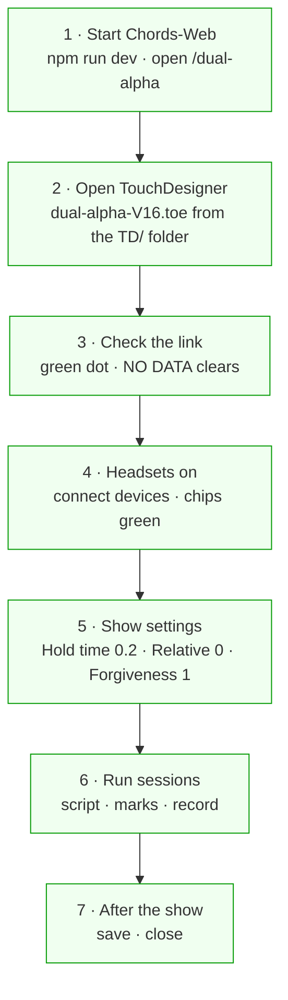
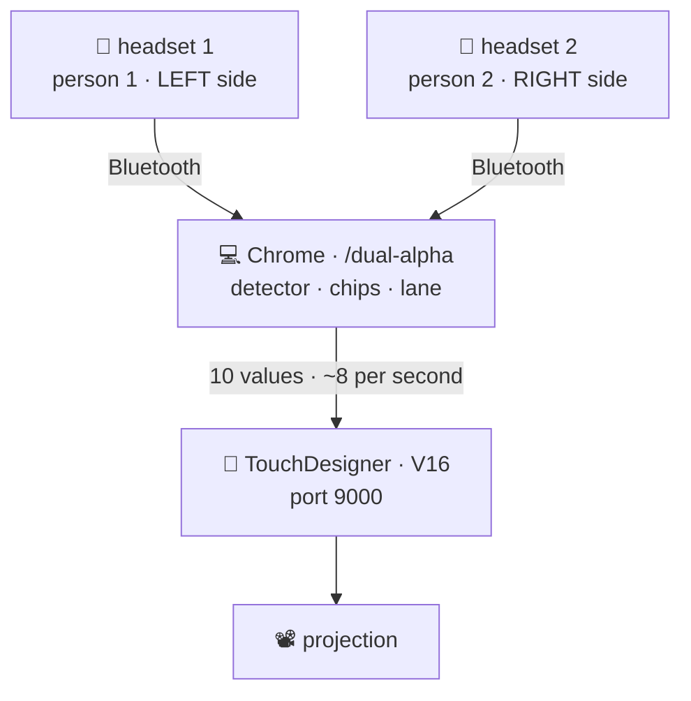
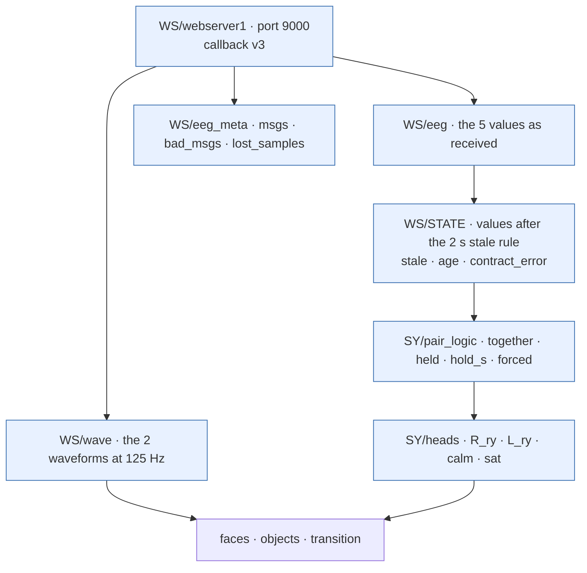
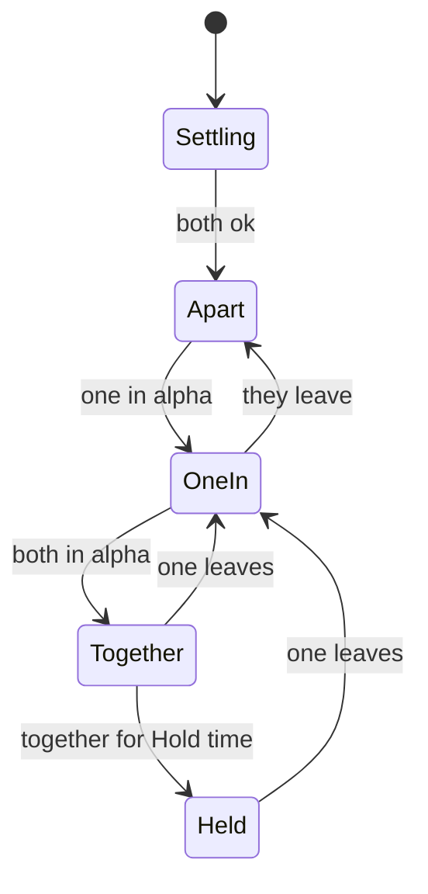
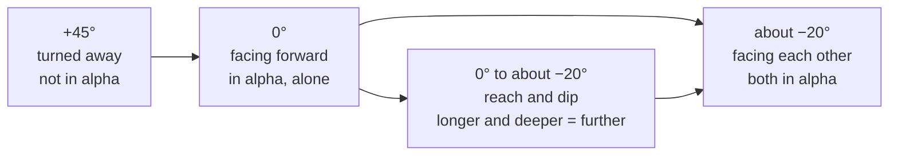
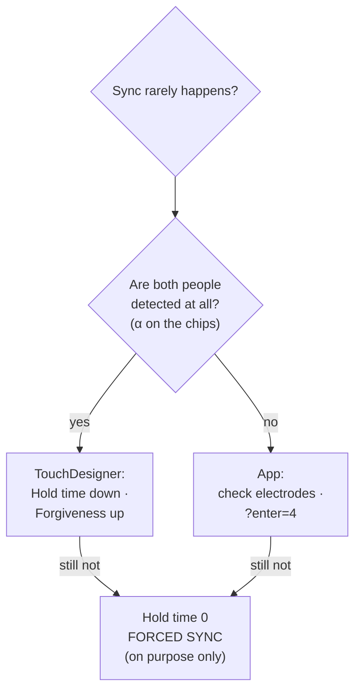
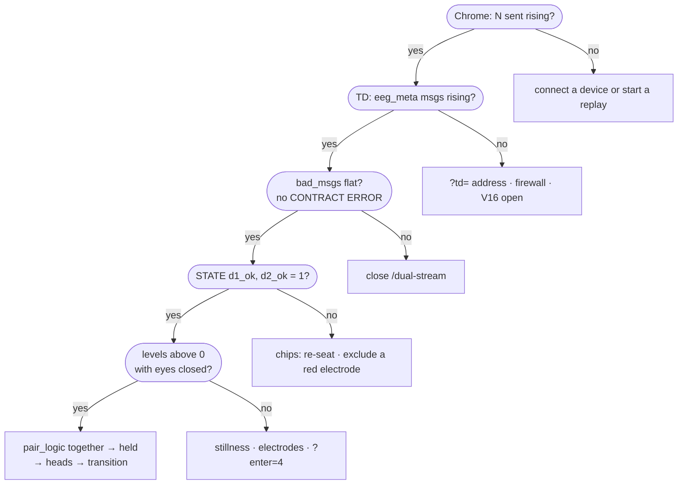

# Dual Alpha: Operator Guide

How to run the Dual Alpha piece from start to finish: start Chords-Web, open TouchDesigner, check the link, put the headsets on, run a session, tune the sync, and fix what goes wrong. It is written for whoever runs the show and tweaks the TouchDesigner file (Kaz, or anyone standing in).

> *Pairs with the `dual-alpha` branch of Chords-Web (page `/dual-alpha`, app 2.7.0a) and `dual-alpha-V16.toe` in this folder. V16 was built from Kaz's V15 without opening TouchDesigner, so the first opening is also a check: see [First opening of V16](#2-open-touchdesigner). Details of every change are in `TD_CHANGES.md`; the plan is `docs/alpha-v2/dual-alpha-route-2026-11-18.md`.*

---

## The whole run at a glance



**What flows where.** The browser page reads two headsets over Bluetooth, decides for each person whether they are in alpha, and sends one small message about 8 times a second to TouchDesigner on port 9000. TouchDesigner turns those values into the heads, objects and transition.



---

## What you need

| Item | Notes |
|---|---|
| A computer with **Chrome** and **Bluetooth** | Web Bluetooth needs Chrome (or Edge). Safari and Firefox cannot connect the headsets |
| **Chords-Web**, branch `dual-alpha` | with Node.js installed (`node --version` 22 or newer) |
| **TouchDesigner 2025** | on the same computer, or on a second one on the same network |
| The **`TD/` folder** from Kaz's `TD.zip` | it holds the face and object models; V16 must sit inside it ([ASSETS.md](ASSETS.md)) |
| `dual-alpha-V16.toe` | from this folder (`touchdesigner/` in the repo) |
| Two **NPG Lite** headsets, charged, with gel electrodes | three electrodes each (O1, Oz, O2) on the back of the head, plus ground and reference on the mastoids. Wired with fewer than three? Set **Electrodes in use** in Settings ([§1](#1-start-chords-web)) |
| Optional: Python 3 | for `mock_sender.py`, to test TouchDesigner with no headsets |

---

## 1. Start Chords-Web

1. Open a terminal in the Chords-Web folder and switch to the branch:
   ```
   git switch dual-alpha
   npm install        # first time only, or after pulling changes
   npm run dev
   ```
2. Wait for `Ready` and the address, normally `http://localhost:3000`.
3. Open that address in **Chrome**. The home page has two buttons under the title:
   - **Dual Alpha** (caption "pairs with TouchDesigner V16"): this piece.
   - **Dual Stream** (caption "pairs with TouchDesigner V15"): the old page, kept as the fallback ([§8](#8-fallback-the-old-pair)).
4. Click **Dual Alpha**. The page opens at `http://localhost:3000/dual-alpha`.

**Use the local address, not the public website.** The page opens a plain `ws://` socket to TouchDesigner, which a page loaded over `https` may not be allowed to do. `http://localhost` is always allowed, and Chrome also allows Bluetooth there.

**Options go in the address.** Add them after `/dual-alpha`, joined with `&`:

| Option | Example | When |
|---|---|---|
| `?td=<address>:<port>` | `/dual-alpha?td=192.168.1.20:9000` | TouchDesigner runs on another computer |
| `?mains=50` | `/dual-alpha?mains=50` | the venue's mains is 50 Hz (Europe, most of Asia). The default is 60 Hz (North America) |
| `?enter=4` | `/dual-alpha?enter=4` | people are rarely detected; lowers the alpha entry level from 5 dB to 4 dB ([§6.3](#63-from-the-app-the-last-resort)) |
| `?debug=1` | `/dual-alpha?debug=1` | logs every reading and message in Chrome's console (View → Developer → JavaScript Console) |

Example with several: `http://localhost:3000/dual-alpha?td=192.168.1.20:9000&mains=50`.

### The Settings panel

How strictly a signal is judged is **not** in the address. Open **Settings** in the toolbar. Everything in it applies immediately — no reload, so the headsets stay connected and a calibration already done is not thrown away — and is remembered on that computer. **Back to defaults** undoes the lot.

| Setting | Default | What it is for |
|---|---|---|
| **Electrodes in use** | 3 | How many of the three inputs have an electrode on them. The rest leave the vote |
| **Mains pickup can reject an electrode** | **off** | Whether mains hum alone may turn an electrode red |
| **Restless rejects an electrode over** | 50 % | Share of the last 10 s that may be artifact before an electrode goes red |

**Electrodes in use matters more than it looks.** A person is `ok` only when **no electrode left switched in is red**, so an input with nothing plugged into it floats, rails, goes red, and holds that person at **not ok** for the whole show — their side greys out in TouchDesigner and `pair_level` stays at 0 however good the one real electrode is. Set it to **1** for a headset wired as one active electrode plus reference and ground, and the unused inputs go dashed and read *no electrode · not in the vote* instead of pretending to be faults.

*(`?chans=`, `?mainsred=` and `?artifact=` still work in the address as a one-off override of the stored value, for old bookmarks.)*

**Where the electrodes go.** The labels O1, Oz and O2 are the occipital sites: back of the head, just above and either side of the inion, with reference and ground on the mastoids. That is where alpha is strongest, so it is the best place to put them.

**But the forehead and behind the ear do work.** Alpha spreads across the whole scalp, and detecting it from frontal and behind-the-ear sites is ordinary practice — it is exactly what a Muse does (AF7/AF8 on the forehead, TP9/TP10 behind the ears). So a temple-or-forehead electrode with reference and ground on the mastoids is a workable montage, not a broken one. Two things change:

* **The peak is smaller.** A frontal electrode sees a few dB less than an occipital one, and the fixed 5 dB entry level can sit above everything that person produces. **Run Calibrate.** The 15 s check measures that person's own entry and exit levels *and* their ceiling, and all three are applied to them alone — which is the whole point of it on a weak montage. `?enter=4` is the blunter version if you have no time for the check.
* **They pick up more muscle and eye movement.** The temple sits on the temporalis muscle, so clenching and swallowing show up; the mid-forehead sees blinks. That reads as *restless*, and above half of the last 10 s it turns the electrode red. Ask for a loose jaw and fewer hard blinks; it is the placement, not the person's state.

**When a person shows clear alpha but never reaches `ok`.** Look at what is red. The quality rules are *stricter than the detector needs*: the 50 µV mains limit was set against the **old** detector, which reported false alpha 56–100 % of the time at that level. The current one analyses 3–45 Hz, so a 50 or 60 Hz line is not even in the band it looks at — mains is a contact-quality measure here, not a detection one. **This is why the mains rule is off by default**: in Settings, *Mains pickup can reject an electrode* starts unticked, so hum alone can no longer force a person's side grey. The figure is still measured, still shown, and still turns the chip amber — it is still the best guide to how well an electrode is sitting. Railing and restlessness still reject an electrode on their own. If you want the old behaviour back, tick it; the toolbar then says *mains rejects over 50 µV* in amber, so a green chip in a noisy room is never mistaken for a measurement. Everything in Settings applies to **both people** — quality is decided in one place, `channelQuality`, and nothing about it is per-device.

**The 50/60 Hz notch is already applied**, before any alpha is measured — that is what `?mains=` selects. The `mains … µV` figure on each chip is how much hum the electrode is picking up, which is a contact-quality measure, not something left in the signal. If a chip says `50 Hz?` or `60 Hz?`, the notch is set to the wrong one and the fix is to reload with the other `?mains=`.

**What you should see now.** A toolbar with **Connect device 1**, **Connect device 2**, a grey dot reading **TD searching · 0 sent**, **Record**, and the recordings list. The page keeps trying to reach TouchDesigner on its own; there is no connect button.

---

## 2. Open TouchDesigner

1. **Copy `dual-alpha-V16.toe` into the `TD/` folder**, next to `20260108_Iterface2V15_Otherworld.toe` and the `.obj` models. The models are loaded by bare file name, so a V16 opened from anywhere else shows no faces or objects.
2. Open `dual-alpha-V16.toe` in TouchDesigner.
3. If TouchDesigner runs on a **different computer** from Chrome:
   - both computers on the same network;
   - on Windows, allow TouchDesigner through the firewall for port 9000 (Windows asks the first time; choose Private networks);
   - find the TouchDesigner computer's address (`ipconfig` on Windows) and use it in `?td=` in step 1.

**First opening of V16: check these once.** V16 has never been opened in TouchDesigner, so the first opening is part of the test. The full list is "Confirm on first open" in `TD_CHANGES.md`; the ones that matter on the night:

| Look at | Expect | If not |
|---|---|---|
| The Textport (Dialogs → Textport) and the network | no red error flags | note the operator and the message; compare with `TD_CHANGES.md` |
| `/project1/SYNCD/container1websocket_example/compat_info` | reads `contract v2 · app 2.7.0a · /dual-alpha` | you opened V15, not V16 |
| The `/controls` panel | sliders **Hold time**, **Relative alpha sync**, **Forgiveness**, and a red **NO DATA** label | lay out the panel by hand |
| The projection | the faces and objects are there, faces turned away, objects moving slightly | models missing: the file is not in the `TD/` folder |

**The operators you will look at.** All new ones are tinted blue in the network editor. `WS` is `/project1/SYNCD/container1websocket_example`, `SY` is `/project1/SYNCD`.



---

## 3. Check the link, before any headset

With Chords-Web open and TouchDesigner running:

| Where | Expect |
|---|---|
| Chrome toolbar | the dot turns **green**, "**TD connected**", and a toast "TouchDesigner connected" |
| TouchDesigner `/controls` | **NO DATA** stays until messages flow; that is normal with no headset and no replay |

**To see data move without headsets**, use either:

- **A replay in the app.** Pick a recording from the list (or "Replay CSV file…") and press **▶ Replay**. The counter "N sent" rises about 8 a second, **NO DATA** clears, and `WS/eeg` moves.
- **The mock sender**, from a terminal in `touchdesigner/`:
  ```
  python3 mock_sender.py --synthetic --loop
  ```
  It plays a 60 s scripted two-person scenario (one person in, then both, a short drop, a lost signal, one bad message). Add `--host <address> --port 9000` for a TouchDesigner on another computer. Close the Chrome tab first: only one sender at a time.

  **To check the look rather than the link, use `--tour` instead of `--synthetic`:**
  ```
  python mock_sender.py --tour --loop --stdlib
  ```
  A 90 s loop that walks both sides through every state the faces can be in: turned away,
  one person in alone (turning forward, reaching across and dipping back, reaching further
  as they go deeper), both in facing each other, each one being the deeper of the two,
  the shortest blink that Forgiveness absorbs, a longer drop that restarts the hold, each
  side greying on its own, both grey, a wrong-version message, and a silence long enough
  to reach the second scene. The transition fires three times a loop. Use this when
  judging whether the piece looks right; use `--synthetic` when checking the plumbing,
  because its timings are the ones quoted in the checks.

  **Add `--stdlib` for anything left running.** Without it the sender uses the `websockets` package, which pings the socket and hangs up with `keepalive ping timeout` when TouchDesigner's Web Server DAT does not answer — a loop left running for a few minutes dies on its own. `--stdlib` uses the sender's own client, which does not ping; a 100 s loop ran clean. On Windows the command is `python`, not `python3`.

**In the scripted scenario you should see**, in each 60 s loop: from about 5 s the left head turns forward and reaches toward the right and back; at about 15 s both heads turn to face each other; about 3 s later the transition plays; at about 38 s the left object goes grey and its head turns away; at 47 s **CONTRACT ERROR** flashes once.

---

## 4. Headsets on

**Electrodes.** Three active electrodes at the back of the head: **O1 (left), Oz (middle), O2 (right)**, plugged into channels 0, 1 and 2 in that order. **Oz on channel 1 matters**: it is the "main waveform" that drives each person's motion. Ground and reference on the **mastoids**, the bony part behind each ear. Write the plug order on each headset.

**Who is who.** Device 1 is **person 1** and drives the **right** side of the image; device 2 is **person 2**, the **left** side. Seat people accordingly.

1. Switch both headsets on.
2. Click **Connect device 1**, choose the NPG device in Chrome's list. Then **Connect device 2**.
3. Wait about 2 s: each channel's chip changes from "waiting for 2 s of signal" to readings.

**Read the chips.** One chip per electrode, grouped by person:

| On the chip | Meaning | Good |
|---|---|---|
| Dot colour | electrode quality | green; amber is a warning; red drops the electrode from the vote |
| `α` and a green border | this electrode sees alpha now | appears when eyes close |
| `prom … dB · … Hz` | how far alpha stands above the background, and its peak frequency | rises above 5 dB with eyes closed; 8–12 Hz |
| `tension … dB` | muscle (jaw, neck, forehead) | low; it jumps when the person clenches or talks |
| `mains … µV` | electrical hum picked up | below 20 (amber 20–50, red above 50) |
| `… 60 Hz?` after mains | the notch is on the wrong mains frequency | add or remove `?mains=50` |
| `artifact …% of 10 s` | how much of the last 10 s was disturbed | below 50% |
| Red word: `railed`, `restless`, `mains` | why the electrode is red | see [§7](#7-troubleshooting) |
| Crossed out | you excluded it by clicking | click again to include |

**Optional one-minute check of the wiring** (the "shorted-input test"): clip one channel's active electrode to the reference electrode. That channel's trace should go almost flat. If it does not, the reference is not where we think it is.

**A quick eyes test per person.** Ask them to close their eyes for 10 s, then open them for 10 s. With eyes closed the chips should show `α` and the person's band in the detector lane should light; with eyes open it should clear within about 2 s. Press **C** when they close their eyes and **O** when they open them: the lane marks the blocks so you can see the detector against what really happened. **X** clears the mark.

### Why only one chip shows alpha

Only the **reading electrode** — the one marked `reading`, normally O1 — shows an `α` flag, a green border or a green highlight on the graph. The other two inputs show contact information only: their dot colour, their mains figure, their rail line.

That is deliberate, and it is worth knowing why they used to light up green when they have no electrode of their own:

* **Every channel is measured against the same reference electrode.** So whatever the reference picks up — including any alpha reaching the mastoid — appears in *all three* channels, with the reference's own contribution common to each.
* **The detector is scale-free.** It reports prominence in dB above each channel's *own* 1/f background, never an absolute microvolt figure — which is what makes it work at all across people and electrode contact. The consequence is that a **faint copy** of a signal containing alpha reports the *same* prominence as the original. Amplitude is irrelevant to it.

Put together: an input with nothing on it picks up a weak version of what the reference sees, and the detector honestly reports "there is an alpha peak here, 6 dB above the background" — because there is. It is just not an independent measurement of anything. Showing that as green was worse than showing nothing, so it no longer does.

**A quick way to see it for yourself:** compare the `… Hz` figure on the three chips. If all three report the same peak frequency, you are looking at one signal appearing three times rather than three measurements.

### Eyes open or eyes closed, per person

Each person has an **eyes open / eyes closed** switch beside their name, and **eyes open is the default** — that is what the piece asks of them: they are watching the projection and reaching alpha through calm focus on it. Telling someone to shut their eyes takes away the thing they are responding to.

It is not cosmetic. Alpha roughly doubles when the eyes close, and the detector's 5 dB entry level was tuned on eyes-closed recordings. Eyes open, the same person's alpha is several dB smaller, so a fixed 5 dB can sit above everything they produce and the piece never responds to them however relaxed they get. The switch moves their entry level:

| Mode | Uncalibrated | After Calibrate |
|---|---|---|
| eyes open *(default)* | 3 dB | just above that person's own measured eyes-open baseline |
| eyes closed | 5 dB | the midpoint of their eyes-closed and eyes-open medians |

Eyes open buys more false positives, deliberately. Eyes closed is the exception — a demonstration, or showing someone what their own alpha looks like.

It only moves the thresholds. It never touches their **ceiling**, which is a measurement of the person rather than a decision about the piece, so switching mode cannot throw a calibration away.

**Where the controls are.** Each person's **alpha controls** sit at the top of their column, directly above their detector lane and their graph — that is what you watch and adjust, so it is not buried under the waveform. The panel shows, left to right:

| | |
|---|---|
| `4.2 dB now` with a dot | their live prominence, green when they are in alpha |
| `+1.2 over` / `0.8 to go` | how far they are from turning on — the number you are really acting on |
| `eyes open` / `eyes closed` | the mode |
| `on 3.0` with **−** and **+** | the entry level, nudged 0.5 dB at a time |
| `off 0.0 dB` | the exit level, which always follows 3 dB below |
| **Reset** | back to whatever their mode implies |

A line underneath says whether those levels came from that person's own 15 s check or are still the mode defaults.

**And you can drag the line.** The green on-line in the detector lane is draggable — there is a grab handle on its right-hand end, and the lane grows taller when it is draggable so the drag is not fiddly. The lane already draws the line against that person's live prominence, so the quickest honest way to make a weak signal reach the piece is to put the line just under where their peaks actually get to and watch the result. Everything updates as you drag: the lane, the panel and what is sent to TouchDesigner.

Three routes to the same number, on purpose: the **mode** buttons for the usual two cases, the **arrows** for a definite step, the **drag** when you want it against what you can see. The last thing you do wins, and `?enter=` in the address overrides all of it — with it set, the controls are shown but disabled and say so.

### Calibrate: the guided 15 second check

**Press Calibrate** in the toolbar once both people are wired and their chips are showing readings. A panel appears with the line to read out, the phase that is running, and a countdown. Three phases of five seconds:

1. Both sit still and comfortable, facing forward.
2. **Eyes open — blink 5 times**, firmly, about one a second.
3. **Eyes closed** and relaxed for 5 s — no talking, no frowning.
4. **Eyes open and still** for 5 s, looking softly ahead, trying not to blink.
5. It finishes on its own at 15 s. **Calibration done** ends it sooner and keeps what was measured; **Start over** restarts from the blinks; **Cancel** leaves without changing anything.

**Each phase ignores its first two seconds**, and the panel says *settling — not recording yet* while it does. The detector reports prominence over a trailing 2 s window, so a reading taken sooner than that after an instruction is partly measuring the previous phase. Dropping those is why five seconds a phase measures *better* than the ten-second version did — the earlier one put the contaminated readings into the median along with the good ones. What is left is about 23 readings a phase, against the 5 a median needs.

**Why the blinks come first.** A flat electrode and a person with genuinely weak alpha look *identical* in the numbers, and that ambiguity has cost real time on this piece — an electrode reading nothing was taken for "this person has no alpha" more than once. A blink is the one signal you can **ask for** and be sure of: it is large, it is deliberate, and on a forehead or temple electrode it is unmissable. So the check opens by asking for five, and the panel says per person whether that electrode saw them:

* **blinks seen** — the electrode is picking that person up. Whatever follows means something.
* **no blink response** — the electrode is almost certainly not making contact. Re-seat it, especially the reference and ground behind the ears, and start over. A ceiling measured through a dead electrode is a ceiling measured off noise.

It is **reported, never enforced**: a person who misses the blink check still gets whatever the alpha phases measured, and the confirmation toast says `NO BLINK RESPONSE` so you know how much to believe it.

**What the last two phases set.** Each person's own **entry level**, **exit level** and **alpha ceiling**, from their eyes-closed median against their eyes-open median — all three, applied to that person alone. `level` then reaches 1.0 at what is strong *for them* rather than at a fixed 12 dB, and the detector turns on at a level they actually reach. Weak-alpha people and frontal montages are what this is for: without it they may never cross the 5 dB default at all, and the piece never responds to them.

The final phase is **eyes open and still** on purpose. In the old two-phase version the eyes-open half was whatever the person happened to do, blinks included, and a blink inflates prominence — so the floor was not a floor. The blinking is now over before the measurement starts.

**Press Calibrate again for every new pair.** It always re-enters the check from the blinks and discards the previous pair's numbers, so people moving through the piece each get their own.

**Read the panel before you confirm.** Each person shows `blink N · closed N · open N`, the readings taken in each phase. A person sitting at all zeros is **not streaming** — their headset is the problem, not their alpha. Confirming anyway leaves them uncalibrated on the 12 dB default, which is safe but means the check did nothing for them. A person needs at least 5 readings in each of the two alpha phases to be trusted; the blink phase is never required.

**One person on their own calibrates fine.** The two people are measured separately all the way through, so you can calibrate one person while the other headset is off, unpaired or broken. Whoever is not sending ends on all zeros, keeps the 12 dB default and is left alone — they do not spoil the other person's ceiling, and they do not block it. This is covered by a test (`calibration.test.ts`, *one person calibrates on their own when the other device is not connected*), so it will not quietly regress. TouchDesigner is equally happy with one signal: that side's head and object respond as normal, and only `pair_level` stays at 0, which it would anyway with one person.

**Skipping it is allowed.** Both people simply stay `uncalibrated` and run on the 12 dB default, exactly as before this step existed.

### Reading the page: the Legend

The toolbar has a **Legend** panel, closed by default. It lists every coloured mark, line and status word on the page in a table, and for each one says **what TouchDesigner does with it** — which is usually the question you actually have. Everything on the page is also hoverable: the status words carry hover cards, and each electrode chip explains its own numbers in a tooltip with its live values in them.

Under each person's chips there is a **To TouchDesigner** panel. This is the fastest answer to *is this device detecting alpha, and how much?*:

* `d1_level` / `d2_level` with a bar — 0 to 1, and 0 means the vote did not pass.
* `d1_ok` / `d2_ok` — a green or red dot.
* `d1_w` / `d2_w` — `flowing` or `stalled`.
* **prominence**, on the same −3 to 15 dB scale as the detector lane, with tick marks for the on threshold, the off threshold, and the ceiling where `level` reaches 1. A blue bar that never reaches the green tick means the device is reading, but there is no alpha to read.
* A sentence saying what the projection is doing with this side right now, in the same words as §6.1.

If the panel's numbers are not moving, nothing on the projection is moving either, whatever the graphs above it look like.

---


**When a duo finishes and you are waiting for new people**, the piece does this on its own,
measured: after about **2 seconds** without data the two objects grey out, and after about
**6 seconds** the image switches to the **second scene**. That is the waiting state — the
background does not grey, it changes scene. Start the next pair and it returns to the first
scene within 2 seconds, with the colour easing back over about a second. Nothing to press.

### Sound

The piece now plays a drum-and-bass break that the two people mix between them. It goes to
**the computer's default audio output** — `/project1/audiodevout2` has both Driver and Device
set to `default`, so it follows whatever Windows is using, and the mono mix is cycled to both
front channels. Nothing to configure on a new laptop beyond having an output selected.

| What you hear | Driven by |
|---|---|
| tempo, roughly 139–200 BPM | `pair_level` — it drives harder when both are in alpha |
| snare, swing, echo, filter resonance | `pair_level` |
| kick weight, bass level, distortion, bass EQ | person 2 (the right side) |
| hats, how far the kick opens the bass filter, treble EQ | person 1 (the left side) |
| silence | no data: everything is muted by `stale`, so quiet means nobody is connected |

**To turn the sound off**, set `/project1/filein_or_AudioLinein` **Index** back to **1**. That
restores Kaz's line-in path exactly. Note the output chain shipped *bypassed* in V15, which is
why the file used to be silent; the bypass is now cleared on `filein_or_AudioLinein`, `null1`
and `audiodevout2`, and re-setting those three bypasses gets the silence back.

The stems live in the `TD/` folder next to the `.toe` (`break_*.wav`) and are referenced by
bare filename, like the models — so if the piece is silent but the visuals work, check they
were copied across.

### Things that have bitten us on this machine

- **Chrome is not installed; Edge is what is actually used.** Edge is Chromium, so Web Bluetooth
  works and the table above allows it, but every instruction that says "Chrome" means Edge here.
  Install Chrome before the show if you would rather follow the guide literally.
- **TouchDesigner's incremental save is on.** Ctrl+S writes `dual-alpha-V16.1.toe` rather than
  overwriting `dual-alpha-V16.toe`, so the file the repo tracks does not change and the next
  save becomes `.2`. Turn the preference off, or save deliberately over the tracked name.
- **A TouchDesigner save carries live state into the file.** It serialises OP storage, so a save
  can embed a stale clock, `pair_logic`'s hold counter mid-count, and `wave`'s whole ring
  buffer. After saving, clear it with `op('wave').unstore('*')` (and the same on `heads` and
  `pair_logic`) or the next open starts mid-state.
- **`dual-alpha-V16-debug.toe`, if you find one, is not the show file.** It carries a Web Server
  DAT that executes arbitrary Python sent to it over HTTP. It exists for debugging on a desk.
  Never run it for a show, and never copy it over `dual-alpha-V16.toe`.

---

## 5. Show settings in TouchDesigner

Set these on the `/controls` panel before the doors open:

| Slider | Show value | Range |
|---|---|---|
| **Hold time** | **0.2** s | 0–5 s; **0 forces the sync**. 0.2 s is about two detector hops, so *any* overlap merges — see [§6.2](#62-making-the-sync-easier-or-harder-live) |
| **Relative alpha sync** | **0** | 0–1 |
| **Forgiveness** | **1** s | 0–3 s |

**The red label on `/controls` must be empty** once data flows. It is on the panel only and never on the projection:

| Label | Means |
|---|---|
| **FORCED SYNC** | Hold time is 0: the heads meet and the transition plays whatever the data. Only on purpose |
| **CONTRACT ERROR** | messages are arriving in the wrong format: the wrong page (Dual Stream) is sending |
| **NO DATA** | nothing valid for 2 s: no page sending, wrong address, or a firewall |

The small number in the corner of the projection (`SY/text1`) shows the Hold time value, as it used to show the Sync Trigger value. Blank its text if you do not want it projected.

---

## 6. During the show

### 6.1 What the audience sees, and why

Each value the app sends has one job. The page sends 10 values; five of them steer the piece.

| Value | What it does on screen |
|---|---|
| `d1_level`, `d2_level` (0–1) | above 0, **that person's head turns to face forward, then reaches toward the other and dips back**, further the longer and deeper they stay in. **Their object calms**. The **deeper head turns a little further** when both are in |
| `d1_ok`, `d2_ok` (0 or 1) | at 0, **that side fades to grey** and its head turns away, so a lost signal never looks like calm |
| `pair_level` (0–1) | above 0, **both heads turn past forward to face each other** over the 1.5 s ease. Overlap for **Hold time** (0.2 s), and **the transition plays** |
| `d1_w`, `d2_w` (waveforms) | **the live texture and motion**: object height, noise layers and rotations, as in V15 |
| `v`, `fs`, `n` | bookkeeping: format check, sample rate, lost-message count |

**The five states of a pair.**



From any state, a lost signal goes back to **Settling**.

| State | On screen |
|---|---|
| Settling | the side with a lost signal is grey; heads turned away |
| Apart | heads turned away; objects moving with each person's signal |
| One in | that head faces forward, then reaches toward the other and dips back; its object calmer; the other head turned away |
| Together | both heads turn to face each other over about 3 s; the deeper one a little further |
| Held | the transition plays |

**The heads, in angles.** +45° is turned away (where V15 starts), 0° is facing forward, negative is turned toward the other person.



**Timing to expect.** The app needs about 1.3 s after eyes close to call alpha, and about 1.9 s after they open to drop it — that is the detector's 2 s window, and it is the one delay that cannot be tuned away. After that the piece is quick.

**One person in alpha, on their own.** Their head turns from away toward the front as soon as the app reports it, and it is tuned for the bursts the signal actually gives — roughly half a second to three seconds:

| Their burst | What their head does |
|---|---|
| 0.5 s | swings the full way from turned-away to facing forward |
| 1 s | past forward, leaning about 14° toward the other person |
| 2–3 s | the full reach, about 18°, dipping back toward forward as it holds |

It eases back out more slowly than it goes in (1.2 s against 0.25 s), so the end of a burst is a settle rather than a snap, and two bursts close together read as one gesture. Measured with `scripts/head_timing.py`, which runs the real head logic offline.

**Both in alpha.** The heads turn past forward to face each other over the 1.5 s ease, and the transition fires once they have overlapped for **Hold time**, 0.2 s by default. So the merge happens on any real overlap rather than needing a sustained one.

**Nothing latches.** The heads follow `together` through the ease, so they turn toward each other for as long as the overlap lasts and ease back to each person's own live state when it ends. Dropping out is not a failure and costs nothing — the pair can simply try again, as often as they like. The transition envelope does play out in full once it fires (`trigger3`: attack 1 s, decay 3 s), which is what makes a short overlap still read as a moment.

### 6.2 Making the sync easier or harder, live

The old **Sync Trigger** slider is gone. In its place, in this order:

1. **Lower Hold time** (0.2 s by default; raise it toward 1–3 s if the merge is firing too easily for the room, or lower it to make it even more immediate).
2. **Raise Forgiveness** (1 → 2 s). A blink or a flicker by one person no longer restarts the count.
3. **Keep Relative alpha sync at 0.** Raising it asks for both people to be deeper together: harder, not easier.
4. If the moment must happen: **Hold time 0** (FORCED SYNC). Remember to put it back to 0.2.



### 6.3 From the app: the last resort

The TouchDesigner sliders cannot make a person count as "in alpha"; the app decides that. If people with eyes closed rarely get `α` on their chips:

1. Re-seat the electrodes: hair under an electrode is the usual cause. Check the chips are green.
2. Make sure the person is still and relaxed, eyes gently closed.
3. Reload the page with **`?enter=4`** (or 3.5). The chips then show "enter 4 dB". Lower values detect more, and also call alpha more often with eyes open.

### 6.4 Recording

Press **Record** at the start of a session and **Stop recording** at the end. You get two files: a CSV of the raw signal (kept in the page's recordings list; **CSV** downloads it), and a `td_stream.jsonl` (downloaded at once) with every message sent to TouchDesigner. The JSONL can be replayed into TouchDesigner later with `mock_sender.py --file <name>.td_stream.jsonl`, with no headsets, to tune the visuals.

---

## 7. Troubleshooting

**Start from the symptom.** The left column is what you see; the middle is where to look; the right is the fix.

| Symptom | Look at | Fix |
|---|---|---|
| Dot stays grey, "TD searching" | is TouchDesigner open with V16? `WS/webserver1` active, port 9000 | open V16; on two computers, check `?td=` address and the Windows firewall |
| Dot green, but **NO DATA** on `/controls` | the "N sent" counter in Chrome | 0 sent: no device streaming and no replay; connect a headset or start a replay |
| **CONTRACT ERROR** | which page is open | close `/dual-stream`; only `/dual-alpha` talks to V16. Only one page at a time |
| Everything frozen, no error | did you open **V15**? `compat_info` | open V16. V15 ignores the new messages and shows nothing |
| One side grey | that person's chips | a red chip: re-seat that electrode, or click it to exclude it. A device disconnected: reconnect |
| Both sides grey | `WS/STATE` `stale`, `age` | stale = 1: no message for 2 s. Check the page is still open and sending |
| A chip is red, **railed** | the `rail … % low/high · raw a–b` line on the chip | a few percent = knocks: check the plug and the cable slack. Most of the samples = the input is pinned, and that is nearly always the **reference or ground** electrode, not this one — see the next row |
| **Railed and high mains together**, all session | the two electrodes **behind the ears** | this pair of symptoms is one fault, not two. Mains hum is common to the whole body and the amplifier only cancels it if the reference has good contact; with a poor reference it saturates *and* the hum goes through the roof. Re-seat reference and ground first, fresh gel, pressed onto bare skin, hair moved aside — the mastoid is bone and dries out fast. Only then look at the active electrode |
| A chip is red, **restless** | more than half of the last 10 s was disturbed | ask the person to sit still, relax the jaw |
| A chip is red, **mains** | hum above 50 µV | re-seat electrodes; move away from power cables and chargers; unplug the laptop charger |
| Chip says **"60 Hz?"** or **"50 Hz?"** | the notch is on the wrong mains frequency | reload with or without `?mains=50` |
| Eyes closed but no `α` | `prom` stays below the green line in the detector lane | **press Calibrate** — the 15 s check sets this person's own entry level, which is what a forehead or behind-the-ear electrode needs; then stillness and contact; then `?enter=4` ([§6.3](#63-from-the-app-the-last-resort)) |
| A chip reads **restless** all session | where that electrode actually is | the temple sits on jaw muscle and the mid-forehead sees blinks; both read as restless. Loose jaw, fewer hard blinks, or move it toward the back of the head |
| **One chip stays restless while its neighbour recovers** | nothing — this was a bug, fixed | the artifact gate compares each electrode against its own recent amplitude, and that reference only updated on clean windows. An electrode whose reference was captured while it was flat or pinned could never produce a clean window again, so it stayed restless for the whole session while a neighbour that happened to start clean behaved normally. The gate now re-seeds its reference after holding for more than ~3 s, which is longer than it is ever meant to hold. It still cannot excuse a railing electrode: that is judged on the raw counts, separately |
| One person is **never ok** and only one electrode looks real | is anything plugged into the other inputs? | an empty input floats and rails, and a single red included electrode holds that person at not ok all show. set **Electrodes in use** to 1 (or 2) in the Settings panel ([§1](#1-start-chords-web)) |
| `α` with eyes open | some relaxed people do have alpha with eyes open | expected; the piece responds to alpha, not to closed eyes |
| Heads never meet though both chips show `α` | `SY/pair_logic` `together`; `/controls` Relative alpha sync | Relative alpha sync back to 0. Each person needs `α` on their reading electrode and `ok` |
| Heads meet but no transition | `SY/pair_logic` `held`, `hold_s` | Hold time should be 0.2; a drop longer than Forgiveness restarts the count. If `together` is 1 and `held` stays 0, Hold time has been turned up |
| Transition plays all the time | **FORCED SYNC** on the panel | Hold time back to 0.2 (not 0) |
| A waiting head turns **away** from the other instead of toward | `SY/heads` `R_ry`, `L_ry` | the turn's sign is inferred; swap the signs of `out['R_ry']` and `out['L_ry']` in `SY/heads_callbacks` |
| Motion stutters or jumps | `WS/eeg_meta` `lost_samples` rising; `WS/wave` info | Wi-Fi or Bluetooth drops; move closer; on one computer this should not happen. If `wave` shows a sample rate other than 125, see `TD_CHANGES.md` item 2 |
| An object's three rotations move in step | expected with one waveform per person | add Delay CHOPs after `WS/wave_slot2` (0.33 s) and `WS/wave_slot3` (0.67 s) |
| Faces or objects missing | the file's folder | V16 must be in the `TD/` folder with the `.obj` files |

**Where to look, in TouchDesigner.** Middle-click an operator, or attach an Info CHOP, to see its values.

| Operator | Channels | Tells you |
|---|---|---|
| `WS/eeg` | `d1_level`, `d1_ok`, `d2_level`, `d2_ok`, `pair_level` | the values as they arrive |
| `WS/eeg_meta` | `msgs`, `bad_msgs`, `lost_samples`, `last_msg`, `n` | whether messages arrive (about 8 a second), are refused, or are lost |
| `WS/STATE` | the five values, `stale`, `age`, `contract_error` | what the piece actually uses, after the 2 s stale rule |
| `WS/wave` | `d1_w`, `d2_w` | the two waveforms at 125 Hz |
| `SY/pair_logic` | `together`, `held`, `hold_s`, `gap_s`, `forced` | why the heads meet or the transition fires |
| `SY/heads` | `R_ry`, `L_ry`, `d1_calm`, `d2_calm`, `d1_sat`, `d2_sat` | the head angles, calming and grey actually applied |

**Diagnose in order**: is the app sending (`N sent` rising)? Is TouchDesigner receiving (`eeg_meta` `msgs` rising)? Are messages accepted (`bad_msgs` flat, no CONTRACT ERROR)? Are the people ok (`STATE` ok = 1)? Are they in alpha (`level` > 0)? Is the pair together (`pair_logic` `together`)?



---

## 8. Fallback: the old pair

If V16 misbehaves on the night, run the old pair. It is in the same build and was checked to be unchanged.

1. Close the `/dual-alpha` tab.
2. On the home page, click **Dual Stream**.
3. Connect both devices; for each channel press **EEG** and the mains **notch** (60 Hz, or 50 Hz in a 50 Hz country), as before.
4. Click **Connect to TouchDesigner**.
5. In TouchDesigner, open Kaz's **V15** (`20260108_Iterface2V15_Otherworld.toe`). Its **Sync Trigger** slider works as it always did.

If even that misbehaves, the last known-good app is commit `61e864a`: `git switch --detach 61e864a`, then `npm run dev`.

---

## 9. Tweaking the look

Change these on the PC, by eye, with a recording playing through `mock_sender.py --file … --loop`. All are starting values from the plan.

| What | Where | Value now |
|---|---|---|
| The 3 s ease of the heads | `SY/filter18` width | 3 s |
| Away angle | `AWAY` in `SY/heads_callbacks` | 45° |
| Waiting head's reach, ramp, dip period | `REACH_MAX`, `REACH_RAMP`, `REACH_PERIOD` | 12°, 8 s, 8 s. `REACH_PERIOD` 0 = lean and hold, no dip |
| Extra reach from depth | `DEPTH_MAX` | 8° at level 1 |
| Meeting angle; the deeper head's extra | `TOGETHER_ANGLE`, `DEEPER_EXTRA`, `DEEPER_GAIN` | −20°, 5°, 2 |
| How fast heads, calm and grey follow | `TAU_TURN`, `TAU_LEVEL`, `TAU_GREY` | 1 s each |
| How much an object calms | `CALM` | 0.7 (rotation swing × 1 − 0.7·level) |
| Waveform play-out delay | `DELAY_S` in `WS/wave_callbacks` | 0.25 s |
| Spectrum window | `WS/audiospect1_FreqCalc` FFT size | 128 (about 1 s at 125 Hz; 64 halves it) |
| Hold time below which the sync is forced | `FORCE_EPS` in `SY/pair_logic_callbacks` | 0.05 s |

**Not wired yet: the deeper head's colour.** The plan asks for the deeper person's head to cycle colour a little faster. In V15 nothing animates the two faces' colour (they share one material with fixed values), so there was nothing to split. `SY/heads` already outputs `d1_colormult` and `d2_colormult`; `TD_CHANGES.md` step B7 says how to hook them up once the faces' colour parameter is chosen.

**Keeping the repo copy in step.** After saving changes in TouchDesigner, copy the `.toe` back to `touchdesigner/` in the repo and run `scripts/td-expand.sh`, so the text copy matches. If you edited Python inside a DAT, copy it back to its `.py` file (`callback_v3.py` or `td_py/…`). Then commit both. `COMPAT.md` has the commands.

---

## Glossary

| Term | Meaning |
|---|---|
| Alpha | the 8–13 Hz rhythm at the back of the head, strong when the eyes are closed and the person is relaxed |
| Chip | the small box per electrode on the Dual Alpha page showing its readings and quality |
| Detector lane | the strip under each person's traces showing alpha strength, thresholds and the decision |
| Forgiveness | how long a brief drop by either person is ignored before the Hold time count restarts |
| Hold time | how long both must be in alpha at the same time before the transition; 0.2 s by default, so any overlap counts. 0 forces it regardless of the data |
| `level` | how far into alpha a person is, 0–1, scaled to them; 0 means not in alpha |
| `ok` | 1 when a person's signal can be trusted |
| `pair_level` | the lower of the two levels; 0 unless both are ok. "Relative alpha synchrony" |
| Mastoid | the bone behind the ear; ground and reference sit there |
| Mains | the hum the building's electricity induces in an electrode — 60 Hz here, 50 Hz in much of Europe and Asia. Interference, not brain activity: it is filtered out before anything is measured, and the µV figure on each chip is the best single measure of how well that electrode is sitting |
| Notch | the filter that removes the mains hum. Set with `?mains=50` or `?mains=60`; a chip saying `50 Hz?` means it is set to the wrong one |
| Prominence | how far the alpha peak stands above that person's own 1/f background, in dB. The blue line in the detector lane, and what `level` is derived from |
| Ceiling | the prominence at which `level` reaches 1, measured from a person's eyes-closed phase in the 15 s check; 12 dB by default |
| Artifact | a window too restless to trust (movement, jaw, blinks). The gate holds the previous decision and the chart shades it grey |
| Railed | a raw count hit 0 or 4095 — the amplifier clipped, usually a loose electrode. Turns that electrode red |
| Tension | high-frequency power: jaw, neck and forehead muscle. Not sent anywhere, but it buries the alpha peak, which is why a person who feels calm can read as no alpha |
| Reading electrode | the positive, which the page calls O1. These headsets are one differential channel -- that electrode plus a reference and a ground -- so it alone decides whether a person is in alpha, immediately. There is no vote between electrodes |
| Relative alpha sync | the minimum `pair_level` that counts as together; 0 = any |
| WS, SY | short for `/project1/SYNCD/container1websocket_example` and `/project1/SYNCD` |
