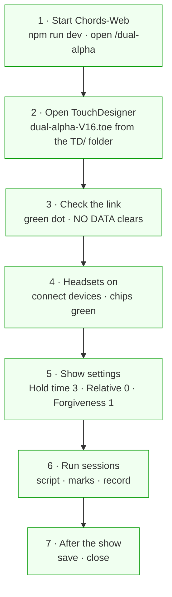
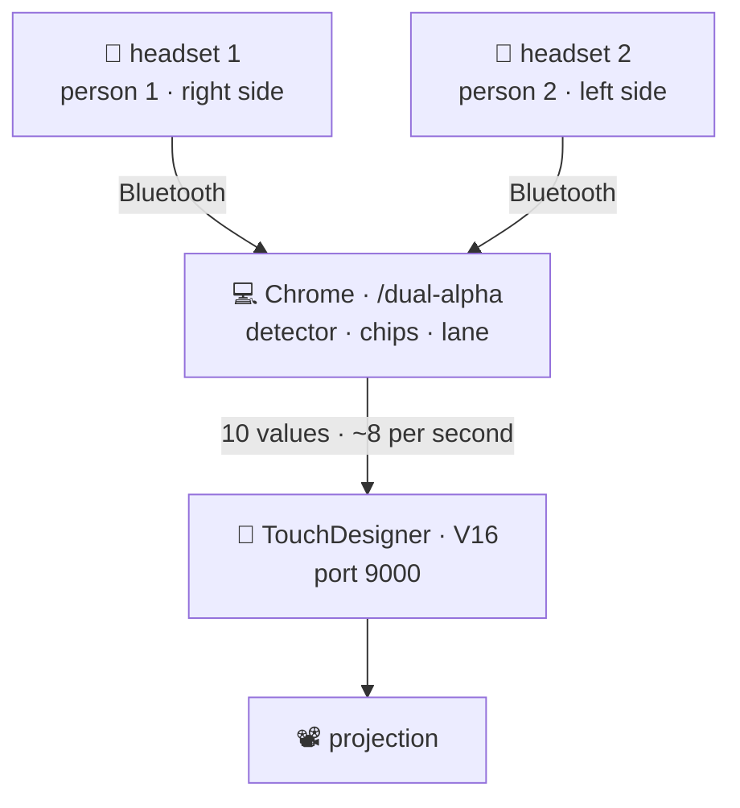
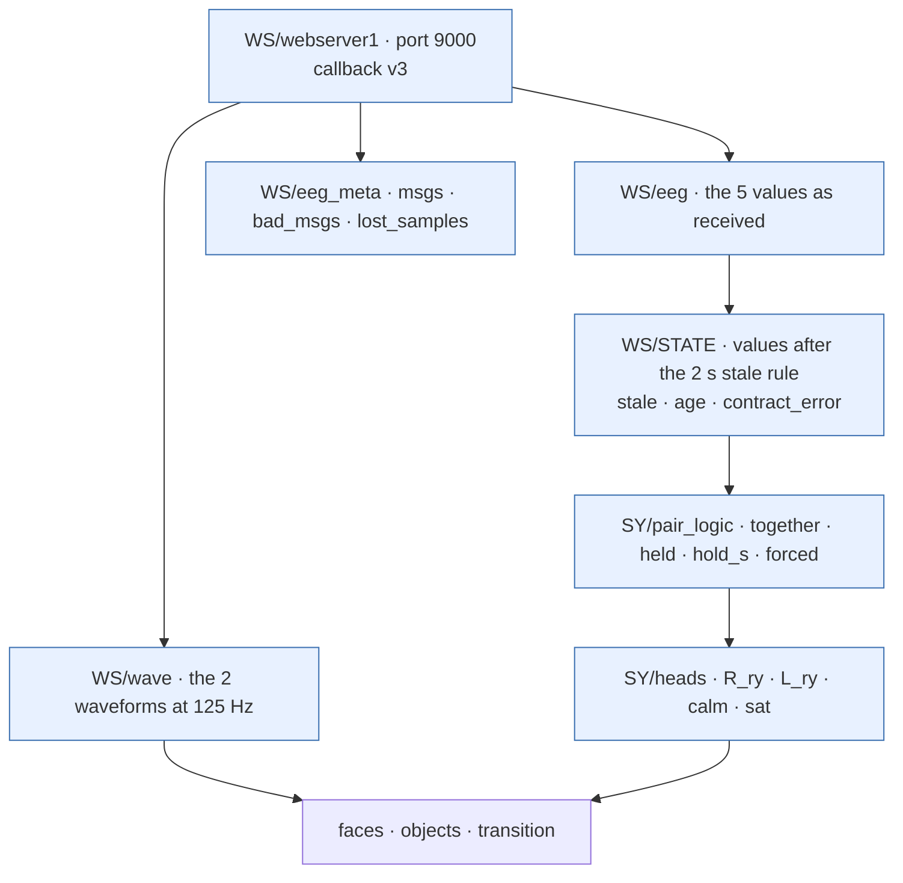
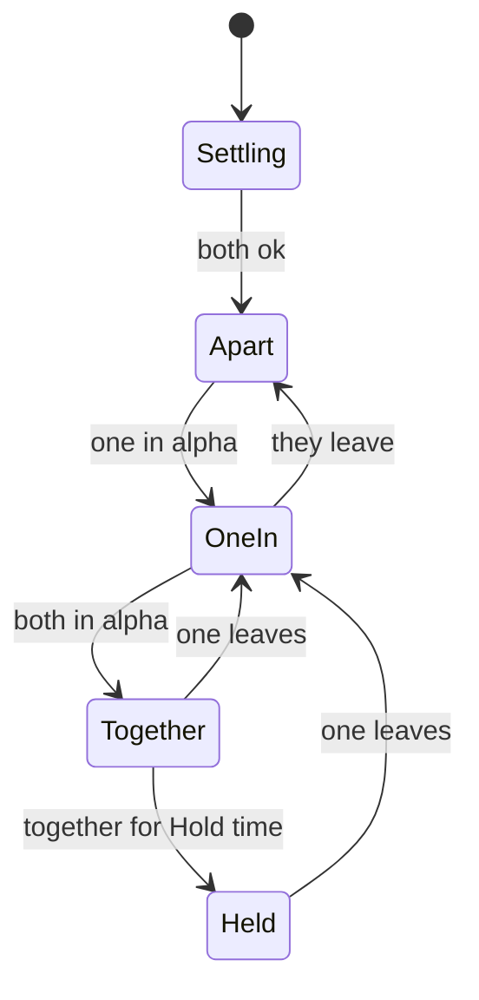
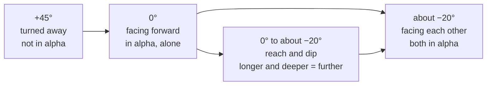
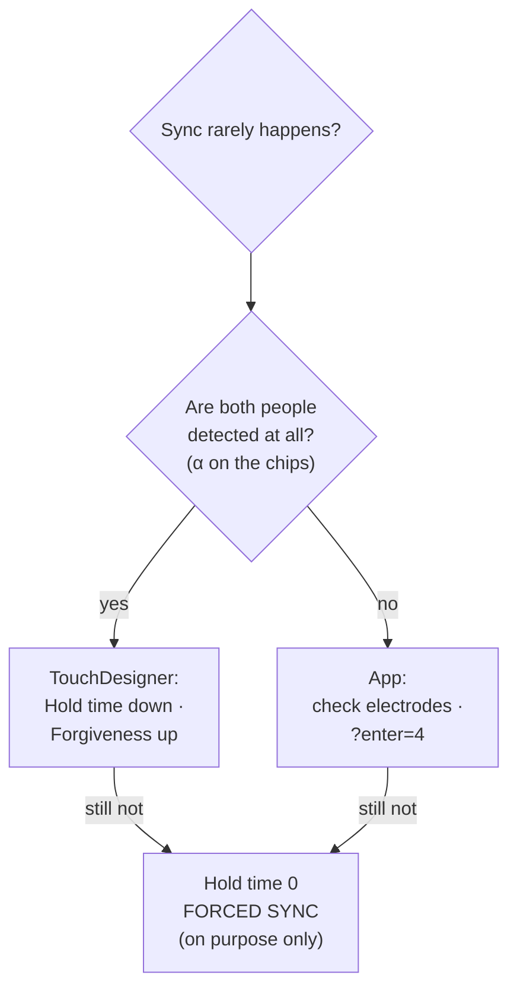

# Dual Alpha: Operator Guide

How to run the Dual Alpha piece from start to finish: start Chords-Web, open TouchDesigner, check the link, put the headsets on, run a session, tune the sync, and fix what goes wrong. It is written for whoever runs the show and tweaks the TouchDesigner file (Kaz, or anyone standing in).

> *Pairs with the `dual-alpha` branch of Chords-Web (page `/dual-alpha`, app 2.7.0a) and `dual-alpha-V16.toe` in this folder. V16 was built from Kaz's V15 without opening TouchDesigner, so the first opening is also a check: see [First opening of V16](#2-open-touchdesigner). Details of every change are in `TD_CHANGES.md`; the plan is `docs/alpha-v2/dual-alpha-route-2026-11-18.md`.*

---

## The whole run at a glance



**What flows where.** The browser page reads two headsets over Bluetooth, decides for each person whether they are in alpha, and sends one small message about 8 times a second to TouchDesigner on port 9000. TouchDesigner turns those values into the heads, objects and transition.



---

## What you need

| Item | Notes |
|---|---|
| A computer with **Chrome** and **Bluetooth** | Web Bluetooth needs Chrome (or Edge). Safari and Firefox cannot connect the headsets |
| **Chords-Web**, branch `dual-alpha` | with Node.js installed (`node --version` 22 or newer) |
| **TouchDesigner 2025** | on the same computer, or on a second one on the same network |
| The **`TD/` folder** from Kaz's `TD.zip` | it holds the face and object models; V16 must sit inside it ([ASSETS.md](ASSETS.md)) |
| `dual-alpha-V16.toe` | from this folder (`touchdesigner/` in the repo) |
| Two **NPG Lite** headsets, charged, with gel electrodes | three electrodes each (O1, Oz, O2) plus ground and reference on the mastoids |
| Optional: Python 3 | for `mock_sender.py`, to test TouchDesigner with no headsets |

---

## 1. Start Chords-Web

1. Open a terminal in the Chords-Web folder and switch to the branch:
   ```
   git switch dual-alpha
   npm install        # first time only, or after pulling changes
   npm run dev
   ```
2. Wait for `Ready` and the address, normally `http://localhost:3000`.
3. Open that address in **Chrome**. The home page has two buttons under the title:
   - **Dual Alpha** (caption "pairs with TouchDesigner V16"): this piece.
   - **Dual Stream** (caption "pairs with TouchDesigner V15"): the old page, kept as the fallback ([§8](#8-fallback-the-old-pair)).
4. Click **Dual Alpha**. The page opens at `http://localhost:3000/dual-alpha`.

**Use the local address, not the public website.** The page opens a plain `ws://` socket to TouchDesigner, which a page loaded over `https` may not be allowed to do. `http://localhost` is always allowed, and Chrome also allows Bluetooth there.

**Options go in the address.** Add them after `/dual-alpha`, joined with `&`:

| Option | Example | When |
|---|---|---|
| `?td=<address>:<port>` | `/dual-alpha?td=192.168.1.20:9000` | TouchDesigner runs on another computer |
| `?mains=50` | `/dual-alpha?mains=50` | the venue's mains is 50 Hz (Europe, most of Asia). The default is 60 Hz (North America) |
| `?enter=4` | `/dual-alpha?enter=4` | people are rarely detected; lowers the alpha entry level from 5 dB to 4 dB ([§6.3](#63-from-the-app-the-last-resort)) |
| `?debug=1` | `/dual-alpha?debug=1` | logs every reading and message in Chrome's console (View → Developer → JavaScript Console) |

Example with several: `http://localhost:3000/dual-alpha?td=192.168.1.20:9000&mains=50`.

**What you should see now.** A toolbar with **Connect device 1**, **Connect device 2**, a grey dot reading **TD searching · 0 sent**, **Record**, and the recordings list. The page keeps trying to reach TouchDesigner on its own; there is no connect button.

---

## 2. Open TouchDesigner

1. **Copy `dual-alpha-V16.toe` into the `TD/` folder**, next to `20260108_Iterface2V15_Otherworld.toe` and the `.obj` models. The models are loaded by bare file name, so a V16 opened from anywhere else shows no faces or objects.
2. Open `dual-alpha-V16.toe` in TouchDesigner.
3. If TouchDesigner runs on a **different computer** from Chrome:
   - both computers on the same network;
   - on Windows, allow TouchDesigner through the firewall for port 9000 (Windows asks the first time; choose Private networks);
   - find the TouchDesigner computer's address (`ipconfig` on Windows) and use it in `?td=` in step 1.

**First opening of V16: check these once.** V16 has never been opened in TouchDesigner, so the first opening is part of the test. The full list is "Confirm on first open" in `TD_CHANGES.md`; the ones that matter on the night:

| Look at | Expect | If not |
|---|---|---|
| The Textport (Dialogs → Textport) and the network | no red error flags | note the operator and the message; compare with `TD_CHANGES.md` |
| `/project1/SYNCD/container1websocket_example/compat_info` | reads `contract v2 · app 2.7.0a · /dual-alpha` | you opened V15, not V16 |
| The `/controls` panel | sliders **Hold time**, **Relative alpha sync**, **Forgiveness**, and a red **NO DATA** label | lay out the panel by hand |
| The projection | the faces and objects are there, faces turned away, objects moving slightly | models missing: the file is not in the `TD/` folder |

**The operators you will look at.** All new ones are tinted blue in the network editor. `WS` is `/project1/SYNCD/container1websocket_example`, `SY` is `/project1/SYNCD`.



---

## 3. Check the link, before any headset

With Chords-Web open and TouchDesigner running:

| Where | Expect |
|---|---|
| Chrome toolbar | the dot turns **green**, "**TD connected**", and a toast "TouchDesigner connected" |
| TouchDesigner `/controls` | **NO DATA** stays until messages flow; that is normal with no headset and no replay |

**To see data move without headsets**, use either:

- **A replay in the app.** Pick a recording from the list (or "Replay CSV file…") and press **▶ Replay**. The counter "N sent" rises about 8 a second, **NO DATA** clears, and `WS/eeg` moves.
- **The mock sender**, from a terminal in `touchdesigner/`:
  ```
  python3 mock_sender.py --synthetic --loop
  ```
  It plays a 60 s scripted two-person scenario (one person in, then both, a short drop, a lost signal, one bad message). Add `--host <address> --port 9000` for a TouchDesigner on another computer. Close the Chrome tab first: only one sender at a time.

  **Add `--stdlib` for anything left running.** Without it the sender uses the `websockets` package, which pings the socket and hangs up with `keepalive ping timeout` when TouchDesigner's Web Server DAT does not answer — a loop left running for a few minutes dies on its own. `--stdlib` uses the sender's own client, which does not ping; a 100 s loop ran clean. On Windows the command is `python`, not `python3`.

**In the scripted scenario you should see**, in each 60 s loop: from about 5 s the right head turns forward and reaches toward the left and back; at about 15 s both heads turn to face each other; about 3 s later the transition plays; at about 38 s the right object goes grey and its head turns away; at 47 s **CONTRACT ERROR** flashes once.

---

## 4. Headsets on

**Electrodes.** Three active electrodes at the back of the head: **O1 (left), Oz (middle), O2 (right)**, plugged into channels 0, 1 and 2 in that order. **Oz on channel 1 matters**: it is the "main waveform" that drives each person's motion. Ground and reference on the **mastoids**, the bony part behind each ear. Write the plug order on each headset.

**Who is who.** Device 1 is **person 1** and drives the **right** side of the image; device 2 is **person 2**, the **left** side. Seat people accordingly.

1. Switch both headsets on.
2. Click **Connect device 1**, choose the NPG device in Chrome's list. Then **Connect device 2**.
3. Wait about 2 s: each channel's chip changes from "waiting for 2 s of signal" to readings.

**Read the chips.** One chip per electrode, grouped by person:

| On the chip | Meaning | Good |
|---|---|---|
| Dot colour | electrode quality | green; amber is a warning; red drops the electrode from the vote |
| `α` and a green border | this electrode sees alpha now | appears when eyes close |
| `prom … dB · … Hz` | how far alpha stands above the background, and its peak frequency | rises above 5 dB with eyes closed; 8–12 Hz |
| `tension … dB` | muscle (jaw, neck, forehead) | low; it jumps when the person clenches or talks |
| `mains … µV` | electrical hum picked up | below 20 (amber 20–50, red above 50) |
| `… 60 Hz?` after mains | the notch is on the wrong mains frequency | add or remove `?mains=50` |
| `artifact …% of 10 s` | how much of the last 10 s was disturbed | below 50% |
| Red word: `railed`, `restless`, `mains` | why the electrode is red | see [§7](#7-troubleshooting) |
| Crossed out | you excluded it by clicking | click again to include |

**Optional one-minute check of the wiring** (the "shorted-input test"): clip one channel's active electrode to the reference electrode. That channel's trace should go almost flat. If it does not, the reference is not where we think it is.

**A quick eyes test per person.** Ask them to close their eyes for 10 s, then open them for 10 s. With eyes closed the chips should show `α` and the person's band in the detector lane should light; with eyes open it should clear within about 2 s. Press **C** when they close their eyes and **O** when they open them: the lane marks the blocks so you can see the detector against what really happened. **X** clears the mark.

### Calibrate: the guided 20 second check

**Press Calibrate** in the toolbar once both people are wired and their chips are showing readings. A panel appears with the script to read out, the half that is running, and a countdown.

1. Both sit still and comfortable, facing forward.
2. **Eyes closed** and relaxed for 10 s — no talking, no frowning.
3. **Eyes open** for 10 s, looking softly ahead without staring.
4. It finishes on its own at 20 s. **Calibration done** ends it sooner and keeps what was measured; **Start over** restarts from eyes-closed; **Cancel** leaves without changing anything.

This sets each person's own **alpha ceiling** from their eyes-closed reading, so `level` reaches 1.0 at what is strong *for them* rather than at a fixed 12 dB. Weak-alpha people are the ones it helps most: without it they may never push the visuals past the middle of their range.

**Press Calibrate again for every new pair.** It always re-enters the check and discards the previous pair's numbers, so people moving through the piece each get their own ceilings.

**Read the panel before you confirm.** Each person shows `closed N · open N`, the number of readings taken in each half. A person sitting at `closed 0 · open 0` is **not streaming** — their headset is the problem, not their alpha. Confirming anyway leaves that person uncalibrated on the 12 dB default, which is safe but means the check did nothing for them. A person needs at least 5 readings in each half to be trusted.

**Skipping it is allowed.** Both people simply stay `uncalibrated` and run on the 12 dB default, exactly as before this step existed.

---

## 5. Show settings in TouchDesigner

Set these on the `/controls` panel before the doors open:

| Slider | Show value | Range |
|---|---|---|
| **Hold time** | **3** s | 0–5 s; **0 forces the sync** |
| **Relative alpha sync** | **0** | 0–1 |
| **Forgiveness** | **1** s | 0–3 s |

**The red label on `/controls` must be empty** once data flows. It is on the panel only and never on the projection:

| Label | Means |
|---|---|
| **FORCED SYNC** | Hold time is 0: the heads meet and the transition plays whatever the data. Only on purpose |
| **CONTRACT ERROR** | messages are arriving in the wrong format: the wrong page (Dual Stream) is sending |
| **NO DATA** | nothing valid for 2 s: no page sending, wrong address, or a firewall |

The small number in the corner of the projection (`SY/text1`) shows the Hold time value, as it used to show the Sync Trigger value. Blank its text if you do not want it projected.

---

## 6. During the show

### 6.1 What the audience sees, and why

Each value the app sends has one job. The page sends 10 values; five of them steer the piece.

| Value | What it does on screen |
|---|---|
| `d1_level`, `d2_level` (0–1) | above 0, **that person's head turns to face forward, then reaches toward the other and dips back**, further the longer and deeper they stay in. **Their object calms**. The **deeper head turns a little further** when both are in |
| `d1_ok`, `d2_ok` (0 or 1) | at 0, **that side fades to grey** and its head turns away, so a lost signal never looks like calm |
| `pair_level` (0–1) | above 0, **both heads turn past forward to face each other** over the 3 s ease. Held for **Hold time**, **the transition plays** |
| `d1_w`, `d2_w` (waveforms) | **the live texture and motion**: object height, noise layers and rotations, as in V15 |
| `v`, `fs`, `n` | bookkeeping: format check, sample rate, lost-message count |

**The five states of a pair.**



From any state, a lost signal goes back to **Settling**.

| State | On screen |
|---|---|
| Settling | the side with a lost signal is grey; heads turned away |
| Apart | heads turned away; objects moving with each person's signal |
| One in | that head faces forward, then reaches toward the other and dips back; its object calmer; the other head turned away |
| Together | both heads turn to face each other over about 3 s; the deeper one a little further |
| Held | the transition plays |

**The heads, in angles.** +45° is turned away (where V15 starts), 0° is facing forward, negative is turned toward the other person.



**Timing to expect.** The app needs about 1.3 s after eyes close to call alpha, and about 1.9 s after they open to drop it. Add the 3 s ease, so heads meet about 4 s after both people settle, and the transition comes Hold time later.

### 6.2 Making the sync easier or harder, live

The old **Sync Trigger** slider is gone. In its place, in this order:

1. **Lower Hold time** (3 → 2 → 1 s). The transition comes sooner after both are in.
2. **Raise Forgiveness** (1 → 2 s). A blink or a flicker by one person no longer restarts the count.
3. **Keep Relative alpha sync at 0.** Raising it asks for both people to be deeper together: harder, not easier.
4. If the moment must happen: **Hold time 0** (FORCED SYNC). Remember to put it back to 3.



### 6.3 From the app: the last resort

The TouchDesigner sliders cannot make a person count as "in alpha"; the app decides that. If people with eyes closed rarely get `α` on their chips:

1. Re-seat the electrodes: hair under an electrode is the usual cause. Check the chips are green.
2. Make sure the person is still and relaxed, eyes gently closed.
3. Reload the page with **`?enter=4`** (or 3.5). The chips then show "enter 4 dB". Lower values detect more, and also call alpha more often with eyes open.

### 6.4 Recording

Press **Record** at the start of a session and **Stop recording** at the end. You get two files: a CSV of the raw signal (kept in the page's recordings list; **CSV** downloads it), and a `td_stream.jsonl` (downloaded at once) with every message sent to TouchDesigner. The JSONL can be replayed into TouchDesigner later with `mock_sender.py --file <name>.td_stream.jsonl`, with no headsets, to tune the visuals.

---

## 7. Troubleshooting

**Start from the symptom.** The left column is what you see; the middle is where to look; the right is the fix.

| Symptom | Look at | Fix |
|---|---|---|
| Dot stays grey, "TD searching" | is TouchDesigner open with V16? `WS/webserver1` active, port 9000 | open V16; on two computers, check `?td=` address and the Windows firewall |
| Dot green, but **NO DATA** on `/controls` | the "N sent" counter in Chrome | 0 sent: no device streaming and no replay; connect a headset or start a replay |
| **CONTRACT ERROR** | which page is open | close `/dual-stream`; only `/dual-alpha` talks to V16. Only one page at a time |
| Everything frozen, no error | did you open **V15**? `compat_info` | open V16. V15 ignores the new messages and shows nothing |
| One side grey | that person's chips | a red chip: re-seat that electrode, or click it to exclude it. A device disconnected: reconnect |
| Both sides grey | `WS/STATE` `stale`, `age` | stale = 1: no message for 2 s. Check the page is still open and sending |
| A chip is red, **railed** | the electrode lost contact or saturated | re-seat, add gel; check the plug |
| A chip is red, **restless** | more than half of the last 10 s was disturbed | ask the person to sit still, relax the jaw |
| A chip is red, **mains** | hum above 50 µV | re-seat electrodes; move away from power cables and chargers; unplug the laptop charger |
| Chip says **"60 Hz?"** or **"50 Hz?"** | the notch is on the wrong mains frequency | reload with or without `?mains=50` |
| Eyes closed but no `α` | `prom` stays below 5 dB | electrodes; stillness; then `?enter=4` ([§6.3](#63-from-the-app-the-last-resort)) |
| `α` with eyes open | some relaxed people do have alpha with eyes open | expected; the piece responds to alpha, not to closed eyes |
| Heads never meet though both chips show `α` | `SY/pair_logic` `together`; `/controls` Relative alpha sync | Relative alpha sync back to 0. Each person needs `α` on at least half of their usable electrodes |
| Heads meet but no transition | `SY/pair_logic` `held`, `hold_s` | wait Hold time; a drop longer than Forgiveness restarts the count; lower Hold time |
| Transition plays all the time | **FORCED SYNC** on the panel | Hold time back to 3 |
| A waiting head turns **away** from the other instead of toward | `SY/heads` `R_ry`, `L_ry` | the turn's sign is inferred; swap the signs of `out['R_ry']` and `out['L_ry']` in `SY/heads_callbacks` |
| Motion stutters or jumps | `WS/eeg_meta` `lost_samples` rising; `WS/wave` info | Wi-Fi or Bluetooth drops; move closer; on one computer this should not happen. If `wave` shows a sample rate other than 125, see `TD_CHANGES.md` item 2 |
| An object's three rotations move in step | expected with one waveform per person | add Delay CHOPs after `WS/wave_slot2` (0.33 s) and `WS/wave_slot3` (0.67 s) |
| Faces or objects missing | the file's folder | V16 must be in the `TD/` folder with the `.obj` files |

**Where to look, in TouchDesigner.** Middle-click an operator, or attach an Info CHOP, to see its values.

| Operator | Channels | Tells you |
|---|---|---|
| `WS/eeg` | `d1_level`, `d1_ok`, `d2_level`, `d2_ok`, `pair_level` | the values as they arrive |
| `WS/eeg_meta` | `msgs`, `bad_msgs`, `lost_samples`, `last_msg`, `n` | whether messages arrive (about 8 a second), are refused, or are lost |
| `WS/STATE` | the five values, `stale`, `age`, `contract_error` | what the piece actually uses, after the 2 s stale rule |
| `WS/wave` | `d1_w`, `d2_w` | the two waveforms at 125 Hz |
| `SY/pair_logic` | `together`, `held`, `hold_s`, `gap_s`, `forced` | why the heads meet or the transition fires |
| `SY/heads` | `R_ry`, `L_ry`, `d1_calm`, `d2_calm`, `d1_sat`, `d2_sat` | the head angles, calming and grey actually applied |

**Diagnose in order**: is the app sending (`N sent` rising)? Is TouchDesigner receiving (`eeg_meta` `msgs` rising)? Are messages accepted (`bad_msgs` flat, no CONTRACT ERROR)? Are the people ok (`STATE` ok = 1)? Are they in alpha (`level` > 0)? Is the pair together (`pair_logic` `together`)?


---

## 8. Fallback: the old pair

If V16 misbehaves on the night, run the old pair. It is in the same build and was checked to be unchanged.

1. Close the `/dual-alpha` tab.
2. On the home page, click **Dual Stream**.
3. Connect both devices; for each channel press **EEG** and the mains **notch** (60 Hz, or 50 Hz in a 50 Hz country), as before.
4. Click **Connect to TouchDesigner**.
5. In TouchDesigner, open Kaz's **V15** (`20260108_Iterface2V15_Otherworld.toe`). Its **Sync Trigger** slider works as it always did.

If even that misbehaves, the last known-good app is commit `61e864a`: `git switch --detach 61e864a`, then `npm run dev`.

---

## 9. Tweaking the look

Change these on the PC, by eye, with a recording playing through `mock_sender.py --file … --loop`. All are starting values from the plan.

| What | Where | Value now |
|---|---|---|
| The 3 s ease of the heads | `SY/filter18` width | 3 s |
| Away angle | `AWAY` in `SY/heads_callbacks` | 45° |
| Waiting head's reach, ramp, dip period | `REACH_MAX`, `REACH_RAMP`, `REACH_PERIOD` | 12°, 8 s, 8 s. `REACH_PERIOD` 0 = lean and hold, no dip |
| Extra reach from depth | `DEPTH_MAX` | 8° at level 1 |
| Meeting angle; the deeper head's extra | `TOGETHER_ANGLE`, `DEEPER_EXTRA`, `DEEPER_GAIN` | −20°, 5°, 2 |
| How fast heads, calm and grey follow | `TAU_TURN`, `TAU_LEVEL`, `TAU_GREY` | 1 s each |
| How much an object calms | `CALM` | 0.7 (rotation swing × 1 − 0.7·level) |
| Waveform play-out delay | `DELAY_S` in `WS/wave_callbacks` | 0.25 s |
| Spectrum window | `WS/audiospect1_FreqCalc` FFT size | 128 (about 1 s at 125 Hz; 64 halves it) |
| Hold time below which the sync is forced | `FORCE_EPS` in `SY/pair_logic_callbacks` | 0.05 s |

**Not wired yet: the deeper head's colour.** The plan asks for the deeper person's head to cycle colour a little faster. In V15 nothing animates the two faces' colour (they share one material with fixed values), so there was nothing to split. `SY/heads` already outputs `d1_colormult` and `d2_colormult`; `TD_CHANGES.md` step B7 says how to hook them up once the faces' colour parameter is chosen.

**Keeping the repo copy in step.** After saving changes in TouchDesigner, copy the `.toe` back to `touchdesigner/` in the repo and run `scripts/td-expand.sh`, so the text copy matches. If you edited Python inside a DAT, copy it back to its `.py` file (`callback_v3.py` or `td_py/…`). Then commit both. `COMPAT.md` has the commands.

---

## Glossary

| Term | Meaning |
|---|---|
| Alpha | the 8–13 Hz rhythm at the back of the head, strong when the eyes are closed and the person is relaxed |
| Chip | the small box per electrode on the Dual Alpha page showing its readings and quality |
| Detector lane | the strip under each person's traces showing alpha strength, thresholds and the decision |
| Forgiveness | how long a brief drop by either person is ignored before the Hold time count restarts |
| Hold time | how long both must stay in alpha together before the transition; 0 forces it |
| `level` | how far into alpha a person is, 0–1, scaled to them; 0 means not in alpha |
| `ok` | 1 when a person's signal can be trusted |
| `pair_level` | the lower of the two levels; 0 unless both are ok. "Relative alpha synchrony" |
| Mastoid | the bone behind the ear; ground and reference sit there |
| Relative alpha sync | the minimum `pair_level` that counts as together; 0 = any |
| WS, SY | short for `/project1/SYNCD/container1websocket_example` and `/project1/SYNCD` |
