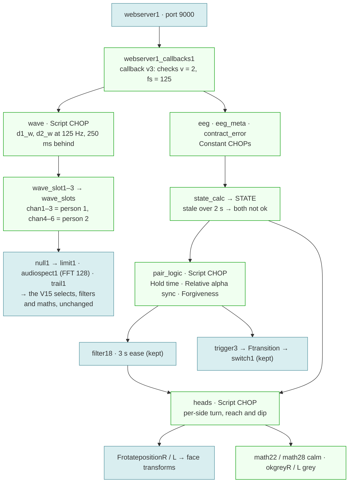

# TD Changes: V15 to dual-alpha-V16

What changed between Kaz's show file `20260108_Iterface2V15_Otherworld.toe` (V15) and `dual-alpha-V16.toe`, written so that each step can be checked, or redone by hand in TouchDesigner, without design decisions. The plan behind it is `docs/alpha-v2/dual-alpha-route-2026-11-18.md` §6 and §9.3.

> *V16 was built on a Mac without running TouchDesigner. It was made by editing the text form of V15 (TouchDesigner's own `toeexpand` / `toecollapse`, build 2025.33230) with `scripts/build_v16_from_v15.py`, which applies exactly the steps below. Items marked [confirm] are inferred, not observed, and are listed again in [Confirm on first open](#confirm-on-first-open).*

---

## Summary

**The staging is V15's; only what feeds it changed.** The objects, faces, noise layers, `filter18`, `trigger3`, `Ftransition` and `switch1` are untouched. The six old waveform slots are now filled from the two contract v2 waveforms, so every V15 operator that read `chan1`…`chan6` still reads the same names, through its own Filter width. The sync comparison is replaced by the pair rule and three live controls.

| | V15 | V16 |
|---|---|---|
| Operators | 630 | 643 (29 removed, 42 added) |
| Files in the expanded text | 1397 | 1425 (44 removed, 63 added, 15 edited) |
| `.toe` size | 57 690 bytes | 69 458 bytes |
| Message the receiver accepts | v1, 25 slots by index | contract v2 only; anything else lights `contract_error` |

New operators are tinted blue in the network editor.

---

## Evidence used

**From the TouchDesigner 2025.33230 bundle** (`TouchDesigner.app/Contents/Resources/tfs`, offline help and `Config/TDParameterHelp.json`), not from memory:

| Question in the plan | Answer | Source |
|---|---|---|
| Constant CHOP parameter names | `const{i}name` / `const{i}value`. `name{i}` / `value{i}` are legacy aliases that "TouchDesigner will attempt to understand" | `Release_Notes/2023.htm`; `Constant_CHOP.htm`; V15's own `constant_eeg.parm` stores `const0value` while its callback writes `par.value0` |
| Script CHOP API | `onCook(scriptOp)`, `scriptOp.clear()`, `.appendChan(name)`, `.numSamples`, `.rate`, `.isTimeSlice`, `.copy(chop)`, `Channel.vals`, `onGetCookLevel` → `CookLevel.ALWAYS` | `ScriptCHOP_Class.htm`, `CHOP_Class.htm`, `Channel_Class.htm`; 302 palette components use `onCook`, 684 the older `cook`, so V16 defines both |
| Order of `clear()` and `rate` | `clear()` resets the rate to the global rate, so `rate` is set after it, and before `numSamples` | Release Notes ("Script CHOP.clear will now set the CHOP to the global sample rate"); `CHOP_Class.htm` |
| OP storage | `fetch(key, default, search=True)`, `store(key, value)`; saved with the file | `OP_Class.htm` |
| Math CHOP order | pre-op → combine → Mult-Add (pre-add, **gain**, post-add) → **Range** last | `Math_CHOP.htm` |
| HSV Adjust TOP | with default ranges, Saturation Multiplier acts on every pixel | `HSV_Adjust_TOP.htm` |
| Trigger CHOP | `threshold` = "Release = Trigger Threshold"; works on time-sliced or static inputs | `Trigger_CHOP.htm` |
| Filter (time slice on) fed by a static CHOP | a common pattern in Derivative's own palette: Filter fed by Constant (7), Par (4), Select (23), Script (1) | expanded palette `.tox` files |
| `.text` file layout | `2\n*` + six big-endian integers (1, 1, 1, 1, 2, byte length) + UTF-8 text | all 404 `.text` files in V15 and the snippets rebuild byte for byte |

---

## The steps

Paths are inside the project. `WS` is `/project1/SYNCD/container1websocket_example`, `SY` is `/project1/SYNCD`. The **check** of each step uses `python3 mock_sender.py --synthetic --loop` (a 60 s scripted scenario, times below are into each loop) or a recorded `td_stream.jsonl`.

### A. The receiver (`WS`)

**A1. Callback v3.** Replace the text of `WS/webserver1_callbacks1` with `callback_v3.py`. `webserver1` already points at this DAT, port 9000, unchanged.

- Parses each text message; anything that is not JSON, or has `v ≠ 2` or `fs ≠ 125`, sets `contract_error` to 1, adds 1 to `eeg_meta` `bad_msgs` and is otherwise ignored. A v1 message from `/dual-stream` (`ts`, `d1_ch0` …, no `v`) is refused this way and cannot raise an exception. The next valid v2 message sets `contract_error` back to 0.
- Writes the five values into `eeg` and the waveform batches into the ring buffer on `wave` (storage key `ring`, 2 s per person). A jump in `n` repeats the last sample for the missing count and adds it to `lost_samples`; an overlap drops the repeated samples; a jump back (app restarted) or a gap over 2 s restarts the ring.
- Writes `n`, the time of the message (`absTime.seconds`) and a message count into `eeg_meta`.
- Check: `eeg` shows the five values moving with the scenario; `eeg_meta` `msgs` rises about 7.8 a second; at 47 s `bad_msgs` rises by 1 and `contract_error` flashes.

**A2. Add three Constant CHOPs** (parameters `const{i}name` / `const{i}value`, all values 0):

| Operator | Channels, in order |
|---|---|
| `WS/eeg` | `d1_level`, `d1_ok`, `d2_level`, `d2_ok`, `pair_level` |
| `WS/eeg_meta` | `n`, `last_msg`, `msgs`, `bad_msgs`, `lost_samples` |
| `WS/contract_error` | `contract_error` |

**A3. Stale data and `STATE`.** Add Constant CHOP `WS/state_calc` whose values are Python expressions, and Null CHOP `WS/STATE` fed by it. `fresh` below is `absTime.seconds - float(op('eeg_meta')['last_msg']) < 2`.

| Channel | Expression |
|---|---|
| `d1_level` | `d1_level × d1_ok × fresh` |
| `d1_ok` | `d1_ok × fresh` |
| `d2_level`, `d2_ok` | the same for person 2 |
| `pair_level` | `pair_level × fresh` |
| `stale` | `0 if fresh else 1` |
| `age` | seconds since the last message |
| `contract_error` | copy of `contract_error` |

- No message for 2 s (app closed, wrong app, network gone) makes both people not ok: grey, heads turned away, no transition.
- Check: stop the sender; after 2 s `STATE` `stale` = 1 and both `ok` = 0.

**A4. Keep the scene switch alive.** In V15 `ts` left `SYNCD` as `out1`, and `/project1/slope1 → logic1 → timer1 → switch2` switches to the second scene when it stops changing. Contract v2 has no `ts`. Add Constant CHOP `WS/ts_clock` with one channel `ts` =
`(absTime.seconds * 125) % 1000000 if fresh else (float(op('eeg_meta')['last_msg']) * 125) % 1000000`
and set the input of `WS/rename1` to `ts_clock` (was `null`). The path `rename1 → switch1 → timeslice1 → select3 → out3 → SYNCD/out1` is unchanged, so `ts` changes every frame while messages arrive and freezes 2 s after the last one.

- Check: with the sender running the project stays on the SYNCD look; stop it and the second scene takes over about 2 s later than in V15 (2 s stale rule plus `timer1`'s 3 s).

**A5. `wave` and the six slots.**

- Add Text DAT `WS/wave_callbacks` (Python) with `td_py/wave_callbacks.py`, docked to `wave`.
- Add Script CHOP `WS/wave`, Callbacks DAT `wave_callbacks`. It outputs two channels, `d1_w` and `d2_w`, at sample rate 125, time sliced: each cook emits the samples that fell due since the last cook (about 2 at 60 frames a second). The playhead runs 250 ms (just before a batch) to 378 ms (just after one) behind the newest sample, eases back to that delay at up to ±5 % speed, and snaps when it is more than 0.5 s off as new data arrives. When no data is at the playhead it holds the last sample.
- Add three Rename CHOPs fed by `wave`: `wave_slot1` (`d1_w d2_w` → `chan1 chan4`), `wave_slot2` (→ `chan2 chan5`), `wave_slot3` (→ `chan3 chan6`); and Merge CHOP `wave_slots` with inputs `wave_slot1`, `wave_slot2`, `wave_slot3`.
- Set the input of `WS/null1` to `wave_slots` (was `timeslice1`).
- Check: `WS/wave` info shows `sample_rate` 125 and `time_slice` 1; `null1` shows `chan1`, `chan4`, `chan2`, `chan5`, `chan3`, `chan6` and keeps moving smoothly when one message is dropped.

What each former channel reads now. Every consumer keeps its V15 Filter width and Math mapping; only the source changed.

| Old slot | Was | Now | Read by (in `SY` unless marked `WS`): select → filter width → what it drives |
|---|---|---|---|
| `chan1` | `d1_ch0` | person 1's waveform `d1_w` | limit: `select9` → 3 s → `SpositionR` (right object height) · `select3` → 1.17 s → `Noise10exponent` · `select6` → 2 s (slider) → `Noise2HarmonicGain`. Spectrum: `select5` → 10 s → `Noise2harmonicSpeed` · `select11` → 0.5 s → `ScolorSpeedR` rotation X. Trail: `WS/select1` → 0.4 s → line `geo1` |
| `chan2` | `d1_ch1` | `d1_w` | spectrum: `select11` → 0.5 s → `ScolorSpeedR` rotation Y · `select15` → 1.64 s → `math20` (face ring spin) · `select18` → 1.64 s → `math21` (`Both_rtation_speed`, read by nothing) |
| `chan3` | `d1_ch2` | `d1_w` | spectrum: `select11` → 0.5 s → `ScolorSpeedR` rotation Z |
| `chan4` | `d2_ch0` | person 2's waveform `d2_w` | limit: `select10` → 3 s → `SpositionL` · `select2` → 10 s (slider) → `Noise10period` · `select4` → 1.93 s (slider) → `BNoise2period` · `select8` → 0.53 s → `NOise2exponent`. Spectrum: `select12` → 0.75 s → `ScolorSpeedL` rotation X. Trail: `WS/select2` → 0.4 s → line `geo5` |
| `chan5` | `d2_ch1` | `d2_w` | spectrum: `select12` → 0.75 s → `ScolorSpeedL` rotation Y · `select13` → 0.28 s → `math20` (face ring spin) · `select14` → 0.28 s → `math21` (unused) |
| `chan6` | `d2_ch2` | `d2_w` | spectrum: `select12` → 0.75 s → `ScolorSpeedL` rotation Z |

`select7` has no input in V15 and still has none. `select16` and `select17` (the comparison) are removed in B1.

**One consequence to look at.** `select11` sends `chan1`, `chan2` and `chan3` through one Filter (`filter10`) into one Math (`math22`), so the right object's three rotations now come from three identical spectra and move in step (scaled 300 / 100 / 300); the same holds for `select12` on the left. Every other pair of consumers differs in source type or Filter width. If the T6 look check finds the rotations too uniform, insert a Delay CHOP after `wave_slot2` (about 0.33 s) and after `wave_slot3` (about 0.67 s), so each axis sees a different stretch of the same waveform (plan §6.3), or send three waveforms per person again (`WAVE_CHANNELS` in the app). Not done here because the Delay CHOP's maximum-delay parameter differs between the bundle's help and its examples, and the look decides it.

**A6. Audio Spectrum FFT size 128.** `WS/audiospect1_FreqCalc` `fftsize` 64 → **128**. At a true 125 Hz that is a 1.02 s window with 0.98 Hz bins up to 62.5 Hz, close to V15's window of about 1 s at ~60 values a second, and no longer folded. The look can differ from V15: that is the T6 look check.

**A7. Name the pair inside the file.** Text DAT `WS/compat_info`: `contract v2 · app 2.7.0a · /dual-alpha`.

**A8. Remove the 25-slot plumbing that only the old callback fed:** `WS/constant_eeg`, `WS/null`, `WS/fileout1` (it recorded `constant_eeg` to a `.chan`). `filein1` and `switch1` stay: switching `switch1` to 0 now only replays an old recording into `ts`.

### B. The pair and the heads (`SY`)

**B1. Remove the waveform comparison and its slider:** `select16`, `select17`, `filter15`, `filter16`, `math13`, `math14`, `math18`, `logic1`, `math19`, `math23`, the slider COMP `Sync_Trigger`, and the old angle maps `math15`, `math16`, `math17`.

**B2. `pair_logic` drives the ease and the transition.**

- Add Text DAT `SY/pair_logic_callbacks` with `td_py/pair_logic_callbacks.py`, and Script CHOP `SY/pair_logic` using it (no input; reads `WS/STATE` and the `/controls` sliders by path; cooks every frame).
- Per frame: `cond = pair_level > Relative alpha sync`. While `cond` holds, the hold count rises. A drop shorter than **Forgiveness** pauses the count and keeps `together` at 1; a longer drop resets it. `held` = the count has reached **Hold time**. **Hold time at or below 0.05 s forces `together` and `held` to 1 whatever the data.** Outputs `together`, `held`, `hold_s`, `gap_s`, `forced` and the three control values.
- Add Select CHOP `SY/sel_together` (input `pair_logic`, channel `together` renamed `chan5`) and set it as the input of `filter18` (was `logic1`). `filter18` keeps width 3 s and slope 1.41.
- Add Select CHOP `SY/sel_held` (channel `held` renamed `chan5`) and set it as the input of `trigger3` (was `math17`, the negated right-face angle). `trigger3`: `threshup` −5 → **0.5**, and `threshold` (Release = Trigger Threshold) **on**, so it releases and re-arms when `held` falls. Its envelope (attack 1, peak 10, decay 3, sustain 0, retrigger 30, min length 15) is unchanged, and `math8 → Ftransition → switch1` still reads `chan5`.
- Why `trigger3` moves: in V16 one person alone reaches the forward angle that used to fire it.
- Check (defaults 3 s / 0 / 1 s): `together` rises at 15–16 s; `held` 3 s later; the transition plays once; the 0.5 s drop at 31 s does not restart it. Hold time 0: `held` = 1 with the sender stopped.

**B3. `heads` turns each face from its own person.** Add Text DAT `SY/heads_callbacks` with `td_py/heads_callbacks.py`, and Script CHOP `SY/heads`, input `filter18` (read as the eased "together" `E`, 0–1). Add Select CHOPs `SY/sel_rotR` (`R_ry` → `chan5`) and `SY/sel_rotL` (`L_ry` → `chan5`) and set them as the inputs of `FrotatepositionR` (was `math15`) and `FrotatepositionL` (was `math16`). `transform6.ry` and `transform5.ry` still read `['chan5']`.

Per side, in degrees; positive is turned away, 0 forward, negative toward the other (plan §6.3):

| Situation | Angle | Constant in `heads_callbacks` |
|---|---|---|
| not in alpha, or not ok | eases to +45 | `AWAY`, `TAU_TURN` 1 s |
| in alpha, alone | eases to 0, then −(12 × min(1, t/8) × dip(t) + 8 × level); dip(t) = ½ − ½ cos(2πt/8) reaches and returns to forward every 8 s | `REACH_MAX`, `REACH_RAMP`, `REACH_PERIOD` (0 = lean and hold, the plan's other reading), `DEPTH_MAX` |
| both in (`E` → 1) | −20, the deeper one up to 5 more (full at a level lead of 0.5) | `TOGETHER_ANGLE`, `DEEPER_EXTRA`, `DEEPER_GAIN` |
| blend | solo × (1 − E) + together × E | |

**Which sign is "toward the other".** V15 mapped `filter18` 0…1 to `FrotatepositionR` 45…0 (`math15`) and `FrotatepositionL` −45…0 (`math16`): apart, the right face's `ry` is +45 and the left face's −45. The plan's "+45 = turned away" therefore means `ry = angle` on the right and `ry = −angle` on the left, so toward the other is `ry < 0` on the right and `ry > 0` on the left. `heads` outputs `R_ry = d1_angle` and `L_ry = −d2_angle`. Geometry agrees: both faces (`filein5`, `filein6`, `Face-mono2.obj`) sit at the origin in `geo6` / `geo7` with no transform; the model's vertices are centred in x (mean 0.001) and weighted to +z (mean 0.52, toward `cam1` at z = 6.3), and a positive rotation about +Y turns a +z-facing face toward +x. So at rest the right head looks right, toward its own person's object (x = +9, `transform8`), and turns left toward person 2's (x = −9) as `ry` goes negative. Person 1 drives the right face, as person 1 already drives every `R` operator. [confirm: the faces' look from the camera]

- Check: 5–15 s the right face turns to forward, then leans left and back every 8 s while the left face stays at −45; 17–19 s both pass forward (right ≈ −23, left ≈ +20, the right one further because person 1 is deeper); 38–43 s the right face returns to +45.

**B4. Calm per person.** `SY/math22` (person 1's object rotation, `ScolorSpeedR`) gain `op('select20')['v1']` → `op('select20')['v1'] * op('heads')['d1_calm']`; `SY/math28` (person 2, `ScolorSpeedL`) the same with `d2_calm`. `calm = 1 − 0.7 × level` (level eased over 1 s). The Math CHOP applies gain before its −1…1 → 0…1 range, so the rotation's swing narrows around the same centre: the object slows and steadies, it does not jump to a new angle.

- Check: during 5–15 s the right object's three rotations swing less than the left one's.

**B5. Grey on `ok` = 0.** Add HSV Adjust TOPs `SY/okgreyR` between `bloom1` and `null15` (person 1's object, `render5` of `geo4`) and `SY/okgreyL` between `bloom2` and `null14` (person 2's, `render4` of `geo3`), with `saturationmult` = `op('heads')['d1_sat']` / `['d2_sat']`. `sat` is `ok` eased over 1 s, so a side fades to grey and back.

- Check: 38–43 s the right object is grey; with the sender stopped both go grey within about 3 s.

**B6. The corner number.** `SY/text1`, a Text TOP composited into the output by `comp5`, showed the Sync Trigger value. It now shows Hold time, `str(round(op('/controls/Hold_time').par.value0.eval(), 1))`. It never shows "FORCED SYNC". [confirm: whether the number should be projected at all; set the text to empty if not]

**B7. Per-head colour speed: not wired, on purpose.** The plan asks that the deeper head cycle colour faster. In V15 nothing animates the two turning faces' colour: `geo6` and `geo7` share material `pbr1`, whose parameters are constants; the POP noise on each face (`noise3`, `noise5`) points at operators that do not exist (`Noise3_HarmoinicGainR` …) in constant mode. The "face colour speed" chain (`math20 → speed3 → both_facecolor_speed2`) rotates the ring of copied faces (`transform3.ry`, `geo2`, the second look), and `transform4.ty`, which shifts the colour ramp used by `lookup2` on the whole image, reads `both_facecolor_speed`, an operator that does not exist in V15. So there is no per-face colour parameter to split, and the whole-image colour shift is already broken in V15. `heads` outputs `d1_colormult` and `d2_colormult` (1 + 0.5 × lead) ready to use. **TODO on the PC:** decide which parameter is the faces' "colour", then give `geo7` its own copy of `pbr1` and multiply that parameter's speed by `op('heads')['d1_colormult']` (right face) and `['d2_colormult']` (left). Fixing `transform4` is a separate question for Kaz.

### C. The operator's panel (`/controls`)

**C1. Three live controls replace "Sync Trigger".** Remove `/controls/Sync_Trigger` and add three sliders, copies of `/controls/BNoise2period1` (same slider internals and look):

| Slider | Label | Range | Default | To make the sync easier |
|---|---|---|---|---|
| `/controls/Hold_time` | Hold time (s) | 0–5 | 3 | lower it; 0 forces the sync |
| `/controls/Relative_alpha_sync` | Relative alpha sync (min pair_level) | 0–1 | 0 | keep at 0 |
| `/controls/Forgiveness` | Forgiveness (s) | 0–3 | 1 | raise it |

**C2. Operator-only status.** Text COMP `/controls/status_label`, red on dark: shows **FORCED SYNC** while Hold time ≤ 0.05, **CONTRACT ERROR** while `contract_error` is 1, **NO DATA** while `STATE` `stale` is 1, and nothing otherwise. It lives on the control panel only; nothing in `/project1` reads it, so it never reaches the projection. The panel state in `controls.panel` was updated from 9 to 12 children.

- Check: drag Hold time fully left: "FORCED SYNC" appears on the panel, the heads turn to face each other and the transition plays with the sender stopped; the projection shows no label.

---

## Confirm on first open

Everything here was inferred without running TouchDesigner. Each line says what to look at.

| # | Item | How to check | If wrong |
|---|---|---|---|
| 1 | The file opens without errors (Textport, red operator flags) | open `dual-alpha-V16.toe` from the folder holding the models ([ASSETS.md](ASSETS.md)) | most likely a parameter written in an unexpected form; compare with `expanded/` |
| 2 | `wave` is time sliced at 125 Hz | Info CHOP on `WS/wave`: `sample_rate` 125, `time_slice` 1, 1–3 samples per frame | set `TIMESLICE = False` in `wave_callbacks` (one sample per frame at the timeline rate), and tell us |
| 3 | `limit1` (Normalize on) behaves like V15 with 2 samples a frame instead of 1 | positions and noise move as in V15 (T6 recording) | the Limit normalizes per time slice; if the motion is too jumpy, try `limit1` Normalize off and compare |
| 4 | Audio Spectrum look at FFT 128 | T6 side-by-side | 64 halves the window |
| 5 | Constant pars written as `const{i}value` from Python | `eeg` follows the stream | the callback already falls back to `value{i}` |
| 6 | `onGetCookLevel` and `CookLevel.ALWAYS` exist in 2025.33230 | the three Script CHOPs cook every frame (cook count rises without input changes) | delete `onGetCookLevel`; they still cook every frame because they read `absTime` |
| 7 | Filter (`filter18`) and Trigger (`trigger3`) on single-sample, not-time-sliced Script CHOP inputs | `filter18` eases over about 3 s when `together` flips; `trigger3` fires once per hold | put a Lag CHOP between `sel_together` and `filter18` |
| 8 | `trigger3` `threshold` toggle name and its re-arming | the transition fires again on the next hold after a release | set the release threshold by hand to 0.5 |
| 9 | Face direction and sign of the turn (B3) | in "One in", the waiting head leans toward the other side, not away | swap the signs of `R_ry` / `L_ry` in `heads_callbacks` (`out['R_ry']`, `out['L_ry']`) |
| 10 | The three new sliders and the status label lay out on the panel | `/controls` panel view | adjust `alignorder` or sizes |
| 11 | `SY/text1` overlay showing Hold time | the projection's corner | blank its text if not wanted |
| 12 | Scene switch with the new `ts` | stop the sender: second scene after about 5 s | `timer1` length |
| 13 | Storage keys `ring`, `play`, `hold`, `heads` are saved with the file when Kaz saves | harmless; the code tolerates old values | `op('wave').unstore('*')` resets them |
| 14 | Each object's three rotations move in step (A5, "One consequence") | T6 look check | Delay CHOPs after `wave_slot2` / `wave_slot3` |
| 15 | `SY/select1` (monitor only, into nothing) selects `chan26`, `chan51`, `chan76`, which depended on V15's 25-channel layout | nothing visible uses it | ignore |

---

## Verification done without TouchDesigner

| Check | Command | Result |
|---|---|---|
| collapse → expand round trip | `scripts/td-collapse.sh` then `scripts/td-expand.sh --check` | "expanded/ matches dual-alpha-V16.toe": text identical, all 1425 files |
| `.toc` ↔ `.dir` | `scripts/verify_toe.py` [1] | 1425 entries, 1425 files, none missing either way, no duplicates |
| every Python DAT compiles | `verify_toe.py` [2] | 30 of 30 (26 from V15, 4 new) |
| every wired input exists | `verify_toe.py` [3] | 426 inputs, 0 unresolved |
| every `op()` / channel reference | `verify_toe.py` [4/5] | 133 references, 0 regressions; 46 new references all resolve to an existing operator and channel; 7 unresolved ones are V15's own and unchanged |
| embedded Python = repo files | `verify_toe.py` [6] | identical for all four DATs |
| the logic | `scripts/test_td_logic.py` | 38 checks pass (receiver, ring and play-out, jitter, gaps, contract errors, hold and forgiveness, forced sync, head angles, calm, grey) |
| end to end over a socket | `scripts/ws_test_server.py` + `mock_sender.py --synthetic` | 450 messages at 7.5 a second (the scenario has 2.5 s of silence), 0 malformed, 125.0 wave samples a second, transitions fired 2 |

V15 references that `verify_toe.py` reports as already broken in V15 (not touched): `SY/transform4.ty` → `both_facecolor_speed` (no such operator); `/project1/switch2.index` → `timer1['done']` (the checker cannot infer Timer CHOP channels; probably fine).

---

## Tuning constants

All starting values from the plan, to be set by eye on the PC. They are module constants at the top of each callbacks DAT.

| DAT | Constant | Value | Meaning |
|---|---|---|---|
| `wave_callbacks` | `DELAY_S` | 0.25 | play-out delay behind the newest sample |
| | `SNAP_S`, `MAX_DRIFT` | 0.5, 0.05 | re-centre threshold, speed correction |
| `pair_logic_callbacks` | `FORCE_EPS` | 0.05 | Hold time at or below this forces the sync |
| `heads_callbacks` | `AWAY` | 45 | rest angle |
| | `REACH_MAX`, `REACH_RAMP`, `REACH_PERIOD` | 12, 8, 8 | waiting head's reach and dip |
| | `DEPTH_MAX` | 8 | extra reach at level 1 |
| | `TOGETHER_ANGLE`, `DEEPER_EXTRA`, `DEEPER_GAIN` | −20, 5, 2 | both in |
| | `TAU_TURN`, `TAU_LEVEL`, `TAU_GREY` | 1, 1, 1 | ease time constants (s) |
| | `CALM`, `COLOR_GAIN` | 0.7, 0.5 | settling and colour factors |

The 3 s ease itself is `filter18` width, as in V15 (plan §6.5).
